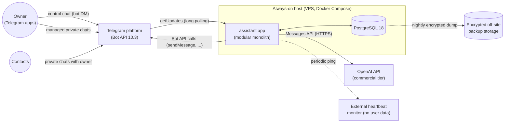
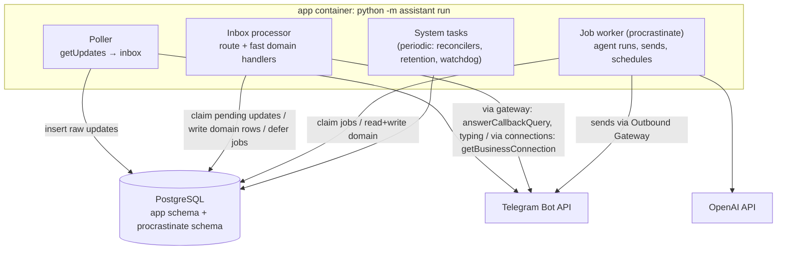
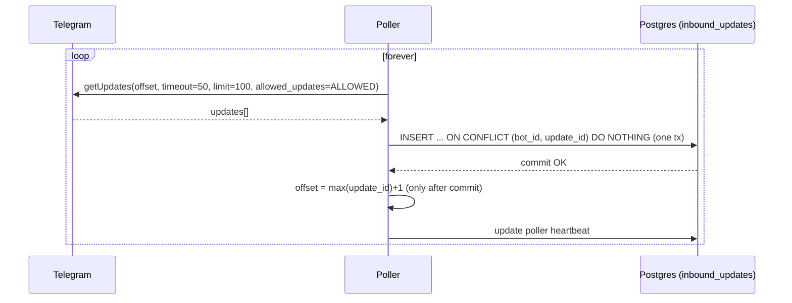
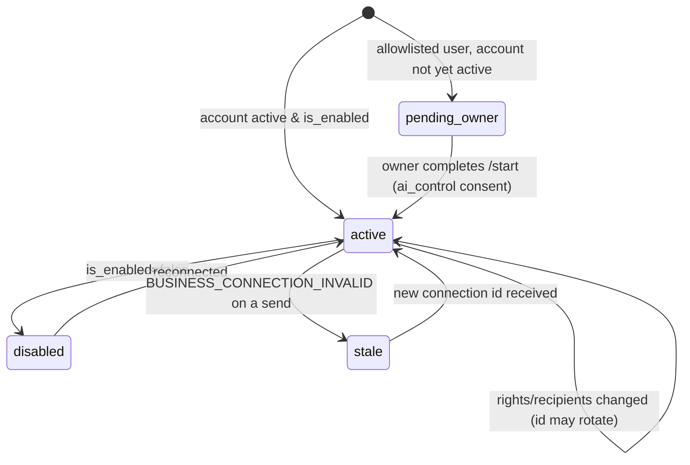
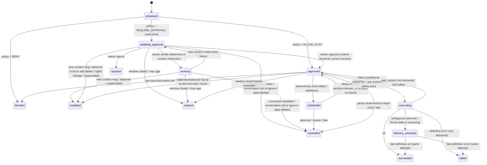
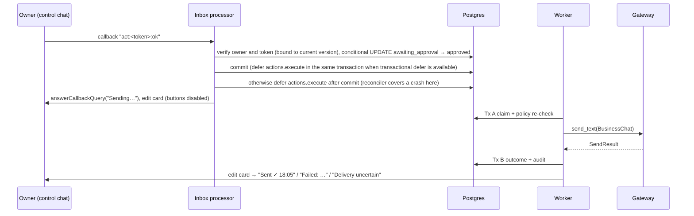
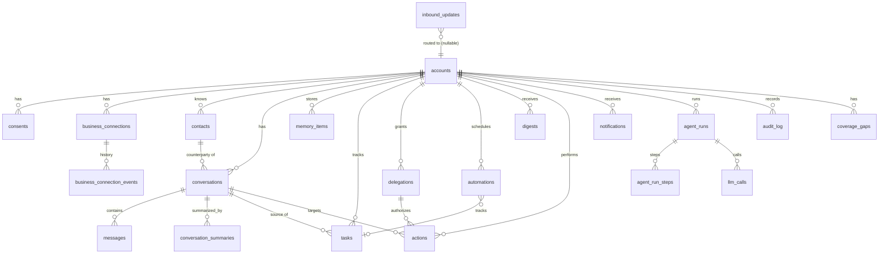

# Architecture — Telegram-Native Personal AI Agent

| | |
|---|---|
| **Status** | Draft v1.0 for owner review (2026-10-17) |
| **Scope** | Technical design for Personal v1 (R0–R2) with a defined path to R3/R4 |
| **Related** | [PRODUCT_REQUIREMENTS.md](PRODUCT_REQUIREMENTS.md) (what & why) · [TELEGRAM_FEASIBILITY.md](TELEGRAM_FEASIBILITY.md) (verified platform facts — cited as **TF §n**) · [IMPLEMENTATION_PLAN.md](IMPLEMENTATION_PLAN.md) (sequencing) · [../AGENTS.md](../AGENTS.md) (repository rules) |

Requirement references (`FR-…`, `NFR-…`, `SEC-…`) point to the PRD. Architecture decisions are summarized in §20 (ADR-nn).

---

## 1. Context, goals, constraints

### 1.1 Quality goals (in priority order)

1. **Safety of external actions** — never send the wrong thing, to the wrong person, twice, or without authorization (NFR-06/07).
2. **Durability of observation** — never lose a delivered update; recover from restarts within seconds (NFR-01/08).
3. **Privacy by design** — minimum data, explicit consent, isolation, retention, encryption (SEC-*).
4. **Correctness under concurrency** — duplicates, out-of-order events, races with the owner (TF §3).
5. **Simplicity and operability by one developer** — one deployable, one database, no extra brokers.
6. **Extensibility to multi-user** — tenant-scoped data and processing from day one (NFR-15).

### 1.2 Hard constraints (from TF)

- Bot API 10.3; business connection semantics per TF §2–§4: no history, 24-hour per-chat reply window, mutable connection id, no per-chat pause signal, bidirectional business messages, one business bot per account.
- Telegram Bot Developer Terms §4.2–4.5, §5.2, §5.4 (TF §7.1).
- AI provider data and disclosure terms (TF §7.2).
- Single developer; personal phase on a single small server.

### 1.3 Non-goals for Personal v1

Horizontal scaling, webhook ingress, microservices, message brokers, vector databases, Mini App, MTProto, multi-tenant billing.

---

## 2. System context



The host needs **no inbound ports** besides SSH while long polling is used (ADR-04).

---

## 3. Technology stack (final recommendation)

| Concern | Choice (pinned) | Alternatives considered | Why |
|---|---|---|---|
| Language/runtime | **Python 3.14** (`requires-python = ">=3.14,<3.15"`) | 3.12/3.13 (work), 3.15 (unsupported by aiogram/pydantic-core) | Newest interpreter the whole stack supports (TF §8). |
| Packaging | **uv** with committed `uv.lock` | Poetry, pip-tools | Fast, reproducible, standard in 2026. |
| Telegram library | **aiogram 3.31.x** (exact pin) | python-telegram-bot 22.8 (Bot API 10.0 only), raw HTTP | Current with Bot API 10.3, typed models, router for control-chat UI. Used *only* as Bot API client + types + control-chat router (ADR-03). |
| Update transport | **Long polling** via our own durable poller | Webhook (FastAPI/aiohttp) | No domain/TLS/inbound ports; equally durable with our inbox; webhooks added when scale/Mini App need an HTTP surface (ADR-04, ADR-14). |
| Database | **PostgreSQL 18** (`pgvector/pgvector:pg18` image; extension unused initially) | SQLite (competitors), managed Postgres | Concurrency, durability, job queue, FTS, trigram; pgvector available later without migration. |
| DB access | **SQLAlchemy 2.1** (async, typed `Mapped[]`), **psycopg 3** async driver | asyncpg | psycopg 3 is SQLAlchemy 2.1's default and **required by procrastinate**; one driver; enables same-transaction job defer (spike). psycopg 3 stays regardless of the spike outcome (procrastinate accepts only psycopg connections); if transactional defer fails, use commit → defer-after-commit → reconciler (§12.4). asyncpg is an option only if procrastinate itself is replaced by the hand-rolled queue (ADR-06 fallback). |
| Migrations | **Alembic** (async env); procrastinate's SQL migrations wrapped as Alembic revisions | procrastinate CLI migrations | One migration history. |
| Jobs & scheduling | **procrastinate 3.10.x** behind a `JobScheduler` port | Hand-rolled `SKIP LOCKED` queue (fallback), saq, APScheduler (rejected), Celery/arq/dramatiq (need brokers) | Postgres-only, async, durable, locks, retries, cancellation, periodic tasks (ADR-06). |
| AI provider | **OpenAI** via official `openai` SDK, behind an `LLMClient` port | Anthropic, Gemini (paid), via adapters if evaluation demands | Owner decision 2026-10-18 on cost grounds; training on API data disabled in the account. Supersedes the original ADR-07 choice (ADR-07a). |
| Default model | **`gpt-6-luna`** for all routes | `gpt-6-sol`, `gpt-6-astra` as measured alternatives if Luna misses quality thresholds (M03/M05 — §7.4) | Cheapest tier ($0.10/$0.50 per 1M tokens), chosen to fit the owner's budget. The cost lever is inverted: routes move **up** on evidence, not down. |
| Settings | **pydantic-settings** (pydantic 2.13.x, capped by aiogram) | dynaconf | Typed config, env-driven. |
| Logging | **structlog** (JSON in prod) with redaction processors | stdlib logging only | Structured, content-free logs. |
| Scheduling math | **python-dateutil** `rrule` + `zoneinfo` | croniter | RFC 5545 recurrence with timezones. |
| Testing | pytest, pytest-asyncio, real Postgres from the Compose `db` service locally and a Postgres service container in CI (each test session creates a throwaway database from a migrated template), hypothesis (state machines) | — | Real Postgres in integration tests; fakes for Telegram/LLM. |
| Quality | ruff (lint+format), mypy (strict on `src/`), import-linter (layer contracts), pip-audit | pyright | Standard, enforceable. |
| Containers | Docker, Docker Compose; `python:3.14-slim` base | Kubernetes, PaaS | One host; owner knows Docker. |
| Hosting (personal) | One small **EU VM**: **Oracle Cloud Always Free**, Frankfurt, `VM.Standard.A1.Flex` ARM64 1 OCPU / 6 GB (owner decision 2026-10-22, §15.5); off-site backups on **Backblaze B2** (EU Central) | DigitalOcean Basic 2 GB (previous default), Hetzner CX23, Google e2-micro (rejected), Railway, Fly.io | $0, full control of sensitive data, polling needs no inbound ports (ADR-15). |
| HTTP framework | **None initially**; FastAPI when webhooks/Mini App/OAuth arrive | aiohttp (aiogram's) | Avoid an unused surface (ADR-14). |

All versions are pinned in `uv.lock`; upgrades are deliberate, tested, and recorded.

---

## 4. Runtime topology

### 4.1 Personal phase (R0–R2)

One container image, one process (`python -m assistant run`) running four cooperating asyncio roles, plus PostgreSQL:



- **Why one process:** simplest to operate and reason about; all roles are I/O-bound asyncio tasks; restarts are fast; durability lives in Postgres, not in memory; liveness is enforced by the supervisor (§4.3).
- **Roles are separable:** each role has its own entrypoint (`assistant run --roles=poller,inbox,worker,system`) so they can be split into containers later without code changes.
- **Long polling must run in exactly one process per bot token** (a second poller gets HTTP 409). The `poller` and `inbox` roles are singletons enforced by Postgres advisory locks held on dedicated connections (§6.1).
- A one-shot `migrate` service runs Alembic before the app starts.

### 4.2 Public phase (R4) — target topology (not built now)

`ingress` (FastAPI webhook, persists updates, returns 2xx) → `inbox processors` partitioned by stream key → `workers` (N replicas, procrastinate) → Postgres (+ PgBouncer in session mode or direct connections for LISTEN). See §19.

### 4.3 Supervision

Compose restarts a container only when its process exits; it never restarts an unhealthy one. An in-process supervisor therefore exits the process with a non-zero code when any role task ends, or when a role's liveness signal is stale: poller, no successful `getUpdates` for 3 min; inbox, backlog > 0 with no progress for 2 min; worker, heartbeat stale. On SIGTERM it stops the poller, drains the inbox, stops claiming jobs, waits for in-flight sends up to the gateway HTTP timeout, then exits. CPU-heavy work runs in `asyncio.to_thread`. procrastinate `stalled_worker_timeout` (default 30 s) is set to at least 2× the longest tolerated event-loop stall, so `retry_stalled_jobs` never re-runs a live job.

**As built (S01.5):** `core/supervisor.py` runs the roles from `process.py`, assembled by `bootstrap.running_process`: `poller` (holds the poller advisory lock; network/5xx back off 1→30 s; a 409 or a lost lock ends the role), `inbox` (holds the inbox advisory lock; finishes the row in hand on stop), and one procrastinate worker per queue (`worker:system`, `worker:outbound`, `worker:llm`; graceful timeouts 20/30/45 s, inside Compose's 90 s). Liveness is probed every 15 s; a role that returns at all counts as failed. procrastinate's `stalled_worker_timeout` is 60 s with a 10 s heartbeat. `python -m assistant run --roles=…` selects roles. Control-chat command replies are sent from inside the inbox row's transaction, so a crash between send and commit can repeat a command reply (never an agent answer, which is a job; see §12.2).

---

## 5. Module structure and dependency rules

### 5.1 Package layout

```
src/assistant/
  __main__.py              # CLI: run, migrate, healthcheck, inbox requeue, post-restore, reindex-search
  config.py                # pydantic-settings (env), feature flags
  bootstrap.py             # composition root: wires ports to adapters
  core/                    # shared kernel: ids, clock port, errors, result types, i18n helpers
  db/                      # engine/session factory, base model, unit of work, repositories base
  telegram/                # ADAPTER: everything aiogram-specific lives here
    ingress/               #   poller, inbox writer, (webhook later)
    routing.py             #   update classification → domain commands
    normalize.py           #   business update → domain event (classify, normalize) — S02.2
    payload.py             #   small readers for stored aiogram payloads (from_user/from, dates)
    business.py            #   BusinessPipeline: gate → normalize → store; dead-letter hook — S02.2
    connections.py         #   business connection registry adapter (getBusinessConnection)
    control/               #   commands, callbacks, renderers; deeplinks.py (/start bizChat<id>) — S02.3
    gateway.py             #   OutboundGateway: the ONLY place that sends to Telegram
    errors.py              #   Telegram error classification
  accounts/                # DOMAIN: accounts, owner allowlist, consents, settings
  conversations/           # DOMAIN: contacts, conversations, messages, coverage, reply window
                           #   models.py, events.py, service.py (7-step transaction), window.py, coverage.py — S02.2
                           #   visibility.py (the bizChat conversation panel) — S02.3
  policy/                  # DOMAIN: policy engine, rules, decisions (pure)
  actions/                 # DOMAIN: action lifecycle, approvals, execution service, audit log
  memory/                  # DOMAIN: memory items, summaries, search normalization, retrieval
  inbox/                   # DOMAIN: triage, attention, notifications, digests
  automation/              # DOMAIN: delegations, monitors, reminders, follow-ups, schedules
  agent/                   # APPLICATION: agent runtime
    runtime.py             #   owned agent loop, budgets
    context.py             #   context builders per run type
    persistence.py         #   run/turn/llm_calls repositories; DB consent reader + call recorder
    ports.py               #   ControlChannel (implemented by telegram/control/agent_channel.py)
    prompt_registry.py     #   active prompt version per run type
    tools/                 #   registry.py (definitions, invariants), executor.py, one module per tool
    schemas.py             #   structured-output models (Pydantic) — from M03
    prompts/               #   versioned prompt templates (name.vN.md)
  process.py               #   roles (poller, inbox, workers) + liveness; run by core/supervisor.py
  llm/                     # LLM port and adapter (the fake lives in tests/fakes/llm.py)
    port.py                #   LLMClient Protocol + provider-neutral types (agent imports only this)
    openai_adapter.py      #   OpenAI Responses API adapter (store=false); imported only by bootstrap
    consent.py             #   consent choke point (§14.3)
    metering.py            #   llm_calls metering + the single price table
  jobs/                    # ADAPTER: app.py (queues, workers), tasks.py (catalogue), scheduler.py
                           #   (JobScheduler impl), reconcile.py (reads procrastinate_jobs)
                           # Ports in core/: jobs.py (JobScheduler), channel.py (ControlChannel),
                           #   supervisor.py. Domain services: inbox/notify.py (notify_owner),
                           #   inbox/watchdog.py, privacy/retention.py, agent/budget.py
  privacy/                 # DOMAIN: retention sweeper, deletion, export
  observability/           # logging setup, redaction, heartbeat, status aggregation
tests/
  unit/  integration/  contract/  scenarios/  fakes/  fixtures/
evals/                     # synthetic datasets + runners (not part of CI by default)
tools/probe/               # throwaway M00 probe (not packaged; never imported by src/)
spikes/                    # throwaway M00 stack spikes (not packaged; never imported by src/)
migrations/                # Alembic
deploy/                    # compose files, Dockerfile, backup scripts, runbooks
```

### 5.2 Layering rules (enforced by import-linter, except where noted)

- **Domain packages** (`accounts`, `conversations`, `policy`, `actions`, `memory`, `inbox`, `automation`, `privacy`) must not import `aiogram`, `openai`, `procrastinate`, or `telegram/`, `llm/`, `jobs/`, `agent/`. They depend on **ports** (Protocols) defined in `core/` or in the domain package.
- `policy/` is **pure**: no I/O; takes a fully-loaded `PolicyContext`, returns a `Decision`. Easy to table-test.
- `agent/` may use domain services and the `LLMClient` and `JobScheduler` ports; never `aiogram`, `procrastinate`, `telegram/` or `jobs/`.
- `telegram/` and `llm/` and `jobs/` are adapters implementing ports; only `bootstrap.py` instantiates and wires them.
- The repository-root `tools/` (e.g., `tools/probe/`; not `agent/tools/`) sits outside `src/`; nothing in `src/` imports it.
- Only `telegram/gateway.py` may call Bot API methods with visible effects (send, edit, delete, mark read, chat actions, `answerCallbackQuery`, `setMyCommands`); `telegram/ingress/` calls only `getUpdates`, `getMe` and `deleteWebhook(drop_pending_updates=False)`, and `telegram/connections.py` only `getBusinessConnection`. import-linter cannot check this rule; it is enforced by ruff banned-api (TID251) with per-file ignores plus an AST test (AGENTS §5).

---

## 6. Telegram integration

### 6.1 Ingress (durable poller)



- **At-least-once, durable:** Telegram only treats updates as confirmed when `getUpdates` is next called with a higher offset; we advance the offset only after the batch is committed. A crash re-delivers uncommitted updates; the unique key absorbs duplicates. (We do **not** use aiogram's `start_polling`, which confirms before handlers finish — TF §3.1.)
- **Explicit `allowed_updates`** on every call: `message`, `edited_message`, `callback_query`, `business_connection`, `business_message`, `edited_business_message`, `deleted_business_messages` (+ `my_chat_member` for block/unblock; `channel_post`/`edited_channel_post` added in R3; `stopped_message_generation` if draft streaming with `can_stop` is used).
- **Startup checks:** `getMe` must report `can_connect_to_business = true` (else alert and run control-chat-only); `deleteWebhook(drop_pending_updates=False)` before polling; verify the bot id (see **Bot identity** below).
- **Never** call anything with `drop_pending_updates=True` (would discard up to 24 h of business messages — TF §3.1).
- **Singleton:** the poller holds `pg_try_advisory_lock(<bot_id>)` on a dedicated, non-pooled connection, re-checks it on every loop (keepalive query), and stops polling immediately if that connection is lost. The inbox processor holds its own advisory lock the same way until R4 stream partitioning.
- **409 Conflict** from `getUpdates` means another consumer is using the token (laptop, probe, restore test): stop polling, alert the owner, back off; never crash-loop.
- **Bot identity:** on first start, store `bot_id` in `system_state`; refuse to start if `getMe().id` differs (wrong token/DB pairing).
- **Offset:** the first `getUpdates` after start omits `offset`; Telegram returns the earliest unconfirmed update, and duplicates are absorbed by the unique key. The offset persisted in `system_state` is for observability only. Drop the in-memory offset after 6 days without updates: update_id may become random after a week, and a stale-high offset would confirm new updates unseen (TF §3.1).
- **Fast lane:** when inserting a batch, the poller detects an allowlisted owner's control-chat `/pause` command or a Pause callback and sets `accounts.autonomy_paused = true` in the same transaction. Normal processing acknowledges it afterwards.
- `inbound_updates.payload` keeps the raw JSON of processed owner traffic for at most 7 days (debugging/replay). The inbox processor sets `payload = NULL` in the same transaction in two cases: when it marks a row `ignored` or `rejected` (groups, non-allowlisted senders, rejected or not-yet-onboarded connections, ignored bot chats, business updates before M02), and when it routes a row to an Ignore-mode conversation. Such rows keep metadata only (kind, update_id, status, timestamps). Dead-lettered (`failed`) rows keep their payload for at most 7 days.

### 6.2 Inbox processing

- A single **inbox processor** task claims `pending` rows in insertion order (`FOR UPDATE SKIP LOCKED LIMIT n`) and processes each in its own transaction, marking it `processed` / `ignored` / `rejected` / `failed`.
- **Handlers must be fast** (no LLM calls): normalize, persist, update state, cancel/outdate actions, defer jobs. Slow work runs as jobs.
- **Error classes:** transient errors (network, Telegram 5xx/429, DB operational errors such as deadlock, serialization failure or connection loss) leave the row `pending` and do not count as attempts. The processor retries the same row with backoff (1, 5, 30, 120 s…), which preserves order. Only deterministic errors (parse, validation, bug) count toward 3 attempts; after that the row becomes `failed` (dead-letter) and processing continues — no head-of-line blocking. Network calls (e.g., the `getBusinessConnection` bootstrap) happen before the processing transaction opens.
- **Fail closed on dead-letter:** for a business update, `chat.id` is parsed from the payload. The conversation gets `autonomy_paused_reason='ingest_error'` and its pending actions are outdated. A `definite` coverage gap is recorded for the conversation (§6.6); summaries and /status show a per-conversation coverage caveat ("N messages could not be processed") until the row is processed. A failed `deleted_business_messages` falls back to purging the content of the listed message ids without further parsing. While failed rows still hold a payload, the owner alert repeats daily and states the purge date.
- **Recovery:** `python -m assistant inbox requeue --failed | --id <n>` resets failed rows to `pending` (runbook: fix → deploy → requeue).
- **Global order** is preserved because the inbox processor is a singleton in the personal phase (advisory lock, §6.1). The multi-user path partitions by `stream_key` (business: `owner_account:chat_id`; control: `owner_account:control`; connection: `owner_account:connection`) — see §19.
- **Jobs are deferred after commit.** If the process dies between commit and defer, reconcilers (§12.4) re-create the work from domain-state flags (e.g., `conversations.pending_triage_at`).

### 6.3 Update routing (hard boundary)

| Update | Condition | Route |
|---|---|---|
| `message` | private chat, `from.id == chat.id`, sender is an allowlisted owner | **Control chat** → aiogram control Router |
| `message` | private chat, sender not allowlisted | Fixed refusal reply (rate-limited); no domain rows; payload cleared at processing (§6.1) |
| `message` | any group/channel chat | Ignored (bot should not be in groups; `/setjoingroups` disabled) |
| `callback_query` | from an allowlisted owner, on a control-chat card | Control Router → callback handlers |
| `callback_query` | otherwise | Answer with "not allowed"; ignore |
| `business_connection` | any | Connection registry (§6.4) |
| `business_message` / `edited_business_message` | connection belongs to an onboarded owner | Business pipeline (§6.5) — **never** the control Router |
| `business_message` | `chat.id == bot.id` or counterpart `is_bot` | Ignored by default (TF §3.2 mirror/loop guard) |
| `deleted_business_messages` | owner connection | Deletion handler |
| `my_chat_member` | owner blocked/unblocked the bot | Account status update; a block pauses autonomy and cancels scheduled autonomous actions |

**Rule:** business updates are normalized by our own code (`telegram/normalize.py`) into domain events. They never reach aiogram handlers, so aiogram's `Message.answer()`-style shortcuts — which auto-inject `business_connection_id` and would send *as the owner* (TF §4.1) — cannot be invoked on them.

### 6.4 Business connection registry

- **Key:** `business_connections.account_id` (the owner's Telegram user id resolves the account). The Telegram `connection_id` is a **mutable attribute** with history (`business_connection_events`).
- **Owner check:** a connection is linked only if `BusinessConnection.user.id` is in the allowlist. For an allowlisted user without an `accounts` row, one is created (`status='onboarding'`) and the connection row gets `status='pending_owner'`. Business messages on a `pending_owner` connection are marked `ignored` with `payload` nulled (FR-ONB-03, J1). For a non-allowlisted user, no `accounts` or `business_connections` row is created: the `inbound_updates` row is marked `rejected` with `payload` set to NULL during processing. The connection id is cached in the non-tenant table `foreign_connections` so later updates on it are rejected without calling `getBusinessConnection` again.
- **Bootstrap:** any business update with an unknown `connection_id` triggers `getBusinessConnection` (TF §2: the initial connection update can be missing). Connection updates and messages are processed idempotently in any order. The call is made before the processing transaction; a failure is transient (the row stays pending).
- **Rights snapshot:** stored per connection version; missing `rights` or `is_enabled=false` ⇒ *no permissions*. Capability tier derived: `none` (disabled), `observe_only` (no `can_reply`), `can_reply`, `extended` (+ `can_read_messages`, `can_delete_sent_messages` or `can_delete_all_messages`). Only rights documented in the official Bot API count (aiogram's undocumented `can_delete_outgoing_messages` grants nothing — TF §13 PQ-10). Granted rights the product never uses (profile, gifts, Stars, stories, `can_delete_all_messages`) are named in the owner notice so they can be turned off (FR-ONB-04).
- **Lifecycle:**



- On `disabled`: stop all business processing for the account, cancel pending sends, notify the owner. On rights change: re-evaluate pending actions; notify the owner (FR-ONB-07).
- **As built (S02.1):** domain logic in `accounts/connections.py` (`apply_snapshot`, `activate_pending`, `resolve`); the adapter `telegram/connections.py` parses payloads, calls `getBusinessConnection` and provides the inbox **preparer** (bootstrap of an unknown id, run by the inbox processor *before* the processing transaction; a network failure raises `core.errors.TransientError`, so the row stays pending without an attempt) and the `CONNECTION`/`BUSINESS` route handlers. A handler may return a `Disposition` (`ignored`/`rejected`) that overrides the route's status and clears the payload in the same transaction. Each applied change writes a `business_connection_events` row (`change`: connected, activated, reconnected, rights_changed, disabled, pending_owner, updated, stale_event; `source`: update, bootstrap, onboarding); an identical state writes nothing. An event about a connection id older than the current one (`date` earlier) is recorded as `stale_event` and not applied. Owner notices are the `connections.notify_owner(event_id)` job, deferred in the same transaction and deduplicated per event (§17). A business update on an old (rotated) id resolves to the owner through the event history. Since S02.2 the `BUSINESS` handler is `telegram/business.py` (§6.5), which calls `ConnectionRegistry.gate_business` first: the S02.1 verdicts are unchanged, and only the owner's live traffic goes on to be stored.
- `BUSINESS_CONNECTION_INVALID` / "business connection not found" on a send: mark the connection `stale`, fail the action as `connection_invalid` (the card offers copy-ready text), block business sends for the account, and wait for the new id from a `business_connection` update or from any business update carrying an unknown id (bootstrap path). Notify the owner if no new id arrives within 30 min. `getBusinessConnection` is called only for ids not yet cached (its documented purpose; it cannot reveal a rotated id). Never retry blindly.

### 6.5 Business message normalization and classification

Classification is the first step for every business message (TF §3.2):

| Direction | Rule (evaluated in order) |
|---|---|
| `ignored_bot_chat` | `chat.id == bot.id`, or counterpart user `is_bot` |
| `assistant_sent` | `sender_business_bot.id == bot.id` (echo, if ever delivered — upsert onto the record created at send time); if an identity-pending row with the same `content_hash` was sent in that conversation within the last 10 min, the echo fills its `telegram_message_id` |
| `owner_automated` | `from.id == owner_user_id` and `is_from_offline` |
| `owner_manual` | `from.id == owner_user_id` |
| `contact` | otherwise (`from.id == chat.id` expected) |

Then, in one transaction:
1. Upsert **contact** (by `account_id`, Telegram user id) and **conversation** (by `account_id`, `business_chat_id`).
2. Upsert **message** by `(conversation_id, telegram_message_id)`; for edits whose content hash changed: overwrite text, set `edited_at` and `content_hash`; the previous text is not kept (FR-OBS-03 needs only an edited marker); no-op edits are ignored. If the edited message is the `base_message_id` of an action, record the audit event `source_edited_after_action` (no content).
3. Update conversation state from **new** messages only (`business_message`, never `edited_business_message`), using Telegram's `message.date`, never receipt time. On `contact` set `last_contact_msg_at = max(last_contact_msg_at, message.date)`; on `owner_manual` set `last_owner_msg_at = max(last_owner_msg_at, message.date)`. Set coverage start if new. Edits never move the reply window (revisit after LV-08/LV-15).
4. **Takeover:** on a new `owner_manual` `business_message` → mark pending actions for this conversation `outdated`, cancel scheduled autonomous replies, set `autonomy_paused_reason='takeover'` per policy (R-09), audit; if the conversation has open tasks, set `pending_triage_at` (resolution check). An owner `edited_business_message` whose content hash changed outdates pending actions for the conversation but does not pause autonomy. No-op edits (unchanged hash) have no effect.
5. **Staleness:** on `contact` → mark pending drafts for this conversation `outdated` (they did not see this message); set `pending_triage_at` / `pending_draft_at` flags per conversation mode. In Assist mode before triage exists (M04), a `contact` message sets `pending_draft_at` and step 7 defers `replies.draft`. Once triage is enabled (M05), drafts are deferred only by `inbox.triage` when `needs_reply` is true, and ingestion no longer defers drafts.
6. Deletions (`deleted_business_messages`): purge content of the listed messages (tombstone with `deleted_at`), outdate dependent actions; if a deleted id is an `assistant_sent` message, record "assistant message deleted" in audit, without attributing it: the payload does not say who deleted it, and an owner's "delete for me only" arrives the same way (TF §12 LV-07). Deletion also sets `payload = NULL` on every `inbound_updates` row linked to those messages (`inbound_updates.message_id`).
7. Defer follow-up jobs (triage/draft/monitor evaluation) after commit.

If the conversation mode is **Ignore**, steps 2–7 store only metadata needed for coverage (no text, no media metadata), and the update's `inbound_updates.payload` is cleared (§6.1).

- **As built (S02.2):** classification and normalization are the pure functions `telegram/normalize.py::classify/normalize` (raw payload → `conversations/events.py` dataclasses); the ignore rules from TF §12 LV-06/LV-18 run first: not a private chat, `chat.id == bot.id`, `chat.id == owner` (Saved Messages), the service account 777000, or a bot counterpart create no rows at all and clear the payload. A `sender_business_bot` other than this bot classifies as `owner_automated` (owner-authored, not presence). The seven steps are `conversations/service.py::record_message`/`record_deletion`, run inside the inbox row's transaction after locking the conversation row (`INSERT … ON CONFLICT DO NOTHING` then `SELECT … FOR UPDATE`). `telegram/business.py::BusinessPipeline.handle` is the `BUSINESS` route handler: it reuses the S02.1 gate (`ConnectionRegistry.gate_business`), normalizes, stores, links `inbound_updates.message_id`, and in Ignore mode clears the payload itself. A no-op edit (same content hash — over content only, never `edit_date`) touches nothing; an edit of a message never seen is stored as `observed_via='edit'` with no state change; an edit after a deletion or a retention purge never restores content. A deletion purges the content columns, keeps the row as a tombstone (`deleted_at`), inserts tombstones for ids never stored (so a late requeue cannot store them), and clears every linked or payload-matching `inbound_updates` row. No jobs are deferred yet: nothing in M02 processes managed content. The dead-letter path is `BusinessPipeline.on_dead_letter` (the processor's per-route `dead_letter_hooks`, run in their own savepoint): it resolves the account from the connection id (never a foreign one), sets `autonomy_paused_reason='ingest_error'`, writes one `definite` `coverage_gaps` row per failed update row (idempotent on `inbound_update_id`), and a later successful processing of that row (`inbox requeue`) resolves the gap and lifts the pause. Media is stored as structural facts only (`kind`, `file_unique_id`, size, mime, duration, dimensions): never `file_id`, a file name, or a shared contact's phone number. Captions live in `messages.text`.

### 6.6 Conversation state, reply window, coverage

- **Reply window:** `window_open = now < last_contact_msg_at + 24h − safety_margin` (default margin 5 min), where `last_contact_msg_at` is the Telegram `date` of the newest contact `business_message` (§6.5 step 3). The local value is an approximation (some incoming events never reach the bot), so a closed-window error is handled as an expected outcome: observed as `PEER_ID_INVALID` on a send or typing action and as `BUSINESS_PEER_INVALID` on an edit (TF §12 LV-08, 2026-10-21; the MTProto `BUSINESS_PEER_USAGE_MISSING` was never seen). Because the edit error is the same as for a paused or excluded chat, the window check runs before every edit as well as every send, and an edit failure is reported as "paused, excluded or window closed". Until the deferred half of LV-08 is run, only contact messages are assumed to reopen the window (the conservative `can_reply` reading).
- **Telegram availability state** per conversation: `active` → `possibly_paused` (after `BUSINESS_PEER_INVALID` on a previously working chat) → back to `active` on the next delivered message.
- **Coverage gaps:** the poller heartbeat is written only after a successful `getUpdates` whose batch was committed. When the interval between the last successful poll T0 and the next one T1 exceeds the watchdog threshold, a `coverage_gaps` row is written. If T1 − T0 > 24 h − 10 min, it gets `certainty = possible` with the at-risk range [T0, T1 − 24 h + 10 min], since only messages dated in that range can have expired. Otherwise it gets `certainty = delayed`: processing was late, and nothing is missing. A dead-lettered business update writes a `definite` gap for its conversation (§6.2); a backup restore writes a `possible` gap (§15.6). Summaries report only `possible`/`definite` gaps as possibly missing messages (FR-SUM-06).
- **As built (S02.2):** the window maths live in `conversations/window.py` (`window_open`, 24 h minus a 5-minute margin, anchored on `last_contact_msg_at` only). Because the M01 poller writes its heartbeat at startup (a restart must not look like a stall), the outage logic uses a second key, `system_state.last_poll_ok`, written only after a completed `getUpdates` (empty or committed): the first completed poll of a run compares it with the previous run's value and `conversations/coverage.py::record_outage` writes one `outage` gap per active account — `possible` with the range above when the silence exceeded 24 h − 10 min, `delayed` otherwise (nothing under 3 minutes). `coverage.summarize` produces the one-line caveat that `/status` shows while a chat is paused by an ingest error or a `possible`/`definite` gap is unresolved.

### 6.7 Control-chat interface

- **aiogram Router** for owner messages and callbacks: commands (`/start`, `/help`, `/status`, `/pause`, `/resume`, `/settings`, `/privacy`, `/activity`, `/export` (R2)), deep links (`/start bizChat<id>` → conversation panel, parsed defensively and verified against the owner's conversations — TF §4.2), callbacks, and free text.
- **Free text** from the owner becomes a `control_turn` message row and a deferred `agent.owner_request` job (§7). The processor immediately sends a typing indicator.
- A deterministic matcher, applied before any LLM call, treats a whole control-chat message from a short configurable stop-word list (e.g., stop / стоп / to'xta / тўхта) as /pause. It pauses first and lets the agent clarify afterwards.
- **UI state** (e.g., "waiting for edited draft text") is stored in Postgres (`pending_inputs`), not aiogram FSM memory — survives restarts and avoids FSM key pitfalls.
- **Callback data** format: `<kind>:<token>:<op>` (≤ 64 bytes). `token` is a random 10-char base62 id stored on the target row (e.g., `actions.approval_token`). Handlers verify `from.id` is the owner of that row, the row state permits the op, and then answer the callback immediately (TF §5).
- **Rendering:** HTML parse mode through a sanitizer (escape `& < >`; only supported tags); split on block boundaries ≤ 4096 chars (control chat only; business sends are never split — §6.8); Telegram `date_time` entities for times where useful; rich messages considered in R3.
- **Progress:** typing indicator re-sent every ~4 s during long runs. A `sendMessageDraft` "Thinking…" placeholder (control chat only — TF §5) is deferred to M08.
- **As built (S02.4) — the confirmation card:** a card is a `pending_inputs` row with a `token` (revision 0006; `accounts/service.py::create_card`), rendered with `telegram/control/cards.py::card_keyboard` and resolved by `claim_card`, which deletes the row under `FOR UPDATE` within the presser's own account — so a double tap, a stale, foreign or expired token all answer "no longer active". Several cards may be live at once; a `/command` cancels pending *text* questions (S01.3 precedence) but not cards, which expire after 24 h (retention sweep). The `callback_query` path (`inbox_handlers._callback` → `ControlDispatcher.dispatch_callback` → `handlers.handle_card_press`) runs in the singleton inbox processor, always answers the press and edits the card in place. First flows on it: the decline/revoke cards (`managed_delete`: Delete/Keep; `managed_mode`: Without AI/Stop observing).

### 6.8 Outbound gateway

The **only** component allowed to call Telegram methods with side effects.

```python
class Target(Protocol): ...
@dataclass(frozen=True) class ControlChat(Target):   account_id: int; chat_id: int
@dataclass(frozen=True) class BusinessChat(Target):  account_id: int; conversation_id: int  # resolves connection_id + chat_id at call time

class OutboundGateway(Protocol):
    async def send_text(self, target: Target, text: str, *, reply_to: int | None = None,
                        keyboard: InlineKeyboard | None = None) -> SendResult: ...
    async def edit_control_text(self, target: ControlChat, message_id: int, text: str, ...) -> SendResult: ...
    async def edit_assistant_message(self, target: BusinessChat, assistant_message_ref: int, text: str) -> SendResult: ...  # messages.id of an assistant_sent row; resolved to telegram_message_id inside the gateway, refused otherwise
    async def send_document(self, target: ControlChat, file: ExportFile, caption: str | None = None) -> SendResult: ...  # /export
    async def chat_action(self, target: ControlChat, action: ChatAction) -> None: ...
    async def delete_own_business_messages(self, target: BusinessChat, assistant_message_refs: list[int]) -> SendResult: ...  # messages.id values; each must be assistant_sent
    async def mark_read(self, target: BusinessChat, message_id: int) -> SendResult: ...   # opt-in only (R3)
```

- **Explicit target types** prevent both mis-routing failures (TF §4.2): `BusinessChat` always attaches the *current* `business_connection_id`; `ControlChat` never does.
- **Method allow-list** (TF §4.2): `sendMessage`, `sendChatAction` (control chat only), `editMessageText` (control-chat cards; in business chats, assistant-sent messages only, enforced by the gateway and `target_is_assistant_sent`), `deleteBusinessMessages` (assistant-sent messages only, same enforcement; `can_delete_all_messages`, Android's default, would otherwise allow deleting any message), `readBusinessMessage` (opt-in, R3), `sendDocument` (control chat only, /export), plus control-chat UI methods. All other business methods are not exposed. The read-only `getBusinessConnection` is called only by `telegram/connections.py` (§5.2).
- **Throttling:** token bucket per target chat (≈1 msg/s) and global (< 25 msg/s); honour `retry_after` on 429 (TF §5).
- `BusinessChat` sends are never split: one action = one `sendMessage`, plain text by default. The renderer's 4096-char splitting (§6.7) applies to `ControlChat` only.
- **Error classification** (`telegram/errors.py`) → `SendResult`:

| Class | Examples | Meaning | Retry? |
|---|---|---|---|
| `ok` | — | Delivered; returns `Message` (may have `message_id == 0` if Telegram scheduled it → "pending identity"); edit/undo disabled while identity is pending | — |
| `rate_limited` | 429 | Not delivered | Yes, after `retry_after` |
| `window_closed` | `PEER_ID_INVALID` on send/typing (TF §12 LV-08); `BUSINESS_PEER_USAGE_MISSING` (MTProto docs, never observed) | Not delivered; the 24 h window has expired | No |
| `peer_unavailable` | `BUSINESS_PEER_INVALID` | No right / chat excluded or paused (LV-04, LV-12) — **or an edit after the window closed (LV-08)**, which Telegram reports the same way | No; mark conversation `possibly_paused` (an edit failure says "paused, excluded or window closed") |
| `connection_invalid` | `BUSINESS_CONNECTION_INVALID`, "business connection not found" | Rotated/disabled connection | No; mark connection stale and wait for the new id (§6.4) |
| `chat_unreachable` | 400 `chat not found` | The chat does not exist yet: the owner has never opened the bot (TF §12 LV-09) | No; **not** a block — never triggers the §6.3 automatic pause. Surface as "open the bot and press Start" |
| `forbidden` | 403, blocked | Not delivered | No |
| `bad_request` | other 400 | Not delivered | No |
| `ambiguous` | timeout/connection reset after request sent, 5xx | **Unknown** | **No** → `delivery_uncertain` |

- Classification keys on the error description code (e.g., `PEER_ID_INVALID`, `BUSINESS_PEER_INVALID`, `BOT_ACCESS_FORBIDDEN`), not on the HTTP status: business errors surface as 400 "Bad Request: <CODE>" (TF §4, verified in LV-01/04/08).
- A `forbidden` result on a `ControlChat` target triggers the same automatic pause as a block (§6.3). A `chat_unreachable` result does not: the owner has simply not opened the bot yet (TF §12 LV-09), and onboarding must say so rather than reporting a delivery failure (§6 invariant 11).
- The gateway never logs message text or request URLs (the Bot API URL contains the token).

---

## 7. Agent orchestration

### 7.1 One agent, several run types

There is one agent identity (same principles, memory, policy), invoked in **run types** that differ in trigger, context, tools, and output contract. Crucially, the **trust level of the trigger determines the capabilities** of the run (ADR-08):

| Run type | Trigger | Trust | Context | Tools | Output |
|---|---|---|---|---|---|
| `owner_request` | Owner message in control chat | **Trusted** (owner) | Owner profile, preferences, recent control turns, coverage summary | Full owner toolset (§8.2) | Text reply to owner; tool side effects via policy |
| `triage` | New contact message(s) in a conversation (debounced) | **Untrusted content** | One conversation window + rolling summary + that contact's notes + owner priorities + this conversation's open tasks (id, kind, title, due_at) | None | `TriageResult` (structured) |
| `draft_reply` | Assist mode, owner request, or delegation evaluation | **Untrusted content** | One conversation + contact notes + owner style prefs + (delegation) shareable knowledge | None | `DraftResult` (structured) |
| `summarize` | Catch-up/digest/summary refresh | Untrusted content | Messages in range per conversation (map → reduce) | None | `ConversationSummary` / `CatchUp` (structured) |
| `extract_memory` (R2) | Conversation activity | Untrusted content | One conversation window | None | `MemoryCandidates` (structured, require owner review) |
| `interpret_instruction` | Owner asks for a delegation/monitor/automation | Trusted | Owner text + current settings + contact directory | None | `DelegationSpec` / `MonitorSpec` / `FollowUpSpec` / `AutomationSpec` (structured, §7.5) → confirmation card |
| `evaluate_monitor` (R2) | New burst in a conversation with ≥ 1 active semantic monitor in scope; one call per burst evaluates all of them | Untrusted content | All active semantic monitor conditions in scope (owner-authored text) + the new burst | None | `MonitorVerdict` list (one entry per monitor) |

**Consequences:**
- In contact-triggered runs (`triage`, `draft_reply`, `summarize`, `extract_memory`, `evaluate_monitor`), contact text can only influence **structured outputs** that deterministic code validates; these runs have no tools.
- Only `owner_request` runs have tools, and only the owner's own control-chat messages trigger them. Two kinds of input are wrapped in the untrusted delimiters (§7.3) and mark the run **tainted** (`agent_runs.tainted`): read-tool results that contain contact-authored text or contact-chosen names (`get_conversation`, `search_messages`, `summarize_period`, `get_attention_list`, `list_tasks`, `get_activity`, `list_conversations`, `resolve_contact` — contact display names and usernames are always rendered inside untrusted delimiters), and owner messages that carry third-party text (`forward_origin`, `quote`, `external_reply`, forwarded captions).
- In a tainted run, every `configure` or `control` tool call returns a confirmation card instead of executing, except calls that reduce autonomy (`pause_autonomy`, `end_delegation`, cancelling an action). `propose_*` tools keep their approval card. Whether or not a run is tainted, `resume_autonomy` executes only via `/resume` or a card button, never from a model tool call.
- **What taint does and does not restrict** (clarification, owner 2026-10-22; invariant 3b unchanged). The agent always reads and works with everything in its context — forwarded text, contact messages, search results. A run is tainted when its context includes third-party text: the current owner message carrying forwarded/quoted text, earlier control turns included in the context that carry such text, or tool results with contact-authored text. Taint gates only *state changes the model initiates* (the `configure`/`control` calls above); reading, searching, summarising and answering are never blocked, and the owner's own direct commands and card buttons need no extra card.
- Even in `owner_request`, side effects go through the policy engine (§9); sends become approval cards.

### 7.2 Owned agent loop (for `owner_request`)

A small, explicit loop over the `LLMClient` port (≈150 lines), chosen over the SDK's beta tool runner because the loop must be **provider-neutral**, **persist every step**, **enforce budgets**, and **scope tools per run** (ADR-07).

```
run = AgentRun(type, account, trigger, model, effort, budget)
messages = context_builder.build(run)            # system + context + user turn
for i in range(MAX_ITERATIONS=8):
    resp = llm.complete(system, messages, tools=registry.for_run(run), effort=..., timeout=120s)
    persist_step(run, resp.usage, resp.stop_reason)
    if resp.stop_reason == "refusal": return safe_refusal_reply(run)
    if resp.stop_reason == "max_tokens": retry_with_larger_max_tokens_or_fail(...)
    messages.append(resp.assistant_content)        # append-only, unchanged (thinking blocks preserved within the run)
    if not resp.tool_calls: return render(resp.text)
    results = await executor.execute_all(run, resp.tool_calls)   # validated, authorized, idempotent
    messages.append(tool_results(results))        # all results in ONE user message
    if budget.exhausted(run): return partial_with_note(run)
return partial_with_note(run)
```

- **Append-only within a run**; across runs, context is rebuilt from domain data (control-chat turns as plain text, no replay of model thinking blocks). Rebuilding context from domain data keeps us clear of any provider-specific constraints on replaying prior reasoning.
- **Budgets:** max iterations, per-run token budget, wall-clock timeout (5 min); exceeded ⇒ graceful partial answer.
- **Cancellation:** `/pause` does not stop read-only owner runs, but any action they propose is subject to the pause; owner can cancel a long run via a "Stop" button (a `sendMessageDraft can_stop` variant is deferred to M08, TQ-06).
- **Structured-output runs** (all other run types) are single calls through `LLMClient.parse` (OpenAI adapter: Responses API `responses.parse(text_format=<Pydantic model>)`), no tools, validated again by our own Pydantic models. Invalid, truncated or refused outputs never trigger actions.
- **As built (S01.4):** `agent/runtime.py` (`OwnerRequestRuntime`), with budgets in `AgentConfig`: 8 iterations, 60k tokens and 5 minutes per run, 120 s per call. A truncated answer is retried once with double the output budget (capped at 8k), never continued by prefilling. Within a run the adapter is stateless (`store=false`): the model's output items, including encrypted reasoning, are passed back unchanged, followed by all tool results of that turn. The `LLMClient` given to the runtime is `ConsentGatedLLMClient(MeteredLLMClient(OpenAIClient))`, built only in `bootstrap.py`.

### 7.3 Context assembly

Context builders (`agent/context.py`) are explicit, testable functions per run type. Rules:

- **Order for prompt caching:** stable system instructions + tool definitions (cached), then account-level preferences/profile (rarely changes), then conversation context, then the new input. Volatile values (current time) go after the last cache breakpoint.
- **Untrusted delimiting:** contact messages are wrapped in clearly labelled blocks (`<conversation_messages source="contact" trust="untrusted">…`), with sender labels derived from classification, never from message text. The same delimiters wrap contact-authored text in `owner_request` tool results and third-party text in forwarded or quoted owner messages (taint, §7.1).
- **Isolation (R-04):** builders for `draft_reply`/`triage`/`extract_memory`/`evaluate_monitor` accept a single `conversation_id` and can only load: that conversation's messages; `memory_items` with scope=contact for this contact or scope=conversation for this conversation; scope=owner items with kind ∈ {preference, style}, or with kind=instruction and `applies_to_replies = true`; and (for delegations) `shareable` items designated for this contact or delegation. Owner-scope facts are never loaded into contact-facing runs. `remember` stores an item about a specific contact as scope=contact for that contact. Tests assert no other conversation's text can appear (FakeLLM inspects prompts).
- **Minimality:** recent window (e.g., last 30 messages or token cap) + rolling summary instead of full history.
- **Language & style:** owner personalization (preferred language for owner-facing output; default and per-contact reply language/tone/style) is passed as preferences; wording is the model's job.

### 7.4 Model configuration and provider behaviour

- `LLM_DEFAULT_MODEL=gpt-6-luna`; per-route overrides: `LLM_ROUTE_<RUN_TYPE>_MODEL`.
- Initial efforts: **light by default** (owner decision 2026-10-18). Every route starts at `low` (`owner_request` via `LLM_OWNER_REQUEST_EFFORT`, default `low`) and moves up only when an evaluation shows `low` misses the quality thresholds, with the decision recorded in `docs/evals/` alongside any model change. Which effort levels `gpt-6-luna` accepts is verified at the first live call; an empty setting sends no effort parameter. An owner-facing quality/cost choice is not planned (owner, 2026-10-18).
- Provider specifics are confined to the adapter and must be **verified against the official OpenAI docs at S01.4, not carried over** from the superseded Anthropic design: reasoning-effort controls, tool-choice semantics, sampling parameters and streaming behaviour all differ. Always check the finish/stop reason, including refusal, before reading content.
- **Cost policy — inverted.** `gpt-6-luna` is the cheapest tier ($0.10/$0.50 per 1M tokens), so there is no cheaper model to fall back to and effort tuning is not the lever it was. The budget risk is therefore low and the **quality** risk is high. At the M03 (summaries) and M05 (triage, monitor evaluation) evaluations, each route is measured on the synthetic Uzbek eval set; a route is moved **up** (`LLM_ROUTE_<RUN_TYPE>_MODEL` to `gpt-6-sol` or `gpt-6-astra`) only when Luna misses the thresholds, and the quality, cost per 100 items and decision are recorded in `docs/evals/`. Uzbek token inflation (Cyrillic and Latin both tokenize worse than English) must be measured in S00.3 before any volume estimate is trusted.
- Usage (input, output, cache read/write tokens) recorded per call in `llm_calls`; monthly budget enforcement (NFR-10): soft alerts at 50/80 %, at 100 % background runs pause and the owner is asked.
- **Provider data hygiene:** commercial API only; no feedback submission; data sharing for training stays off. The OpenAI adapter **always passes `store=false`** on Responses API calls (the default stores response objects for 30 days — TF §7.2) and never uses Conversations, Files, Batch, vector stores, Assistants or background mode for message content (each has its own retention, mostly "until deleted"). A unit test asserts `store=false` on every adapter request.
- **Swappability:** `LLMClient` exposes `complete(...)` and `parse(...)` with provider-neutral types; an Anthropic or Gemini (paid) adapter can be added if the Uzbek evaluation requires it (TF §7.2).

### 7.5 Structured output schemas (initial)

```python
class TriageResult(BaseModel):
    needs_reply: bool
    contains_question_to_owner: bool
    requests_decision: bool
    urgency: Literal["low", "normal", "high", "urgent"]
    deadline: datetime | None
    commitments: list[CommitmentCandidate]  # who promised what to whom, due
    resolved_task_ids: list[int]  # open tasks of this conversation resolved by the new messages
    open_questions: list[str]
    escalation_category: Literal["none", "urgent_decision", "needs_owner", "fyi", "suspicious"]
    reasons: list[str]  # short, for alert text and audit
    language: str
    script: Literal["latin", "cyrillic", "mixed", "other"]


class DraftResult(BaseModel):
    needs_reply: bool  # Assist-mode drafting without triage; needs_reply=false ⇒ no card, audit draft_skipped
    skip_reason: str | None
    text: str
    confidence: Literal["low", "medium", "high"]
    uses_only_permitted_information: bool
    sensitive_topic: bool
    makes_commitment: bool  # dates, money, meetings, promises
    should_escalate: bool
    escalation_reason: str | None
    language: str
```

`CommitmentCandidate` carries `source_message_id: int` and `existing_task_id: int | None`.

Model-facing specs for owner instructions (output of `interpret_instruction`):

```python
class Scope(BaseModel):
    contact_ids: list[int] = []
    conversation_ids: list[int] = []
    all_observed: bool = False


class Condition(BaseModel):
    kind: Literal[
        "contact_replied", "keywords", "media_received", "semantic", "decision_requested", "urgent"
    ]
    contact_id: int | None = None
    terms: list[str] = []
    description: str | None = None
    media_kinds: list[str] = []


class MonitorSpec(BaseModel):
    scope: Scope
    condition: Condition
    action: Literal["alert", "alert_with_summary", "digest", "create_task", "draft_reply"]
    lifecycle: Literal["one_shot", "standing"]
    expires_at: datetime | None
    bypass_quiet_hours: bool = False


class FollowUpSpec(BaseModel):
    conversation_id: int
    task_id: int | None
    expected: Condition
    deadline_at: datetime
    on_met: Literal["close_and_notify", "close_silent"]
    on_missed: Literal["remind_with_draft", "remind"]


class AutomationSpec(BaseModel):
    kind: Literal["reminder", "scheduled_summary", "digest"]
    rrule: str | None
    run_at: datetime | None
    timezone: str
    payload: dict
```

`CatchUp`, `ConversationSummary`, `MemoryCandidates` and `MonitorVerdict` (model output only) and the model-facing specs `DelegationSpec`, `MonitorSpec`, `FollowUpSpec` and `AutomationSpec` are defined in `agent/schemas.py`, versioned with their prompts and finalized in the slice that introduces them. `agent/` maps each spec into a persisted domain rule model (`automation/rules.py`: `DelegationRules`, `MonitorRule`, `FollowUpRule`, `ScheduleRule`), each carrying `schema_version: int`; prompt version bumps never change persisted models. Condition kinds `contact_replied`, `keywords` and `media_received` are evaluated deterministically (no LLM); `semantic`, `decision_requested` and `urgent` use `evaluate_monitor` or triage flags.

### 7.6 Prompts

Prompts are versioned text templates in `agent/prompts/` (e.g., `triage.v1.md`), loaded by name+version; the version is stored on every `agent_runs` row so evaluations and behaviour changes are traceable. Prompts state rules (isolation, honesty about coverage, disclosure, never claim to be human), not wording rules.

---

## 8. Tools and execution contracts

### 8.1 Capability classes

| Class | Meaning | Execution |
|---|---|---|
| `read` | Reads owner-visible data | Executes immediately |
| `propose` | Creates a proposal requiring owner approval (e.g., send a message) | Creates an `action` in `awaiting_approval`; returns "proposed, awaiting approval" to the model |
| `configure` | Creates/changes settings, memory, automations | Simple items execute and are echoed with Undo; delegations/monitors/automations and deletions require a confirmation card; in a tainted run (§7.1) every configure call becomes a confirmation card |
| `control` | Pause/resume, cancel actions | `pause_autonomy`, `end_delegation`, cancel: immediate; `resume_autonomy`: only via /resume or a card button; other control calls in a tainted run become a confirmation card |

Echoed = executed, then shown to the owner with an Undo button.

There is **no** tool that sends a message directly. Owner-dictated sends always produce an approval card in Personal v1 (R-05).

### 8.2 Tool catalogue (owner_request runs)

| Tool | Class | Purpose | Release |
|---|---|---|---|
| `get_status` | read | Connection, rights tier, coverage, autonomy state, budget. **Implemented S01.4** (`agent/tools/status.py`, flag `tool.get_status`); **extended S02.3**: returns the same `observability/status.py::StatusReport` that `/status` renders (content-free: counts, states, times) | R0 |
| `list_conversations` | read | Filter by activity window, mode, attention, contact name | R1 |
| `get_conversation` | read | Recent messages + summary for one conversation (paged) | R1 |
| `search_messages` | read | Multilingual search with filters (contact, date range) | R1 |
| `summarize_period` | read | Catch-up over a time range (uses cached summaries) | R1 |
| `get_attention_list` | read | Conversations needing response/decision with reasons | R1/R2 |
| `get_activity` | read | Actions and decisions in a time range | R1 |
| `resolve_contact` | read | Fuzzy contact lookup → candidates (for disambiguation) | R1 |
| `propose_reply` | propose | Draft (via `draft_reply` run) and create an approval card for a conversation | R1 |
| `propose_message` | propose | Owner-dictated text to a conversation → approval card | R1 |
| `remember` / `forget` / `list_memories` | configure/read | Owner instructions and contact notes | R1 |
| `set_conversation_mode` / `set_contact_priority` | configure | Ignore/Observe/Assist and priorities (echoed with Undo). Delegate is not a mode value; it is reached only through `create_delegation` (confirmation card) | R1/R2 |
| `update_preferences` | configure | Language, style, quiet hours, digest time | R1 |
| `list_tasks` / `update_task` | read/configure | Open loops and follow-ups | R2 |
| `create_reminder` | configure | One-off/recurring reminder (echoed with exact local time) | R2 |
| `create_monitor` / `create_follow_up` / `create_automation` | configure | Interpreted spec → confirmation card | R2 |
| `create_delegation` / `end_delegation` | configure/control | Interpreted spec → confirmation card; end immediately | R2 |
| `list_automations` / `update_automation` / `delete_automation` | read/configure | Manage automations | R2 |
| `pause_autonomy` / `resume_autonomy` | control | Kill switch (also available as commands); a model `resume_autonomy` call only offers a Resume card button (§7.1) | R1 |
| `delete_conversation_data` / `delete_contact_data` / `delete_everything` | configure | Deletion with mandatory confirmation card (FR-PRV-04) | R1 |

Each tool definition: name, description, JSON schema (strict), capability class, allowed run types, minimum capability tier, release flag (default off). Tools are registered in `agent/tools/registry.py`; the registry filters by run type, account capability tier, and feature flags. Release flags are switched on with `FEATURE_FLAGS` (comma-separated). Registration refuses a tool whose name looks like an outbound effect (`send_*`, `edit_*`, `delete_message*`, `mark_read*`, `reply*`), a tool allowed for any run type other than `owner_request`, and a tool without a release flag (RG-17).

### 8.3 Execution contract

For every tool call the executor:
1. **Validates** arguments with the tool's Pydantic model (schema-valid ≠ semantically valid).
2. **Authorizes**: tool allowed for this run type; target entities belong to the run's account; capability tier sufficient.
3. **Applies policy** for `propose`/`configure` (§9).
4. **Executes idempotently**: `propose_*` keyed by `(run_id, tool_call_id)`. In addition, a conversation has at most one live approval card: the proposal transaction locks the conversation row, moves any `awaiting_approval` or `revising` action for that conversation to `outdated` (reason `superseded`) and edits its card. A retried `agent.owner_request` job for the same `turn_id` reuses the existing awaiting action for that conversation instead of superseding it (lookup by `actions.trigger_turn_id` + `conversation_id`).
5. **Returns** a compact, factual result (or `is_error=true` with a short reason). Results never claim success for pending or failed work: e.g., `{"status":"awaiting_approval","card":"sent to owner"}`.
6. **Records** the step in `agent_run_steps` (tool name, argument digest, status, latency).

### 8.4 Prompt-injection and abuse defenses (layered)

1. **Capability separation by trigger trust** (§7.1) — the decisive control.
2. **Context isolation per conversation** (§7.3).
3. **Untrusted delimiting** and system instructions that contact text is data.
4. **Structured outputs + deterministic validation** (e.g., `DraftResult.makes_commitment` or `sensitive_topic` ⇒ no autonomous send; length/format checks; autonomous output must pass `content_grounded`, `language_gate` and `knowledge_scope` (§9.3)).
5. **Policy engine re-checks** before any send.
6. **Suspicious-content flagging** in triage (`escalation_category="suspicious"`), surfaced to the owner.
7. **Taint tracking in `owner_request`** — once untrusted content enters a run, any state change requires an owner tap (§7.1).

---

## 9. Authorization and policy

### 9.1 Principles

- The model **proposes**; the application **decides** (D-06).
- **Fail closed**: missing data, unknown state, or errors ⇒ deny.
- **Two-phase evaluation:** at proposal time (to decide auto vs approval vs deny) and again **immediately before execution** with fresh reads (state may have changed).
- Decisions are **explainable**: each returns the list of checks with pass/fail and human-readable reasons (FR-ACT-03).

### 9.2 Policy engine

```python
@dataclass(frozen=True)
class PolicyContext:
    now: datetime
    account: AccountSnapshot  # status, paused, allowlisted, consents
    connection: ConnectionSnapshot  # enabled, rights tier, current connection_id
    conversation: (
        ConversationSnapshot  # mode, availability, is_bot, last_contact_msg_at, last_owner_msg_at
    )
    delegation: DelegationSnapshot | None
    action: ActionProposal  # kind, origin, text, version, base_message_id, shown_through_message_id, created_at, flags from DraftResult
    counters: RateCounters  # autonomous sends per conversation/hour, per delegation


class Outcome(Enum):
    ALLOW_AUTO
    REQUIRE_APPROVAL
    DENY


@dataclass(frozen=True)
class Decision:
    outcome: Outcome
    checks: tuple[CheckResult, ...]  # name, passed, reason
```

`decide(ctx) -> Decision` is a pure function composed of named rules. The executor loads a `PolicyContext` inside the same transaction that transitions the action state, from rows locked in the order defined in §9.4.

### 9.3 Rule catalogue

**Send preconditions (required for any send; failure ⇒ DENY with reason):**

| Rule | Check |
|---|---|
| `account_active` | `accounts.status == 'active'` (not onboarding/blocked/deleted); PRD §12.2 #1 |
| `connection_active` | Connection enabled, belongs to account, `can_reply` granted |
| `conversation_owned` | Conversation belongs to the account's connection; not a bot chat |
| `conversation_available` | Not in Ignore mode; availability not `possibly_paused` (unless the owner explicitly retries) |
| `window_open` | Reply window open with safety margin |
| `no_takeover_since` | No `owner_manual` message in this conversation whose `sent_at` (Telegram `date`) is later than the `sent_at` of the action's `base_message_id` (or, without a base message, later than `action.created_at`). This holds even when ingestion lags. |
| `not_stale` | No contact message in this conversation whose `messages.id` (ingestion order) is greater than the approved (for autonomous actions: drafted) version's `shown_through_message_id`; Telegram dates are never compared with server time |
| `not_already_executed` | Action state allows execution (idempotency) |
| `not_expired` | Within `expires_at`; not cancelled/superseded |
| `inbox_drained` | No `pending` `inbound_updates` rows exist (personal phase: any; R4: same `stream_key`) and the startup ingestion barrier (§9.4) has passed. If not, the job is rescheduled in 3 s (a wait, not a DENY). |
| `target_is_assistant_sent` | For `edit_message`/`delete_own` actions, every target must resolve to a `messages` row in the same conversation with `direction='assistant_sent'`, recorded from our own send result; otherwise DENY. Owner-typed and contact messages can never be edited or deleted (AGENTS §6 invariant 14). |
| `length_ok` | The final owner-voice text is 1–4096 characters after entity parsing; longer drafts are DENY with "too long, edit" on the card (never auto-split) |
| `consent_valid` | Managed-content AI consent active (for AI-generated text) |

**Autonomy conditions (required for `ALLOW_AUTO`; failure ⇒ REQUIRE_APPROVAL or DENY):**

| Rule | Check |
|---|---|
| `autonomy_not_paused` | Account-level kill switch off; conversation autonomy not paused (takeover, or `ingest_error` per §6.2) |
| `delegation_active` | An active, owner-confirmed `delegations` row (time-bounded or standing) covers this conversation now |
| `in_scope` | Triage/draft in scope of the delegation's topic and allowed behaviours |
| `trigger_fresh` | The contact message being answered has `sent_at` ≥ now − `autonomy_max_message_age` (default 30 min). Older messages (e.g., post-outage backlog) become drafts or escalations. |
| `draft_safe` | `confidence == high`, `uses_only_permitted_information`, not `sensitive_topic`, not `makes_commitment` (unless allowed), not `should_escalate` |
| `content_grounded` | Every number, amount, date/time expression, URL, email, phone number and @username in the final text appears in the delegation's shareable knowledge or the delegation spec. Values supplied only by the contact do not count, because echoing them can amount to a commitment. Otherwise REQUIRE_APPROVAL. |
| `knowledge_scope` | In a topic-scoped delegation, a reply that uses shareable knowledge goes only to contacts listed in the delegation, unless the owner explicitly widened sharing to "anyone raising this topic" on the confirmation card. |
| `disclosure_present` | Disclosure included when required (first autonomous reply in session / after 24 h idle); a session = the delegation's active period, or for a standing delegation a run of autonomous replies in the conversation with no gap > 24 h |
| `volume_ok` | Under per-conversation/hour and per-delegation caps; contact not a bot; no loop pattern |
| `language_gate` | The language and script reported by the deterministic ingestion tagger (§11.2) for the contact's messages and for the draft text agree with `DraftResult.language`, and that language is enabled for autonomy (FR-AUT-13). |

`draft_safe` flags come from the call that read untrusted text. They can only downgrade an action to approval and are never the sole basis for ALLOW_AUTO.

### 9.4 Action lifecycle and at-most-once execution



A backup restore (§15.6) additionally moves every non-terminal action to `cancelled` (or `executing` to `delivery_uncertain`).

**Ingestion barrier.** A send is never decided on domain state that lags behind updates Telegram has already delivered or is still holding (owner takeover, newer contact message, /pause). (a) After process start, the poller's first `getUpdates` uses `timeout=0`. The worker does not run `actions.execute` until a poll has returned fewer than `limit` updates and every `inbound_updates` row inserted up to that poll is processed. (b) Rule `inbox_drained` (§9.3) is checked in Tx A for every send. (c) Autonomous actions carry `max_lateness` (default 2 min after `scheduled_for`). Past it, Tx A moves them to `cancelled` (reason `late`) and turns them into a draft card or escalation instead of sending.

Execution protocol (`actions.execute` job on queue `outbound`; no procrastinate lock — Tx A row locks order it against takeover, /pause and other state-changing handlers):
1. **Tx A:** take row locks in the global order account → conversation → delegation → action: `SELECT … FROM accounts … FOR SHARE`, `SELECT … FROM conversations … FOR SHARE`, `SELECT … FROM delegations … FOR UPDATE` (autonomous origin only; protects per-delegation caps), then the action `FOR UPDATE`; require `approved`; load `PolicyContext` from these locked rows; evaluate send preconditions (+ autonomy conditions if origin is autonomous). Fail ⇒ `outdated` (staleness/takeover), `expired` (window closed), or `blocked` (any other failed precondition); update card, commit, stop. Pass ⇒ `executing`, new `attempt_id`, `attempt_started_at=now`, commit.
2. **Call** `OutboundGateway.send_text(BusinessChat(...))` outside any transaction.
3. **Tx B:** record the outcome: `succeeded` (store `telegram_message_id`; upsert the `messages` row with `INSERT … ON CONFLICT (conversation_id, telegram_message_id) DO UPDATE SET direction='assistant_sent', action_id=EXCLUDED.action_id`, so an echo processed first is absorbed; if the result has `message_id == 0`, store NULL and set `actions.identity_pending = true`), `failed`, back to `approved` with `retry_at` (429), or `delivery_uncertain`. Audit. Update the card. Tx B updates the action with `UPDATE … WHERE id = :id AND attempt_id = :attempt AND state IN ('executing','delivery_uncertain')`. A definitive result that arrives after `mark_uncertain` moves `delivery_uncertain` to `succeeded`/`failed` and updates the card. This records an outcome and never retries.
4. A periodic task (`system.mark_uncertain`, §12.2) marks actions stuck in `executing` beyond its threshold (at least 2 min) as `delivery_uncertain` (crash between steps 1 and 3). **Never** auto-retried; the owner is notified to check the chat.

**Lock order everywhere:** handlers that change send-relevant state take `FOR UPDATE` on the same account and conversation rows, in the same order, before touching actions. These are inbox takeover and contact-message handling, `/pause`, `/resume`, rights/connection changes and consent revocation. The `/pause` acknowledgement is sent only after its transaction commits. `disclosure_present` is evaluated in Tx A against prior sends in `succeeded` or `delivery_uncertain`; an uncertain send counts as not disclosed.

Telegram offers no idempotency key (TF §4), so this protocol guarantees **at-most-once**: a send is attempted only after a committed claim, and ambiguous attempts are never repeated automatically.

### 9.5 Approval handling



If the commit fails, answer the callback with an error and leave the card unchanged.

Double taps resolve to one transition (conditional UPDATE on state); stale tokens get "This card is no longer active".

The approval token is bound to (action_id, version). Every edit or revision increments `version`, rotates the token and sets `revising`; Approve is rejected while revising. The revision write is `UPDATE … WHERE state = 'revising' AND version = :v`. The executor sends exactly the approved version's text.

---

## 10. Data model

### 10.1 Conventions

- PostgreSQL schema `app` (procrastinate uses schema `procrastinate`).
- Primary keys `bigint generated always as identity`; Telegram ids stored as `bigint`; Telegram string ids (`connection_id`) as `text`.
- **Every tenant-owned table has `account_id` (FK, NOT NULL, indexed)**; repositories require an account context.
- Timestamps `timestamptz` in UTC; owner timezone applied only at presentation/scheduling.
- Enums as `text` with CHECK constraints (easier migrations).
- Content-bearing columns (the complete set that retention, deletion and any future field-level encryption must cover): `messages.text` (a media caption is stored here too, so one column holds every message text — S02.2), `messages.media` (structural facts only, but tied to the message and purged with it), `messages.search_key`/`search_tsv`, `actions.text`, `memory_items.content`, `conversation_summaries.summary`, `tasks.title`/`details`, `control_turns.text`, `delegations.spec` (knowledge excerpts), `automations.spec` (owner-authored conditions and reminder text, often naming contacts), `contacts.display_name`/`username`, `inbound_updates.payload`. A new content-bearing column must be added to this list, to §10.4 and to the deletion cascade.

### 10.2 Entity-relationship overview



### 10.3 Tables (essential columns)

| Table | Key columns | Notes |
|---|---|---|
| `accounts` | `id`, `telegram_user_id` UNIQUE, `status` (onboarding/active/blocked/deleted), `control_chat_id`, `timezone`, `locale_pref`, `settings` jsonb (validated), `autonomy_paused` bool, `created_at` | Tenant root. Allowlist from config; a row (status `onboarding`) is created on the first /start or the first connection from an allowlisted user. |
| `consents` | `account_id`, `kind` (`ai_control`, `ai_managed`), `policy_version`, `processors` jsonb, `granted_at`, `revoked_at` | Append-only; current = latest non-revoked. |
| `business_connections` | `account_id` UNIQUE, `connection_id`, `is_enabled`, `rights` jsonb, `capability_tier`, `user_chat_id`, `status` (pending_owner/active/disabled/stale), `connected_at`, `updated_at` | One row per account (one bot per account). |
| `business_connection_events` | `account_id`, `connection_id`, `payload_digest`, `rights`, `is_enabled`, `change`, `observed_at`, `source` (update/bootstrap/onboarding) | History for audit and id rotation; content-free. |
| `foreign_connections` | `connection_id` PK, `telegram_user_id`, `first_seen_at`, `last_seen_at` | Non-tenant; connections from non-allowlisted users (metadata only; purged 30 days after `last_seen_at`) |
| `inbound_updates` | `id`, `bot_id`, `update_id`, UNIQUE(`bot_id`,`update_id`), `kind`, `account_id` NULL, `message_id` NULL (set when the update is processed into a message), `payload` jsonb (cleared at processing for ignored/rejected/Ignore-mode rows and on message deletion; otherwise purged after ≤ 7 d), `status` (pending/processed/ignored/rejected/failed), `attempts`, `error_code`, `received_at`, `processed_at` | Durable inbox. |
| `contacts` | `account_id`, `telegram_user_id`, UNIQUE(`account_id`,`telegram_user_id`), `display_name`, `username`, `is_bot`, `priority`, `first_seen_at` | Names refreshed from messages. |
| `conversations` | `account_id`, `kind` (`business`), `business_chat_id`, UNIQUE(`account_id`,`business_chat_id`), `contact_id`, `mode` (ignore/observe/assist), `availability` (active/possibly_paused), `last_contact_msg_at`, `last_owner_msg_at`, `last_assistant_msg_at`, `coverage_started_at`, `autonomy_paused_reason` (takeover/ingest_error), `pending_ai_since` NULL (content no AI run has seen yet; consumed once `ai_managed` consent is active, §14.3), `summary_gap_before` NULL, `created_at`, `updated_at`; later: `pending_draft_at` (added in M04), `pending_triage_at` (added in M05), `autonomy_paused_until` and `settings` jsonb (added when first used, M04–M06) | Reply window derived from `last_contact_msg_at`. Delegate is not a mode value (§8.2). As built through S02.4 (`src/assistant/conversations/models.py`). |
| `control_turns` | `account_id`, `role` (owner/assistant), `telegram_message_id`, `text`, `created_at`, `run_id`, `contains_managed` (bool), `refs` jsonb | Control-chat history (plain text). `contains_managed` is set when the turn was produced from managed content; `refs` lists the conversation/contact ids the turn drew on (filled from tool calls), used to purge or redact turns on deletion. |
| `messages` | `account_id`, `conversation_id`, `telegram_message_id` NULL (NULL = pending identity), UNIQUE(`conversation_id`,`telegram_message_id`) (NULLs distinct), `direction` (contact/owner_manual/owner_automated/assistant_sent), `sent_at`, `edited_at`, `deleted_at`, `reply_to_telegram_message_id`, `content_type`, `text` (also the caption), `media` jsonb (kind, size, file_unique_id, mime, duration, dimensions — never `file_id`), `search_key`, `search_tsv` (generated; from S03.1), `script`, `lang_guess`, `content_hash`, `source_update_id`, `observed_via` (new/edit/deletion), `purged_at`, `action_id` NULL (from M04) | Content columns purged by retention or deletion; tombstones keep ids (`deleted_at` = gone from the owner's view, `purged_at` = expired). Edits overwrite text (no revision history, §6.5). Built in S02.2 (revision 0005). |
| `conversation_summaries` | `account_id`, `conversation_id`, `kind` (rolling/period), `period_start`, `period_end`, `covers_through_message_id`, `summary` jsonb, `prompt_version`, `model`, `created_at` | Long-term memory; rollup is attempted before the retention purge; the purge does not wait for it (§10.4). |
| `memory_items` | `account_id`, `scope` (owner/contact/conversation/delegation), `contact_id` NULL FK, `conversation_id` NULL FK, `delegation_id` NULL FK (ON DELETE CASCADE; CHECK: exactly the FK matching `scope` is set, none for `owner`), `kind` (instruction/preference/fact/style/shareable), `content`, `source` (owner_stated/agent_inferred), `status` (active/pending_review/archived), `provenance` jsonb (message ids, `run_id`, `tainted`), `sensitivity`, `applies_to_replies` (bool, owner-set, default false), `created_at`, `updated_at` | Inferred items require review before use. Contact-facing loading rules in §7.3. |
| `tasks` | `account_id`, `conversation_id` NULL, `kind` (owner_commitment/contact_commitment/open_question/follow_up/reminder/decision), `title`, `details`, `due_at`, `snoozed_until` NULL, `status` (open/done/cancelled/expired), `source_message_ids`, `created_by` (owner/agent), `closed_at` | Open loops. Snoozed tasks stay `open` and are hidden from attention lists and reminders until `snoozed_until`. Agent-created tasks are unique on (`conversation_id`, `kind`, first `source_message_id`); a candidate that matches an open task updates it instead of inserting a new one. Agent-created tasks close automatically when triage lists them in `resolved_task_ids` (audited; reported in the digest). |
| `delegations` | `account_id`, `spec` jsonb (validated domain rule model `DelegationRules` with `schema_version`: scope, behaviours, knowledge refs, escalation, limits, disclosure), `status` (draft/active/ended/cancelled), `starts_at`, `ends_at`, `confirmed_at`, `ended_reason` | Confirmation required to activate. A standing delegation has `ends_at` NULL and a scope of exactly one conversation. |
| `automations` | `account_id`, `kind` (reminder/monitor/follow_up/scheduled_summary/delegation_end/digest), `task_id` NULL FK → `tasks`, `spec` jsonb (validated domain rule model with `schema_version`), `status`, `rrule`, `run_at`, `timezone`, `tz_policy` (follow_owner/fixed), `next_run_at` (UTC), `last_run_at`, `confirmed_at` | Triggers. `next_run_at` is NULL for event-only automations (monitors). `tasks` hold what the owner tracks (open loops, reminders, follow-ups: status, due date, snooze). `automations` hold time and/or event triggers and may reference a task. Mapping: reminder = task (kind `reminder`) + time automation (kind `reminder`, `task_id`); recurring reminder, digest or scheduled summary = time automation; monitor = event automation; conditional follow-up (J7) = task (kind `follow_up`, `due_at` = deadline) + automation (kind `follow_up`, `task_id`, event condition from `FollowUpSpec`, `next_run_at` = deadline). Domain rows are the source of truth for schedules. |
| `automation_occurrences` | `account_id`, `automation_id`, `occurrence_at`, `status` (claimed/fired/skipped), `fired_at`, `note`, UNIQUE(`automation_id`,`occurrence_at`) | Occurrence ledger; dedupe and FR-FUP-08 late/skip notes |
| `digests` | `account_id`, `period_start`, `period_end`, `status` (building/sent/failed), `message_id`, `sent_at`, UNIQUE(`account_id`,`period_start`,`period_end`) | One row per digest period; `digest.build` claims it before sending (dedupe) |
| `actions` | `account_id`, `conversation_id`, `kind` (send_message/edit_message/mark_read/delete_own; `mark_read` is R3 and not built in Personal v1), `origin` (owner_dictated/agent_proposal/delegation_auto), `delegation_id`, `run_id`, `tool_call_id`, `trigger_turn_id` NULL, `text`, `version` (int), `shown_through_message_id` (bigint: the highest `messages.id` of the conversation that the shown version accounted for), `base_message_id`, `state`, `policy_decision` jsonb, `approval_token` UNIQUE, `card_message_id`, `scheduled_for`, `expires_at`, `attempt_id`, `attempt_started_at`, `telegram_message_id`, `identity_pending` bool, `error_class`, `created_at`, `decided_at`, `executed_at`, UNIQUE(`run_id`,`tool_call_id`), partial UNIQUE(`conversation_id`) WHERE `state` IN ('awaiting_approval','revising') | Lifecycle per §9.4; approval bound to `version` (§9.5). |
| `notifications` | `account_id`, `kind`, `priority`, `status` (queued/sent/suppressed/batched), `dedupe_key`, UNIQUE(`account_id`,`dedupe_key`), `refs` jsonb, `digest_id` NULL FK → `digests`, `sent_at` | Alert noise control. |
| `pending_inputs` | `account_id`, `kind`, `ref_id`, `prompt_message_id`, `expires_at` | Multi-step control-chat UI state. |
| `agent_runs` | `account_id`, `run_type`, `trigger_ref`, `model`, `effort`, `prompt_version`, `status`, `iterations`, `tainted` (bool), `started_at`, `finished_at`, `error_class` | `tainted` per §7.1. |
| `agent_run_steps` | `run_id`, `seq`, `tool_name`, `args_digest`, `status`, `latency_ms` | No content. |
| `llm_calls` | `run_id`, `account_id`, `purpose`, `model`, `input_tokens`, `output_tokens`, `cache_read_tokens`, `cache_write_tokens`, `cost_estimate`, `request_id`, `created_at` | Budgeting (NFR-10). |
| `audit_log` | `account_id`, `at`, `actor` (owner/agent/system), `event`, `subject_type`, `subject_id`, `details` jsonb | Append-only; owner-visible (FR-ACT-01, SEC-11). |
| `coverage_gaps` | `account_id`, `conversation_id` NULL, `kind` (outage/restore/dead_letter), `at_risk_from`, `at_risk_to`, `certainty` (delayed/possible/definite) | Surfaced in summaries (only `possible`/`definite`, §6.6). |
| `system_state` | `key`, `value`, `updated_at` | Poller heartbeat, offsets (observability only), `bot_id` (§6.1), `restore_pending` (§15.6), `normalizer_version` (§11.2). |

### 10.4 Retention (defaults; owner-configurable — PRD R-07)

| Data | Default | Mechanism |
|---|---|---|
| `inbound_updates.payload` | Cleared at processing for ignored/rejected/Ignore-mode rows and on message deletion; otherwise 7 days | Inbox processor + nightly purge (row kept as metadata 30 days) |
| `messages` content (text, caption, `search_key`/`search_tsv`) | 90 days | Hourly sweep; the retention period is a hard ceiling. `memory.refresh_summary` is scheduled to roll up messages from day `retention_days − 10`; at `retention_days` content is purged unconditionally, whether or not a summary exists. If content is purged without summary coverage (no `ai_managed` consent, provider outage, budget exhausted, repeated validation failures), set `conversations.summary_gap_before = <date>` so that summaries state that earlier messages expired without a summary. |
| Summaries, memory, tasks | Until deleted (closed tasks + 1 year) | Owner actions / sweep |
| `actions.text` | Same as messages | Sweep |
| `control_turns.text` | Same as messages content (90 days) | Hourly sweep; per-conversation/contact deletion purges or redacts turns whose `refs` include it |
| `contacts.display_name`/`username` | While the contact has retained data | Per-contact deletion clears |
| `delegations.spec` | Until deleted (ended + 1 year); knowledge entered only inside this delegation (spec excerpts and `memory_items` with `scope = delegation`) is purged at delegation end. Saved shareable knowledge (`memory_items.kind = shareable`, owner/contact scope) persists until deleted (PRD §13) | Sweep |
| `automations.spec` | Until deleted (ended/cancelled + 1 year) | Sweep; per-contact/conversation deletion removes automations that reference them |
| `automation_occurrences`, `digests` | 1 year (metadata only) | Sweep |
| `notifications.refs`, `pending_inputs` | 30 days / until expiry | Sweep |
| `audit_log` | 1 year (no content) | Sweep |
| `business_connection_events` | 1 year (no content) | Sweep |
| `foreign_connections` | 30 days after `last_seen_at` (metadata only) | Sweep |
| `agent_runs`/`llm_calls` | 1 year | Sweep |
| Backups (local, on the server) | 14 daily + 4 weekly | Backup rotation (contains data within retention) |
| Backups (off-site, Backblaze B2) | Mirrors local: 14 daily + 4 weekly; age ciphertext only | Pruned by the backup job after each upload with **hard deletes** (no hidden prior versions kept by bucket versioning/lifecycle); a backup pruned or deleted locally does not persist off-site |

Deletion requests (FR-PRV-04) cascade through `account_id`/`conversation_id`/`contact_id` foreign keys (including the `memory_items` FKs) and purge or redact `control_turns` whose `refs` include a deleted conversation or contact.

---

## 11. Memory and retrieval

### 11.1 Layers

1. **Working context** — recent messages of a conversation (token-capped window).
2. **Rolling conversation summaries** — updated incrementally after activity settles (job `memory.refresh_summary`, debounced), recording `covers_through_message_id`. They carry long-term context after raw messages expire.
3. **Curated memory items** — owner instructions, preferences, contact notes, shareable knowledge; inferred facts after review (R2).
4. **Tasks** — open loops linked to conversations.
5. **Activity log** — what the assistant did.

### 11.2 Multilingual search (no vector DB initially — ADR-10)

- **One normalization function** `memory.search.normalize(text) -> str`, used identically at write time (`messages.search_key`) and query time (TF §8):
  - Unicode NFKC, lowercase.
  - Uzbek Cyrillic → Latin transliteration (rule-based, in-house, ~50 lines; context rules for е/ц/ё/ю/я/ь).
  - **ASCII canonical form** (owner decision 2026-10-22, replacing the earlier oʻ→`ö`, gʻ→`ğ` form; M00 F10 had named it as the alternative): oʻ / o' / o\` / ö / ō / ŏ / ó → `o`; gʻ / ğ / ǵ → `g`; all apostrophe variants (`ʻ ʼ ‘ ’ ' \` ´`) and the tutuq belgisi are removed; ş → `sh`, ç → `ch`, ñ → `ng`. Reason: people often type without the new alphabet or apostrophes, so 1995 Latin, new Latin, apostrophe-less Latin and Cyrillic converge on one key.
  - Cyrillic → Latin uses the Uzbek table (incl. ў→`o`, ғ→`g`, қ→`q`, ҳ→`h`, х→`x`) plus rules for the Russian letters ё/ю/я/ц/щ/ы/э/ъ/ь, so Latin-typed Russian also matches Cyrillic Russian (consistent on both sides; acceptable for search keys). `pg_trgm` fuzzy matching absorbs the remaining typos (e.g., x/h). Original text is always kept for display and for the LLM (which reads native script better).
  - The normalizer has a version (`NORMALIZER_VERSION` in code, the applied one stored globally as `system_state.normalizer_version`); there are no per-row versions. When the stored version is older, `python -m assistant reindex-search` rebuilds `search_key` for **all** retained rows and then records the new version. S03.1 bumps it for the ASCII form.
- **Indexes:** `search_tsv = to_tsvector('simple', search_key)` (GIN) for word/prefix queries; `pg_trgm` GIN on `search_key` for fuzzy/substring; optional language-specific stemmed vectors for Russian/English messages later. No `unaccent` on Uzbek text.
- **Query flow:** owner question → `search_messages` tool → normalized query terms (prefix `:*`, plus light stem variants for Uzbek k/q→g voicing) ∪ trigram similarity → ranked candidates with filters (contact, date) → the LLM reads top results and answers with references. The model may also generate query variants (Latin/Cyrillic/Russian/English) for recall.
- **Script/language tagging** at ingestion (`script`, `lang_guess`) using cheap heuristics (Cyrillic share; ўқғҳ ⇒ Uzbek Cyrillic; щы ⇒ Russian).
- **pgvector later** (R3), considered in M08 only if the S03.4 retrieval thresholds fail after query-variant tuning; any embedding provider is a new processor requiring consent and the Uzbek evaluation.

---

## 12. Background jobs and scheduling

### 12.1 Engine and port

procrastinate 3.10 (PsycopgConnector) behind:

```python
class JobScheduler(Protocol):
    async def defer(
        self,
        task: str,
        *,
        args: dict,
        lock: str | None = None,
        queueing_lock: str | None = None,
        schedule_at: datetime | None = None,
    ) -> JobRef | None: ...
    async def cancel(self, job: JobRef) -> None: ...
```

Job payloads carry **ids only**; handlers reload state and re-check conditions (idempotent). Domain rows are the source of truth; jobs are triggers.

**Worker configuration.** The worker role runs one procrastinate worker per queue (asyncio tasks in the same process), each with explicit concurrency, because procrastinate's default is 1. Queues: `system` (periodic tasks, reconcilers, `heartbeat_ping`; concurrency 1); `outbound` (`actions.execute`, `actions.release_scheduled`, `notify.deliver`, `automation.fire`, `connections.refresh` — short, time-sensitive jobs; any LLM work they need is deferred to `llm`; concurrency 2); `llm` (`agent.*`, `inbox.triage`, `replies.*`, `memory.*`, `digest.build`; concurrency 3). A procrastinate `lock` is never put on a future-scheduled job (`schedule_at`/`schedule_in`), because procrastinate runs same-lock jobs in priority/creation order, so such a job blocks every later job with the same lock until it runs. Debounced jobs use `queueing_lock` only. Per-conversation serialization uses short write transactions that lock the conversation row (lock order in §9.4). Apart from `acct:{id}:control`, which only serializes owner turns, no lock is held across an LLM or Telegram call.

### 12.2 Task catalogue

| Task | Lock / queueing lock | Purpose |
|---|---|---|
| `agent.owner_request(turn_id)` | lock `acct:{id}:control` | Run the owner agent loop; reply in control chat |
| `inbox.triage(conversation_id)` | qlock `triage:{conv}`; **no `lock`**; `schedule_in` debounce (default 20 s); trailing debounce: if `last_contact_msg_at` is newer than (scheduled time − debounce), the handler re-defers itself and exits | Triage burst; create tasks/notifications; trigger draft/delegation evaluation |
| `replies.draft(conversation_id, reason)` | qlock `draft:{conv}`; `schedule_in` debounce (same setting as triage, default 20 s); no `lock` | Create a draft action + approval card |
| `replies.delegated(conversation_id)` | qlock `deleg:{conv}`; no `lock` | Autonomy decision → schedule send / draft / escalate |
| `actions.release_scheduled(action_id)` | qlock `release:{action}`; no `lock`; `schedule_at = scheduled_for`; queue `outbound` | Re-check takeover/pause; move `scheduled → approved`; defer `actions.execute` for immediate execution |
| `actions.execute(action_id)` | no `lock` (Tx A row locks order it against state-changing handlers, §9.4); queue `outbound` | At-most-once send protocol (§9.4) |
| `notify.deliver(notification_id)` | qlock `notify:{notification_id}`; no `lock`; dedupe via `notifications` UNIQUE(`account_id`,`dedupe_key`) and a conditional status update; queue `outbound` | Deliver/batch alerts respecting quiet hours (class `system` alerts bypass them, §17) |
| `automation.fire(automation_id, occurrence_at)` | qlock `auto:{id}:{occurrence_at}` (optimization; dedupe by the occurrence ledger, §12.4); queue `outbound` (LLM-backed summaries deferred to `llm`) | Reminders, follow-up checks, scheduled summaries, delegation end |
| `digest.build(account_id, period)` | qlock `digest:{acct}:{period}` (dedupe by the `digests` row) | Daily digest |
| `memory.refresh_summary(conversation_id)` | qlock `sum:{conv}`; debounce | Rolling summary |
| `memory.extract(conversation_id)` (R2) | qlock `mem:{conv}` | Inferred memory candidates for review |
| `connections.notify_owner(event_id)` | no lock; queue `system`; deferred in the registry transaction; deduplicated per event by `notify_owner` | Connection notice: tier, unused rights, managed-consent question (FR-ONB-04/07, S02.1) |

`getBusinessConnection` for an unknown id is **not** a job: the inbox processor calls it before the processing transaction (§6.2, §6.4), so the update is processed with the connection known. (An earlier draft listed a `connections.refresh` job; S02.1 replaced it.)

Delayed work uses lock-free timer jobs (queueing lock only, e.g., `actions.release_scheduled`); these re-check domain state and defer jobs for immediate execution.

Periodic system tasks (code-declared `@app.periodic`):

| Task | Cadence | Purpose |
|---|---|---|
| `system.reconcile_schedules` | every minute | Defer due automation occurrences from `next_run_at` |
| `system.reconcile_pending` | every minute | Re-defer work whose job may have been lost between commit and defer: triage/draft/summary for flagged conversations without a queued job; `approved`/`scheduled` actions that are due and have no `todo`/`doing` `actions.execute` job (safe, because Tx A's claim prevents a second send); `notifications` queued for more than 30 s; owner `control_turns` without an `agent_runs` row after 30 s |
| `system.expire_actions` | every minute | Expire approvals when windows close or `APPROVAL_MAX_AGE` passes; update cards |
| `system.mark_uncertain` | every minute | `executing` older than max(2 min, gateway HTTP timeout + maximum throttle wait + 30 s) ⇒ `delivery_uncertain` |
| `system.ingestion_watchdog` | every minute | Heartbeat freshness, gap recording, owner alert |
| `system.retention_sweep` | hourly | Retention per §10.4 |
| `system.retry_stalled_jobs` | every 10 min | procrastinate stalled-worker recovery (required — TF §8) |
| `system.remove_old_jobs` | daily | Job table hygiene |
| `system.heartbeat_ping` | every 5 min | External dead-man's-switch ping (no data) |
| `system.backup_check` | daily | Verify last backup age |

**As built (S01.5):** `jobs/tasks.py` registers `agent.owner_request` (queue `llm`, lock `acct:{id}:control` set at defer, bounded retry on DB errors only), and the periodic `system.ingestion_watchdog`, `system.reconcile_pending`, `system.retention_sweep`, `system.retry_stalled_jobs`, `system.remove_old_jobs` (72 h of finished jobs; failed/aborted kept) and `system.heartbeat_ping`, each with a queueing lock. Task bodies live on `JobHandlers` so they are testable without a worker. The owner turn and its job are written in one transaction by the dispatcher. `reconcile_pending` re-defers an owner turn older than 30 s and younger than 1 h that has no `agent.owner_request` job in `todo`/`doing`/`succeeded`/`failed` (none at all, or only aborted ones after a shutdown). A re-delivered job for an already-answered turn is a no-op, and a run left `running` by a crash is marked `interrupted` and done again. Dead-letter alerts come from the watchdog (one per row); budget alerts (50/80/100 %, once per month each) run after each owner job. All alerts go through `inbox/notify.py` (`OwnerAlerts.notify_owner`), deduplicated in `audit_log`.

### 12.3 Retries

Custom retry strategy: bounded attempts (default 5), small exponential base (procrastinate's `exponential_wait` is base^attempt — use base 2 with a cap), honour Telegram `retry_after`, treat `window_closed`/`peer_unavailable`/`forbidden`/`bad_request`/`ambiguous` as **terminal** (no retry), retry LLM 429/5xx/timeouts. Never `retry=True`.

### 12.4 Schedules and reconcilers

- Per-user recurring work (digests, recurring reminders) is stored as `automations` rows: `rrule` + IANA `timezone` + `next_run_at` (UTC). In one transaction the reconciler inserts the due occurrence into `automation_occurrences` (ON CONFLICT DO NOTHING), advances `next_run_at` to the following occurrence, and defers `automation.fire(automation_id, occurrence_at)`. The handler moves the occurrence from `claimed` to `fired` with a conditional UPDATE (no-op if already fired) and delivers through `notifications` with `dedupe_key = 'auto:{automation_id}:{occurrence_at}'`. Digests are deduplicated by the `digests` row (one per account and period). The queueing lock is only an optimization. procrastinate periodic tasks are used only for system tasks (they are code-declared and skipped when > 10 min late — TF §8).
- Missed occurrences after downtime: fire late with a note if still relevant (`max_lateness` per kind), else skip with a note (FR-FUP-08).
- **Timezones (`automations.tz_policy`):** digests, quiet hours and recurring routines use `follow_owner` and are recomputed from their local rule when `accounts.timezone` changes. Explicit city/time items and relative one-off reminders ("in 2 hours") are `fixed` (stored as a UTC instant, never recomputed). A non-existent local time runs at the first valid instant after the gap. An ambiguous local time runs once (fold=0), enforced by an occurrence key equal to the UTC instant, which `automation.fire` checks before acting.
- **Transactional defer:** if the spike (M00) confirms procrastinate can defer on the SQLAlchemy session's underlying psycopg connection, jobs are deferred in the same transaction as domain writes. Otherwise: commit domain row with a pending flag → defer after commit → reconciler catches any gap. Either way correctness relies on domain state, not on the job row.

---

## 13. Concurrency and idempotency (summary)

| Concern | Mechanism |
|---|---|
| Duplicate updates | `UNIQUE(bot_id, update_id)`; message upsert `UNIQUE(conversation_id, telegram_message_id)`; content-hash for edits |
| Out-of-order connection vs messages | Connection bootstrap on unknown id; rights checked at send time |
| Bursts from a contact | Debounced triage/draft via queueing locks; one card per burst |
| Concurrent work on one conversation | Short write transactions lock the conversation row (§9.4 lock order); procrastinate `lock` only for jobs that are never future-scheduled (`acct:{id}:control`) |
| Concurrent owner requests | `lock = acct:{id}:control` |
| Double-tap approvals | Conditional state UPDATE; token single-use per state and bound to the action version |
| Duplicate proposals from retried runs | `UNIQUE(run_id, tool_call_id)`; one live card per conversation (partial unique index + supersede); retried owner turns reuse the card via `trigger_turn_id` |
| Send duplication | At-most-once protocol + `delivery_uncertain` (§9.4) |
| Owner racing the assistant | Takeover detection, send delay, ingestion barrier, pre-send re-check under row locks (reduce, not eliminate — TF §3.3) |
| Poller/inbox singletons | Advisory locks on dedicated connections; 409 handling; bot-id check |
| Scheduled occurrence duplication | Occurrence ledger UNIQUE(automation_id, occurrence_at) + notification `dedupe_key`; queueing lock as an optimization |
| update_id randomization | Never used as watermark (TF §3.1) |

---

## 14. Security and privacy

### 14.1 Threat model (top risks)

| ID | Threat | Mitigations |
|---|---|---|
| T1 | Prompt injection via contact messages | Trigger-trust capability separation (§7.1), isolation, structured outputs, policy, taint tracking in owner runs (§7.1) |
| T2 | Cross-contact information leak | Per-conversation context builders; tests that assert isolation; delegation knowledge explicitly owner-designated |
| T3 | Wrong recipient / wrong identity send | Single gateway with typed targets; actions bound to `conversation_id`; policy `conversation_owned`; aiogram shortcuts banned for business |
| T4 | Duplicate or unauthorized sends | At-most-once protocol; policy two-phase; kill switch |
| T5 | Unauthorized users or connections | Allowlist; owner check on connections; non-owner content not stored |
| T6 | Secret leakage (bot token, AI key) | Secrets only in env/secret files with 0600; never logged (disable HTTP client URL logging; redact exceptions); rotation runbook |
| T7 | Server or database compromise | No inbound ports except SSH (keys only); provider firewall; DB not published; encrypted volume; encrypted off-site backups; minimal retention; unattended upgrades |
| T8 | Callback forgery/replay | Owner-bound random tokens; state checks; answer only for owner |
| T9 | Provider-side retention or misuse | Commercial no-training terms; minimal context; no feedback/Files/Batch for content; disclosed in privacy policy |
| T10 | Supply chain | Locked deps, pip-audit in CI, pinned base images, deliberate upgrades |
| T11 | Bot loops | Ignore bot chats; volume caps; no autonomy in bot chats |
| T12 | Policy violation leading to account ban | Telegram §5.4 controls: consent, no concealment (activity log), retention, scope change notices |

### 14.2 Encryption at rest (Telegram §4.4(a))

- **Personal phase:** Postgres data lives on a provider block-storage volume encrypted at rest by the provider. TQ-05 verifies the guarantee for the chosen provider (Oracle Cloud block volumes, owner decision 2026-10-22; Oracle states that block volumes are encrypted at rest — the citation is recorded by the S02.6 deploy work). If the provider offers no such guarantee, choose another provider rather than LUKS: a LUKS key kept off the disk needs a manual unlock after every reboot. Bind-mount the volume path (e.g., `/mnt/assistant-data/pg`) to the image's data directory, never a default named volume on the root disk. Verify `PGDATA`/`VOLUME` on the pinned image at provisioning, because postgres 18+ images use a version-specific subdirectory under `/var/lib/postgresql`. The healthcheck asserts the data directory is on the block device. Swap is disabled or on encrypted storage. Backups are encrypted client-side with `age` to a recipient (public) key. Only the recipient key is on the server; the age identity (private key) is kept offline by the owner (password manager + paper copy) and retrieved only by the restore runbook. Secrets are never in the database or repository.
- **Field-level application encryption** of content columns is **deferred** to the public-readiness decision (ADR-11): it conflicts with database full-text search and adds key management; content columns are isolated (§10.1) so it can be added later (e.g., envelope encryption per account with blind search keys).

### 14.3 Consent enforcement

- `consents` gates processing. Every LLM call requires `ai_control`. Every LLM call that includes managed-conversation content requires an active `ai_managed` consent whose `processors` include the adapter's processor id. Enforcement has one choke point, the `LLMClient` wrapper. Each request carries the provenance of every content part (context-builder sections, tool results, control turns flagged `contains_managed`), and the wrapper raises before calling the provider if a required consent is missing. When `ai_managed` is not active, the tool registry omits the tools that return managed content, including contact names (`get_conversation`, `search_messages`, `summarize_period`, `get_attention_list`, `list_tasks`, `get_activity`, `list_conversations`, `resolve_contact`), and the `owner_request` builder excludes control turns flagged `contains_managed`. Context builders also check, as defence in depth; tested.
- Before `ai_managed` is granted, and after revocation, business messages from an active connection are stored normally in the owner's encrypted database (content, subject to retention) for coverage. No LLM call may include them, and LLM-dependent jobs (triage, drafts, summaries, semantic monitors) do not run; flagged conversations are processed once consent is granted. If the owner declines or revokes, they are offered deletion of the stored managed data, plus a choice between a non-AI mode (coverage and visibility only) and disconnection (J1, FR-ONB-06). The privacy policy and consent text state this.
- Revocation stops new work immediately; queued jobs re-check consent when they run.
- Consent text names processors (OpenAI; any future embedding/transcription/observability vendor counts — SEC-02).

### 14.4 Logging and telemetry hygiene

- structlog processors drop/redact: message text, captions, names, usernames, phone numbers, tokens, URLs containing `/bot`. Log identifiers are internal ids.
- Exceptions are logged as `{exc_type, sqlstate, constraint, error_code}`, never as `str(exc)`. The SQLAlchemy engine is created with `hide_parameters=True`. Pydantic errors are logged via `e.errors(include_input=False, include_url=False)`, and Telegram/LLM SDK errors via their typed codes.
- Postgres runs with `log_error_verbosity=terse`, `log_min_error_statement=panic` and `log_statement=none`, so "DETAIL: Failing row contains …" never puts message text in the db container log.
- In prod the app refuses to start if `OPENAI_LOG`, or the aiohttp, aiogram, httpx or SQLAlchemy loggers, are at DEBUG.
- Third-party error tracking is not used initially (it would be a new processor). If adopted later: self-hosted or strictly scrubbed, and disclosed.
- **As built (S02.4):** `tests/integration/test_log_hygiene.py` runs a full scenario plus injected failures (unique and NOT NULL violations, a deterministic error, a Telegram 400, a pydantic tool-argument failure, an LLM 400, a network error whose message carries the Bot API URL with the token), each with a canary, and asserts neither the canary nor the token reaches the application log (structlog output and stdlib records). The terse Postgres settings are asserted from inside the test database; CI sets them on its service container and greps the container log for the canary after the suite. `privacy/content_columns.py` is the checked registry of every `text`/`jsonb` column (content vs structural), compared with the live schema by a test.

### 14.5 Privacy policy

Versioned in `docs/legal/privacy-policy.md`, registered with @BotFather, served by `/privacy`; covers both bot roles, data classes, purposes, retention table, processors and their retention (TF §7.2), rights and how to exercise them, contact. The policy also states that bot messages already delivered to the owner's control chat stay in the owner's Telegram history (the bot can delete its own messages only within 48 h), and that deleted data can persist in encrypted backups until they rotate out (14 daily + 4 weekly, i.e., up to 4 weeks).

---

## 15. Environments and deployment

### 15.1 Development runtime

- **Linux runtime for development** (ADR-13): Docker Compose (`compose.dev.yml`: `app` with the source bind-mounted + `db`) on Docker Desktop (WSL2 backend); all Python tooling runs inside the `app` container, optionally attached via a VS Code Dev Container (AGENTS §4). Native Windows execution is not a supported target (psycopg async needs a selector event loop on Windows — TF §8).
- Commands are exposed through a task runner (`just`, run on the host; recipes execute in the container): `setup`, `up`, `down`, `down-hard`, `hooks`, `check`, `test`, `lint`, `fmt`, `typecheck`, `layers`, `healthcheck`, `migrate`, `run`, `probe`, `sanitize`, `audit`, `shell`, plus the SSH production recipes of §15.4 (AGENTS §4).
- Tests run in the container against the Compose `db` (separate test database); CI uses a Postgres service container.

### 15.2 Configuration

pydantic-settings reads environment variables (from `.env`, git-ignored; `.env.example` committed). Key settings: `BOT_TOKEN`, `OWNER_TELEGRAM_IDS`, `DATABASE_URL` (`postgresql+psycopg://…`) (procrastinate's PsycopgConnector receives a libpq DSN derived from it: `make_url(DATABASE_URL).set(drivername="postgresql").render_as_string(hide_password=False)`; unit-tested), `OPENAI_API_KEY`, `LLM_DEFAULT_MODEL`, route overrides, `LLM_MONTHLY_BUDGET_USD`, `HEARTBEAT_URL`, `AUTONOMY_SEND_DELAY` (default 45 s; owner activity during it cancels the send), `APPROVAL_MAX_AGE` (default 12 h, bounded by the reply window), feature flags (`FEATURE_ASSIST`, `FEATURE_AUTONOMY`, …), retention overrides.

### 15.3 Bots per environment and the one-business-bot rule

Telegram allows only one connected business bot per account (TF §2). Therefore:

| Environment | Bot | Connected as business bot to | Counterparts for testing |
|---|---|---|---|
| **M00 probe** (history) | probe/dev bot — the bot now named **Alviro** (M02.md, 2026-10-21) | A: main account restricted to the chats with the second and third accounts; B: second account (all 1:1 chats; it has no real contacts) — TF §11 | A: second account (contact), third account (LV-08); B: main account, a third-party bot |
| **Development, M01–S02.5** (history) | same bot (Alviro) | Owner's **main account**, Chat Automation scope = chats with the second and third accounts | Second account (contact); third account (non-owner refusal) |
| **Development, from the S02.6 switch** | **dev bot** (new, neutral name, created by the owner with /newbot; own token) | Owner's **second account** (acting as owner; Premium not required since Bot API 10.0, TF C-01). Dev `OWNER_TELEGRAM_IDS` = the second account | Main account, and friends who agreed |
| **Production / personal use** | **Alviro** (production only; polled only by the server) | Owner's **main account** | Real contacts (Q-10 scope), including the second account as test contact |

History: the original plan had this two-bot split; on 2026-10-21 the owner chose one bot (Alviro as dev and prod); on **2026-10-22** the owner reversed that and restored the split above. At the switch the dev database is dropped and recreated (`just down-hard`, `just up`, `just migrate`) so no production-account rows remain on the laptop.

Each environment has its own token, allowlist and database. **Only one process may poll a token.** A second `getUpdates` caller on the same token gets HTTP `409 Conflict` while the other long-poll is open, and whenever it does get a response it takes the updates and advances the offset — those updates are confirmed to Telegram and never reach the other poller. A laptop polling Alviro would therefore steal production messages from the server and put real content on the laptop. So Alviro's token is only in the server `.env`; laptops use the dev bot. Production-only behaviours are checked on the server in planned windows (the R0 session, `tools/acceptance/r0-session.md`). A one-off, non-polling call with Alviro's token from a laptop (e.g. `probe getfile` for the LV-11 7-day re-check, due ≥ 2026-10-25 19:33 UTC) runs only with a per-run owner go-ahead (AGENTS §9).

### 15.4 Production (personal) deployment

```
deploy/
  Dockerfile               # python:3.14-slim, uv sync --frozen, non-root user
  compose.prod.yml         # services: db, migrate (one-shot), app, backup
  backup/backup.sh         # pg_dump | age -r <pubkey> | rclone to Backblaze B2
  runbooks/                # provisioning, deploy, restore, rotate secrets, incident
```

- **Services:** `db` (`pgvector/pgvector:pg18`, data bind-mounted from the encrypted block volume per §14.2, no published ports), `migrate` (`python -m assistant migrate`, runs before app), `app` (`python -m assistant run`, restart unless-stopped, healthcheck via `python -m assistant healthcheck`, `stop_grace_period: 90s`; liveness per §4.3), `backup` (scheduled `pg_dump` → `age` → local `/backups` and off-site **Backblaze B2** (EU Central) via `rclone`; 14 daily + 4 weekly in both places, §10.4). Images are built for **linux/arm64** on the server (Oracle A1) and checked for amd64 + arm64 in CI (S02.6).
- **Off-site backups (owner decision 2026-10-22):** a private B2 bucket with a bucket-scoped application key (the only B2 credential on the server); `rclone` prunes with hard deletes so pruned or deleted backups do not persist as hidden versions; files are `age`-encrypted before upload, so B2 holds ciphertext only. B2 is a different company from the host, so one account problem cannot lose both copies. An upload-success marker records the last good off-site copy (S02.6).
- **Host hardening checklist:** SSH keys only (password login disabled), non-root sudo user, provider firewall allowing only SSH (Oracle VCN security list / NSG; polling needs no inbound ports), unattended security upgrades with `Unattended-Upgrade::Automatic-Reboot "false"` and a monthly manual-reboot checklist item, Docker log rotation, time sync, no `ports:` on `db`, encrypted volume, restore test before R1 exit in an isolated environment (NFR-09, §15.6).
- **Deploy** (one path): `just deploy <host>` runs, over SSH, `git pull --ff-only` in the server checkout `/opt/assistant` (tracks `main` with a read-only deploy key), then `docker compose -f deploy/compose.prod.yml up -d --build --remove-orphans` (migrate runs first). The server `.env` (chmod 600) holds Alviro's token and is created by the provisioning runbook — from S02.6 pushed with `just prod-env-push <host>`; VM creation and first-boot setup are `just oci-provision` and `just prod-bootstrap <host>` (S02.6). No registry. Wrappers: `just prod-logs <host>`, `just prod-status <host>`, `just prod-backup <host>`; restore follows `deploy/runbooks/` (§15.6), not a recipe. Zero-downtime is not required; restarts are < 60 s and Telegram queues updates meanwhile.
- **Upgrades** of aiogram/openai/procrastinate follow AGENTS.md (changelog review, tests, staged on dev).
- **As built (S02.5):** `deploy/compose.prod.yml` (services `db`, `migrate`, `app`, `backup`; the backups volume is mounted read-only into `app` so `system.backup_check` can read the sidecar's `last_success` marker, `BACKUP_STATUS_PATH`), `deploy/backup/` (`Dockerfile` on `postgres:18` with `age` and `rclone`; `backup.sh` loop/once; `restore.sh` decrypts to a pipe and sets `restore_pending`), the prod image copies `migrations/` and `alembic.ini`, `just deploy|prod-status|prod-logs|prod-backup <host>` run over SSH against the server checkout that tracks `main` with a read-only deploy key, and the runbooks listed above plus `botfather.md`. `python -m assistant post-restore` implements §15.6 (actions/automations steps join in M04/M05); `bootstrap.running_process` refuses to start while `restore_pending` is set; the owner notice is delivered by the first `ingestion_watchdog` run after the restart.

### 15.5 Hosting choice

**Owner decision 2026-10-22: Oracle Cloud Always Free** (replaces the earlier DigitalOcean Basic 2 GB default; the stack stays provider-neutral). Always-on is mandatory (Telegram retention 24 h; jobs; polling).

| Item | Choice |
|---|---|
| Region | Home region Frankfurt (`eu-frankfurt-1`) |
| Shape | `VM.Standard.A1.Flex` **ARM64**, 1 OCPU / 6 GB RAM — right-sized so memory use stays above Oracle's 20 % idle threshold |
| OS / disks | Ubuntu 24.04; 50 GB boot volume + **50 GB block volume** for Postgres data (Oracle encrypts block volumes at rest — TQ-05) |
| Ingress | SSH only |
| Account | Upgraded to **Pay As You Go** with a **USD 1 budget alert**; expected cost **$0** |
| Off-site backups | Backblaze B2 (EU Central), §15.4 |

**Why:** the owner wants free only and a reliable product. Google's free e2-micro (1 GB RAM, US regions only, 1 GB/month egress, which backups would exceed and incur charges) was rejected.

**Risk — idle reclamation, no SLA.** Oracle's docs say idle Always Free instances may be reclaimed: for A1, 7-day 95th-percentile CPU < 20 %, network < 20 % and memory < 20 % (https://docs.oracle.com/en-us/iaas/Content/FreeTier/resourceref.htm). Mitigations: the PAYG upgrade (Oracle's 2023 notice is reported to exempt PAYG accounts from idle reclamation — *unverified*), right-sizing so memory stays above the threshold, the external heartbeat monitor (§17), off-site backups and a tested restore runbook (§15.6). The free tier has no SLA; **move to a paid VM before public launch (M09).**

### 15.6 Restore from backup

A restore rewinds the database by up to 24 h. Actions sent after the dump come back as executable, the messages that would make `not_stale`/`no_takeover_since` fail are gone (Telegram already confirmed those updates and will not redeliver them), schedules move back in time, and /pause, consent revocations, deletions and settings changes made after the dump are undone. Therefore:

- The restore script sets `system_state.restore_pending`. While it is set, `assistant run` refuses to start any role.
- The operator then runs `python -m assistant post-restore --backup-taken-at <ts>`, which in one transaction: (1) sets `accounts.autonomy_paused = true` for every account; (2) moves every action in `proposed`/`awaiting_approval`/`revising`/`approved`/`scheduled` to `cancelled` (reason `restored_from_backup`), and every action in `executing` to `delivery_uncertain`; (3) deletes procrastinate jobs in `todo`/`doing`, since reconcilers re-create valid work from domain state; (4) recomputes `automations.next_run_at` from now, skipping past occurrences with a note (FR-FUP-08); (5) inserts a `coverage_gaps` row (`kind = restore`, `certainty = possible`) for [backup_taken_at, now]; (6) runs the retention sweep; and (7) clears `restore_pending`.
- It then sends the owner a notice (class `system`, §17) listing the cancelled actions, the gap, and what may need re-applying because it happened after the backup was taken: deletion requests, consent revocations, /pause and settings changes.
- Restore tests run against an isolated scratch database, and the scratch restore runs **no poller and no worker** (no role that could call Telegram or run jobs against the restored state). The restored data stays on the server or another environment under the same protections; it is never loaded into the dev environment.

---

## 16. Testing strategy

| Layer | Scope | Tools / approach | Runs |
|---|---|---|---|
| **Unit** | Pure logic: policy rules, classification, normalization, state machines, schedule math, renderers, error classification | pytest; hypothesis for state machines; injected `Clock` | Every commit |
| **Integration** | Repositories, unique constraints, inbox processing, action execution protocol, job deferral and locks, retention, migrations up/down | Real PostgreSQL 18 (the Compose `db`; a service container in CI), procrastinate with real DB | Every commit |
| **Contract** | Telegram payload → normalized events; gateway request shapes (`business_connection_id` present/absent per target) | Recorded fixtures from M00 with **synthetic text**; `FakeTelegramSender` (`tests/fakes/sender.py`; records the exact request arguments behind the gateway's `TelegramSender` port and scripts errors) and `FakeUpdateSource` (`tests/fakes/telegram.py`; scripted `getUpdates` batches) | Every commit |
| **Scenario** | End-to-end journeys in-process (J1, J4, J5, J7, J8, J9 …) | Real DB + `FakeTelegram` + `FakeLLM` (scripted structured outputs; asserts prompt isolation) + fake clock | Every commit |
| **Evaluations** | LLM quality: summary faithfulness, retrieval recall, triage accuracy, draft acceptability, injection resistance, language/script correctness | `evals/` runners against the real provider; **synthetic, hand-written datasets** in Uzbek (Latin/Cyrillic), Russian, English, mixed; thresholds per capability; results recorded in `docs/evals/` | Manually, before milestones that depend on them; cost-approved |
| **Manual live tests** | Real Telegram behaviour per milestone checklists | Owner + second account (+ friends) | Per milestone |

Mandatory regression tests: see IMPLEMENTATION_PLAN §10 (single list).

CI (GitHub Actions, once a remote exists): ruff, mypy, import-linter, pip-audit, unit + integration + contract + scenario tests with a Postgres service container.

---

## 17. Observability and operations

- **Logs:** JSON (structlog), content-free, with `account_id`, `conversation_id`, `update_id`, `job`, `action_id`, `run_id`, `error_class`.
- **Status:** `/status` (owner) aggregates from the DB: connection/rights tier, poller heartbeat age, inbox backlog, failed updates, pending/uncertain actions, queued jobs, coverage gaps, autonomy state, LLM spend this month. **As built (S02.3):** one read model, `observability/status.py::build_status` → `StatusReport`, rendered by the `/status` handler and returned as-is by the `get_status` tool, so the two never disagree; it reports connection state/tier/rights/connected-since, chats observed by mode and the earliest coverage start, unresolved gaps (counts and the latest range), per-chat autonomy pauses, both consents, inbox pending/failed, poller heartbeat age and month-to-date spend, plus the coverage caveat (§6.6). `/start bizChat<id>` ("Manage Bot", TF §12 LV-10) shows `conversations/visibility.py::conversation_panel` for an onboarded owner: contact, mode, first seen, coverage start, counts by direction, deleted/expired, last contact time, approximate reply-window state, availability and gap warnings; unknown, foreign and malformed ids get one identical refusal, and a malformed id never reaches the database (`control/deeplinks.py`).
- **Owner alerts** (via the bot): ingestion stall, dead-lettered updates, delivery uncertain, connection disabled/rights changed, budget thresholds, backup stale. These are class `system` alerts: never suppressed by quiet hours, batching or caps.
- **External heartbeat:** the app pings a dead-man's-switch URL every 5 min only while the poller and worker are healthy; the monitor alerts the owner (email/push) if pings stop — covers the case where the app cannot message the owner.
- **Runbooks** (`deploy/runbooks/`): provision server, deploy, restore from backup (§15.6), rotate bot token/API key, respond to delivery-uncertain, handle Telegram outage, handle breach.

---

## 18. Failure handling matrix

| Failure | Detection | Response | User-visible |
|---|---|---|---|
| App crash/restart | Process exit; heartbeat; supervisor (§4.3) | Compose restart; poller resumes from Telegram's unconfirmed queue; `executing` → `delivery_uncertain` after the `mark_uncertain` threshold; the worker holds sends until the ingestion barrier passes (§9.4) | None, or "delivery uncertain" card |
| Host down < 24 h | External heartbeat | Restart host; backlog drains | Possibly delayed alerts; `delayed` gap (not reported as missing messages, §6.6) |
| Host down > 24 h | External heartbeat | Restart the host; if the host or its data is lost, restore from backup and run the post-restore procedure (§15.6); `possible` coverage gap recorded (§6.6) | Owner told messages may be missing for the at-risk window |
| Postgres down | Health check failures | App retries with backoff; poller pauses (does not advance offset) | Delays only |
| Telegram API errors | Gateway classification | Per §6.8 table | Failed/uncertain card states |
| Telegram 429 | `retry_after` | Throttle + retry | None |
| LLM API outage/429 | SDK errors | Retry with backoff (jobs); owner told if interactive | "AI service unavailable, retrying" |
| LLM refusal | provider refusal signal | No action; owner request answered with explanation; triage marks `needs_owner` | Short notice |
| Invalid structured output | Validation error | One retry, then treat as low-confidence (no autonomous action) | Draft/escalation instead of auto-reply |
| Poison update | 3 deterministic failures (transient errors retried without limit) | Dead-letter; the conversation fails closed; coverage caveat; requeue after a fix; for business updates, record a `definite` coverage gap | Owner alerted daily until resolved |
| Connection id rotated | `BUSINESS_CONNECTION_INVALID` | Mark stale; wait for the new id; owner notified after 30 min | None unless persistent |
| Chat paused/excluded | `BUSINESS_PEER_INVALID` | `possibly_paused`; stop automation there | One notice |
| Window closed | `PEER_ID_INVALID` on send (an edit gives `BUSINESS_PEER_INVALID`, TF §12 LV-08); normally caught earlier by the local window check | Expire action; copy-ready text | Card shows expired |
| Budget exhausted | `llm_calls` sum | Pause background LLM work; ask owner | Notice with options |
| Clock/timezone change | Settings update | Recompute `next_run_at` for `follow_owner` automations; `fixed` ones unchanged (§12.4) | Confirmation message |

---

## 19. Multi-user extensibility

**In place from day one:** `account_id` on every tenant table and in every job lock; per-account consents, settings, budgets; single shared bot routing by `business_connection.user.id`; allowlist instead of hard-coded owner; content-free logs; per-account LLM metering; provider-neutral LLM port; transport-agnostic ingress.

**Changes for R4 (public), when the owner decides:**
- Webhook ingress (FastAPI) persisting raw updates and returning 2xx (always 2xx for stored payloads to avoid head-of-line blocking — TF §3.1); polling retired.
- Inbox processors partitioned by `stream_key`; multiple workers (procrastinate is multi-worker safe); global Telegram rate limiting shared via Postgres.
- Note: Telegram's open-source server keys business webhook queues by `chat_id` without the connection id, so two owners' chats with the same contact may share a delivery queue (TF §3.1, inferred) — another reason to always return 2xx quickly.
- Quotas (LLM spend, messages/day), plans, Telegram Stars billing (`createInvoiceLink` subscriptions), `/terms`, `/paysupport`.
- Legal: Uzbekistan transfer conditions (verify OpenAI's DPF/SCC position — PQ-09; EU-region or cloud-marketplace routing if it fails), GDPR, Telegram terms clarification, AI disclosure obligations; users physically in unsupported provider regions (e.g., Russia) handled.
- Encryption: decide on per-account envelope encryption of content columns.
- Alternative model: per-user Managed Bots (Bot API 9.6) if users want their own bot identity — schema already carries `bot_id`.

---

## 20. Architecture decision log

| ADR | Decision | Status | Rationale / alternatives |
|---|---|---|---|
| ADR-01 | Modular monolith; one process with poller, inbox, worker, system roles; one Postgres | Proposed | Simplest reliable topology; roles separable later. |
| ADR-02 | Python 3.14 pinned `<3.15`; uv lockfile | Proposed | Stack compatibility (TF §8). |
| ADR-03 | aiogram 3.31 as Bot API client, types, and control-chat router only; business updates normalized by our code; one outbound gateway | Proposed | Avoids shortcut-injection hazards; testable boundary (TF §4.1). |
| ADR-04 | Long polling with a durable inbox for personal phases; webhook later | Proposed | No inbound ports/TLS; equal durability; transport-agnostic ingress. |
| ADR-05 | PostgreSQL 18 + SQLAlchemy 2.1 async + psycopg 3 + Alembic | Proposed | One driver shared with procrastinate; a spike failure changes only the defer pattern (§12.4), not the driver. |
| ADR-06 | procrastinate jobs behind `JobScheduler`; domain rows as source of truth; reconcilers | **Accepted** 2026-10-17 (M00 S00.3 jobs spike; docs/milestones/M00.md) | Durable without Redis; transactional defer works (TQ-01); the hand-rolled SKIP LOCKED queue fallback is not needed. |
| ADR-07 | Anthropic Claude via official SDK behind provider-neutral `LLMClient`; default `claude-opus-5-5` | **Superseded by ADR-07a** | Never implemented; no code was written against it. |
| ADR-07a | **OpenAI** via official `openai` SDK behind the same provider-neutral `LLMClient`; default `gpt-6-luna` for all routes; owned agent loop; structured outputs for untrusted-content runs | Accepted 2026-10-18 (owner) | Owner's decision on cost. The port was designed provider-neutral for exactly this, so the swap is an adapter, not a rewrite. **Consequence:** starting at the cheapest tier inverts the cost strategy — quality is now the risk, not spend, and the Uzbek evaluation (A8/A9) becomes the gate that decides whether routes must move up. Provider terms must be verified and recorded (TF PQ-09; data terms recorded in TF §7.2 on 2026-10-18) before any message content is sent. |
| ADR-08 | Capabilities determined by trigger trust: contact-triggered runs have no tools and return structured outputs only; owner runs that have read contact-authored text cannot change state without owner confirmation (taint) | Proposed | Decisive prompt-injection control. |
| ADR-09 | At-most-once send protocol with `delivery_uncertain`; never auto-retry ambiguous sends | Proposed | No Bot API idempotency key. |
| ADR-10 | Postgres FTS (`simple`) + pg_trgm with app-side multilingual normalization; no vector DB initially | **Validated** 2026-10-17 (M00 S00.3 search spike, 6/6; docs/milestones/M00.md); canonical form changed to ASCII 2026-10-22 (owner, §11.2) | Uzbek has no stemmer; pgvector available later. Retrieval thresholds still gated by S03.4. |
| ADR-11 | Encryption at rest via encrypted volume + encrypted backups; field-level encryption deferred to R4 decision | Proposed | Meets Telegram §4.4(a) for personal phase without breaking search. |
| ADR-12 | Tenant model: `account_id` everywhere; single shared bot; allowlist | Proposed | Multi-user path without rewrite. |
| ADR-13 | Linux-based development runtime (Compose `app` container on Docker Desktop's WSL2 backend; Dev Container optional) | Proposed | psycopg async on Windows; dev/prod parity. |
| ADR-14 | No HTTP framework until needed; FastAPI then | Proposed | Avoid unused surface. |
| ADR-15 | Single EU VM with Docker Compose: **Oracle Cloud Always Free** (Frankfurt, A1 ARM64 1 OCPU / 6 GB, block volume, PAYG + $1 budget alert); off-site backups on Backblaze B2 (EU) | Accepted 2026-10-22 (owner; replaces the DigitalOcean default) | $0, control, simplicity; provider-neutral stack. Risks: idle reclamation and no SLA (§15.5); paid VM before public launch (M09). |
| ADR-16 | Evaluation and test data are synthetic/hand-written; never real chats | Proposed | Telegram §4.3/Content Licensing. |

---

## 21. Open technical questions

| ID | Question | Resolution |
|---|---|---|
| TQ-01 | Can procrastinate defer jobs on the SQLAlchemy async session's psycopg connection (same transaction)? | M00 spike; fallback documented (§12.4). |
| TQ-02 | Exact Telegram behaviours LV-01…LV-19 (TF §11). | M00 probe; update §6.4–6.6 and error map. |
| TQ-03 | Token usage per message for Uzbek/Russian text (both scripts tokenize worse than English); daily cost at the owner's volume against the $5/month budget. | M00 token counting on synthetic samples; M02 real metering. |
| TQ-04 | Uzbek output quality for summaries and drafts on `gpt-6-luna` vs more capable tiers. | Evaluation sets in M03 (summaries) and M04/M06 (drafts); mandatory comparison against more capable tiers for high-volume routes in M03/M05 (§7.4). |
| TQ-05 | Provider encryption-at-rest guarantee for the hosting provider: **Oracle Cloud block volumes** (owner decision 2026-10-22). | **Pending evidence:** the S02.6 deploy work cites Oracle's block-volume encryption documentation and the provisioning check confirms Postgres data sits on the block volume (§14.2). |
| TQ-06 | Whether `sendMessageDraft` streaming is worth implementing for the control chat. | Deferred: R0–R2 use the typing indicator (FR-CTL-04); `sendMessageDraft` streaming or a placeholder is an M08 candidate (IMPLEMENTATION_PLAN §11). |
