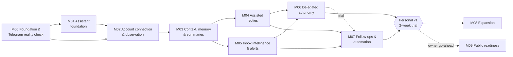

# Implementation Plan — Telegram-Native Personal AI Agent

| | |
|---|---|
| **Status** | Draft v1.0 for owner review (2026-10-17) |
| **Related** | [PRODUCT_REQUIREMENTS.md](PRODUCT_REQUIREMENTS.md) · [ARCHITECTURE.md](ARCHITECTURE.md) · [TELEGRAM_FEASIBILITY.md](TELEGRAM_FEASIBILITY.md) · [../AGENTS.md](../AGENTS.md) |

This plan turns the PRD and architecture into **vertical slices**: each delivers a demonstrable end-to-end capability with only the infrastructure it needs, its own automated tests, and (where Telegram behaviour matters) real-account verification. Milestones are approved one at a time by the owner; once approved, the milestone's scope is executed without re-asking about routine details.

---

## 1. Plan overview

### 1.1 Releases and milestones

| Release | Milestones | Outcome |
|---|---|---|
| **R0 Foundation** | M00 Foundation & Telegram reality check · M01 Assistant foundation · M02 Account connection & observation | The owner talks to the assistant; managed conversations are captured reliably on an always-on server; real Telegram behaviour verified. |
| **R1 Personal Alpha** | M03 Context, memory & summaries · M04 Assisted replies | Daily use for catch-up, search, memory, and approved replies. |
| **R2 Personal Beta = Personal v1** | M05 Inbox intelligence & alerts · M06 Delegated autonomous communication · M07 Follow-ups, reminders & automation | The full personal agent: triage, alerts, monitors, delegation, commitments and follow-ups. |
| **R3 Expansion** | M08 (prioritized after Personal v1 review) | Channels, voice, images, semantic retrieval, Mini App, etc. |
| **R4 Public** | M09 (only on the owner's explicit go-ahead) | Multi-user readiness, legal, billing. |

**Changes versus the preliminary sequence (PROJECT_CONTEXT §11)** — PRD R-01/R-02:
- **New M00** front-loads a throwaway Telegram probe and stack spikes, so no product code depends on unverified behaviour (PROJECT_CONTEXT §12 Phase C/D).
- **Inbox intelligence (M05) now precedes autonomy (M06):** autonomous replies depend on triage, escalation, and notification machinery, and observation/triage is the lower-risk, higher-value step.
- **Always-on deployment moves into M02:** observation is lossy without it (Telegram drops undelivered updates after ~24 h).

### 1.2 Dependency graph

M04 and M05 can be developed in either order after M03 (both build on the S01.3 card primitives); the recommended order is M04 then M05. If M05 is built first, the S05.1 Assist-trigger switch and the S05.2 `delivery_uncertain` test move to S04.2 and S04.4 respectively.

M06 and M07 are built in parallel in phase P3 ([docs/engineering/p3/](engineering/p3/README.md)), but M07's acceptance (§9: all R2 criteria re-verified, S07.5 personal trial) needs M06, so the trial starts only after both are complete (dotted edge).

### 1.3 Highest-risk assumptions and when they are retired

| # | Assumption | Risk if wrong | Validated in | How |
|---|---|---|---|---|
| A1 | Owner's manual messages arrive as `business_message` (takeover detection) | Takeover design invalid | M00 (LV-02) — **retired 2026-10-18** (TF §12 LV-02) | Probe with two accounts |
| A2 | Bot sends are not echoed (or echoes are recognisable) | Duplicate records / loops | M00 (LV-03) — **retired 2026-10-18** (no echo, TF §12 LV-03) | Probe |
| A3 | Paused/excluded chats produce recognisable send errors | Silent failures | M00 (LV-04, LV-08) — **paused and excluded: retired 2026-10-18** (both give `BUSINESS_PEER_INVALID`, TF §12 LV-04); LV-08 window errors pending | Probe |
| A4 | Connection id rotation and missing connection updates are handled by bootstrap | Lost connection state | M00 (LV-01, LV-05) — **retired 2026-10-18**: a reconnect rotates the id (as designed: resolve by account, bootstrap unknown ids); a disconnect sends `is_enabled=false`; the old id gives `BUSINESS_CONNECTION_INVALID` (TF §12 LV-01/LV-05) | Probe |
| A5 | 24 h window semantics and error strings | Wrong expiry/fallback | M00 (LV-08) — **error strings retired 2026-10-21** (TF §12 LV-08: `PEER_ID_INVALID` on send/typing, `BUSINESS_PEER_INVALID` on edit; the inferred `BUSINESS_PEER_USAGE_MISSING` never appeared; `telegram/errors.py` and ARCHITECTURE §6.6/§6.8 updated). Reopen semantics (owner message, contact edit) deferred by the owner to the M02 live session; the product assumes contact-only reopen until then | Probe (start early) |
| A6 | procrastinate + SQLAlchemy async + psycopg 3 integrate (incl. transactional defer) | Job architecture change | M00 (S00.3) | Spike; fallback to hand-rolled queue |
| A7 | LLM provider billing works from Uzbekistan | Provider change | M00 (S00.3) — **retired 2026-10-18** (OpenAI account and payment set up, owner confirmation) | Owner card test |
| A8 | `gpt-6-luna` quality in Uzbek (Latin/Cyrillic) for summaries | Weak core value | M03 gate (M00 smoke deferred to it, owner 2026-10-18) | Synthetic eval set |
| A9 | `gpt-6-luna` quality for Uzbek drafts | Autonomy unsafe | M04 (informational) / M06 (gate) (M00 smoke deferred, owner 2026-10-18) | Synthetic eval + owner ratings |
| A10 | LLM cost at the owner's volume is acceptable | Budget overrun | M00 estimate + owner-set budget, M02–M05 metering, M03/M05 model comparison | `count_tokens`, `llm_calls` |
| A11 | Telegram terms permit per-chat LLM processing for the owner's service | Account/bot ban risk | Personal phase: accepted risk with consent controls; before R4: written clarification | @BotSupport / counsel (M09) |

### 1.4 Working agreement per milestone

1. Owner approves the milestone (scope as written here).
2. Implement slices in order; each slice merges only when its tests pass and its acceptance criteria are met.
3. Run the milestone's manual integration checklist with real accounts.
4. Update docs (architecture deltas, TF results, evals, runbooks) and record a short milestone report in `docs/milestones/Mxx.md` (demo notes, decisions, known issues).
5. Owner reviews the report and approves the next milestone.

**Milestone status** (the single record of what may be implemented; AGENTS.md §3). A status changes only to record the owner's explicit approval (with its date); `done` only after the owner reviews the milestone report.

| Milestone | Status (`not approved` / `approved` / `in progress` / `done`) | Owner approval (date) | Report |
|---|---|---|---|
| M00 Foundation & Telegram reality check | `done` (owner reviewed M00.md 2026-10-21: "M00 OK"; the LV-11 7-day re-check and the LV-08 reopen half are recorded after close, as the plan allows) | 2026-10-17 | [M00.md](milestones/M00.md) |
| M01 Assistant foundation | `done` (owner reviewed 2026-10-19 via the M01 review page; merge approved) | 2026-10-17 | [M01.md](milestones/M01.md) |
| M02 Account connection & observation | `done` — **owner reviewed the report 2026-10-26 ("M02 OK")**; R0 live session passed 2026-10-26 (PR #23); the LV-08 reopen half moved to M04. *History:* S02.1 built; **S02.2–S02.5 built 2026-10-21** (business ingestion and classification, revision 0005; visibility report and bizChat panel; confirmation cards, decline/revoke flow with deletion, log hygiene, policy v3; prod compose, backups, post-restore, runbooks). **S02.6 Production hardening added 2026-10-22 (owner), merged 2026-10-23 (PR #8)**: review fixes, Oracle/B2 automation, two-bot switch (§4). Owner decisions 2026-10-22: hosting **Oracle Cloud Always Free** (planned Frankfurt; **amended 2026-10-23: US East Ashburn, `us-ashburn-1`**; A1 ARM64 1 OCPU / 6 GB, PAYG + USD 1 budget alert), off-site backups **Backblaze B2** (EU), **two bots** — Alviro production-only (polled only by the server), a new dev bot on the second account for all local runs (supersedes the 2026-10-21 one-bot decision). **Step C merged 2026-10-24 (PR #12)**: privacy policy v4 (published 2026-10-24, same URL), AI-permission card, `/status` 7-day warnings, Telegram error classification fix, revision 0010. Session A account steps done (Oracle Ashburn + PAYG + API key, B2, heartbeat, prod secrets, dev bot). Next: step D (laptop switch to the dev bot), then provisioning over SSH, then Session B (the R0 live test, on the Oracle server). S02.2 onwards unblocked 2026-10-21 (LV-08 error strings recorded in TF §12, per the 2026-10-18 condition). Owner decisions 2026-10-21: the S02.1 manual check and the deferred LV-08 half are folded into the M02 live session; the agent commits at slice ends, pushes, and merges to `main` when `just check` and CI are green; milestone reports still reviewed by the owner | 2026-10-18 | [M02.md](milestones/M02.md) |
| M03 Context, memory & summaries | `done` — **owner reviewed and said "M03 OK" on 2026-10-27**; decisions confirmed the same day; the owner checklist passed with open items C1–C5 and O1 (M03.md "Owner checklist") left for an M03 fix round before M04 code. **Fix round started by the owner 2026-10-27** (C1–C5, O1, G1 and the S03.7 open items; one draft PR per fix group; [M03-fix-round.md](milestones/M03-fix-round.md)); M03 code changes are allowed for the items of that round only. **Ended by the owner 2026-10-27** after C2, C1/P9, C3, G1 and C4 (merged #35, #40; deployed 2026-10-27) and a last CI-speed step; O1 dropped; C5 and the S03.7 items stay open items. *History:* **all slices complete: S03.1–S03.6 and the close-out merged and deployed (2026-10-26); S03.7 Robust attribution and search (added by the owner 2026-10-26) complete, its PR pending the owner's merge and a deploy; close-out pending the owner** (owner checks, NFR-04, decisions, the G1 summarize model/effort decision, the E1 review; [M03-owner-guide.md](milestones/M03-owner-guide.md)). Not `done` until the owner's "M03 OK" after reviewing M03.md; the eval gates still need the owner's E1 review. *History:* started 2026-10-23 when S02.6 merged (PR #8), per the 2026-10-21 advance approval and D43. S03.1 merged 2026-10-23 (PR #10); S03.2 (PR #17), S03.3 (PR #19/#20 via #17/#21), S03.4 (PR #15, #18), S03.5 (PR #22) and S03.6 eval-driven tuning (PR #25, added 2026-10-26 at the owner's request) merged by 2026-10-26; close-out PR #27 merged 2026-10-26; S03.7 (added by the owner 2026-10-26) on `m03/s03.7-attribution-search`; E1 synthetic dataset merged (PR #9). (Approved in advance, owner 2026-10-21: code may start once M02's slices are complete; S03.4 real-model evals capped at USD 1; the owner's Uzbek review of E1 is still required for the gate. 2026-10-22: M03 code starts once **S02.6 merges** (Sessions A/B need not finish first); the first M03 branch is the **E1 synthetic dataset** (in parallel with S03.1), frozen before S03.2.) | 2026-10-21 | [M03.md](milestones/M03.md) |
| M04 Assisted replies | `in progress` — **owner go-ahead for phase P2 on 2026-10-27** after "M03 OK" ([P2 decisions](engineering/p2/decisions.md) B4). `approved` in advance (owner, 2026-10-21): code may start once M03's slices are complete; the 7-day daily-use trial and the E2 rating remain the owner's | 2026-10-21 | [M04.md](milestones/M04.md) |
| M05 Inbox intelligence & alerts | `in progress` — **owner go-ahead for phase P2 on 2026-10-27**. `approved` (owner, 2026-10-26): runs in phase P2 in parallel with M04 ([docs/engineering/p2/](engineering/p2/README.md)); code starts after the owner's "M03 OK" and after the shared foundation F0 lands; the E3 gate needs the owner's label confirmation | 2026-10-26 | [M05.md](milestones/M05.md) |
| M06 Delegated autonomous communication | `approved` — owner approval 2026-10-29 (OD-1); code starts at D0 = Mon 2026-11-02 on `int/p3`; plan: [docs/engineering/p3/](engineering/p3/README.md). Before D0 only the pre-start units run (docs and synthetic data: DATA-E2, DATA-E4a, DATA-E4b, QA-P3, the PV6 text, F0-C) | 2026-10-29 | — |
| M07 Follow-ups, reminders & automation | `approved` — owner approval 2026-10-29 (OD-1); code starts at D0 = Mon 2026-11-02 on `int/p3`; plan: [docs/engineering/p3/](engineering/p3/README.md) | 2026-10-29 | — |
| M08 Expansion | `not approved` | — | — |
| M09 Public readiness | `not approved` | — | — |

### 1.5 Global Definition of Done (applies to every slice)

- Code follows [AGENTS.md](../AGENTS.md) (layering, safety invariants, typing, logging hygiene).
- Automated tests added at the right layers (§10); full suite green **in CI** (from 2026-10-26 the full suite runs only in GitHub CI; locally only the relevant tests — AGENTS §11); ruff, mypy, import-linter clean.
- Alembic migration included for schema changes, tested up/down on a real Postgres.
- No secrets or message content in logs (redaction test passes); feature flags default to the safe state.
- New external processors or data uses: consent text and privacy policy updated before activation.
- Changes that expand processing of managed data ship with a one-time owner notice and opt-out before activation (SEC-12).
- Docs updated where behaviour or decisions changed; acceptance criteria demonstrably met.
- Manual Telegram checks executed when the slice touches Telegram behaviour, results noted.
- For `tools/probe/` and `spikes/`, only these items apply: no secrets, no real chat data committed, results documented.

Sizes are relative effort for one developer working with AI assistance: **S** ≈ 1–2 days, **M** ≈ 3–5 days, **L** ≈ 1–2 weeks. Sizes are effort only; calendar minimums for soak periods are listed per milestone.

---

## 2. M00 — Foundation & Telegram reality check

**Objective:** a working, reproducible engineering setup, and verified answers to the platform and stack questions that the design depends on — before writing product code.

**User-visible result:** none for the product; the owner sees a verified Telegram behaviour report (TF §12) and a ready repository.

**Dependencies:** owner approval of PRD/architecture; LLM provider account (OpenAI since ADR-07a; by S00.3). The probe/dev bot uses any neutral throwaway username without "Telegram"; the product name (Q-01) is needed only for the prod bot (S02.5).

**Scope:** In: tooling, probe, LV-01…LV-19, stack/provider/search spikes. Out: product features, deployment.

### S00.1 Repository and tooling (M)

- `git init`; `.gitignore` (incl. `.env`, `var/`); `.env.example` listing every setting with placeholder values (AGENTS §9); MIT-or-private licence decision deferred (private repo).
- `pyproject.toml` (uv; `requires-python = ">=3.14,<3.15"`; `.python-version`); dependency groups: runtime (aiogram, sqlalchemy[asyncio], psycopg[binary,pool], alembic, procrastinate, openai, pydantic-settings, structlog, python-dateutil) and dev (pytest, pytest-asyncio, hypothesis, ruff, mypy, import-linter, pip-audit).
- `src/assistant/` skeleton per ARCHITECTURE §5 with empty packages and `import-linter` contracts.
- `config.py` (pydantic-settings), `observability/logging.py` (structlog + redaction processors), `__main__.py` with `healthcheck` = settings validation + `SELECT 1` against DATABASE_URL → exit 0, otherwise 1.
- `deploy/Dockerfile`, `compose.dev.yml` (app with bind mount, virtualenv outside the bind mount; `pgvector/pgvector:pg18` with a separate `assistant_test` database created by an init script), optional `.devcontainer/`.
- `justfile` (host-side; recipes delegate to the container): `setup`, `up`, `down`, `test`, `lint`, `typecheck`, `check`, `healthcheck`, `hooks`, `migrate` (usable from S01.1), `run`.
- Pre-commit: gitleaks + ruff executed in the container via `just hooks`; mypy and import-linter run in `just check`. CI workflow file ready for when a GitHub remote exists.
- **Tests:** config loading/validation; redaction removes text/token patterns; healthcheck exit codes; import-linter contracts pass.
- **Acceptance:** From a fresh clone, `just setup` then `just check` exit 0 from PowerShell on the owner's Windows machine (Docker Desktop, WSL2 backend).

### S00.2 Telegram probe and live validation (M, calendar ≥ 2 days because of LV-08)

- Owner creates the probe/dev bot in @BotFather (steps in §13; any neutral working username), enables **Secretary Mode**, disables group joins (`/setjoingroups`), and stores the token in `.env`.
- `tools/probe/`: a throwaway script (not imported by the app) that long-polls with an explicit `allowed_updates` list and appends raw updates as JSON lines to `var/probe/` (git-ignored) — full payloads only for allow-listed chat ids (the test accounts and the bot); for any other chat only the update type, `update_id` and a hash of `chat.id`; plus a small command set to perform test sends/edits/typing/deletes/`getBusinessConnection`/`getFile`.
- Owner sets up connections A and B exactly as in TF §11 (A: probe bot → **main account**, Chat Automation restricted to the chats with the **second** and **third** accounts; B: probe bot → **second account**, which has no real contacts, with all 1:1 chats), never widening the main account's scope, and does not open or /start the probe bot from any account until LV-09 is recorded. After BotFather setup, verify that `getMe` returns `can_connect_to_business: true`.
- Execute **LV-01 … LV-19** (TF §11). Start LV-08 on day 1 in the dedicated third-account chat; the other LVs run in parallel in the second-account chat.
- Record results in TF §12; update classification rules and error mapping in ARCHITECTURE §6.5/§6.8 if anything differs.
- Produce `tests/fixtures/telegram/*.json` generated by `tools/probe/sanitize.py` (owner-run; agent-run allowed since 2026-10-19, AGENTS §9) from observed payloads, with all text, names, usernames, file ids and media replaced by synthetic values; the coding agent never reads `var/probe/` (Telegram §4.3).
- **Acceptance:** every LV row has a recorded result or an explicit "could not test" with reason; fixtures committed; architecture deltas (if any) documented. The 7-day LV-11 result may be recorded after M00 closes and does not block M01.

### S00.3 Stack and provider spikes (M)

- **Jobs spike (A6):** in the dev container, SQLAlchemy 2.1 async + psycopg 3 + Alembic baseline + procrastinate schema as an Alembic revision; prove: `schedule_at`, `lock`, `queueing_lock` (`AlreadyEnqueued` handling), retry strategy, `retry_stalled_jobs`, **transactional defer on the session's raw psycopg connection** (TQ-01), and that a future-scheduled job does not delay an immediate job for the same conversation under the chosen pattern. Record the outcome; if transactional defer fails, adopt "commit + defer + reconciler" (already the designed fallback). If procrastinate integration fails materially, switch to the hand-rolled queue (ADR-06 fallback) before M01. Spike code lives in `spikes/` (not imported by `src/`; excluded from import-linter and mypy strict). Its deliverables are the decision record in `docs/milestones/M00.md` and a minimal reproducible test that S01.1 re-implements in `src/`. The first committed Alembic revisions are created in S01.1.
- **Provider spike (A7, A10):** owner creates the OpenAI platform account, adds a card (Uzbek-issued card test — TF §7.2), sets a monthly spend limit, stores the key in `.env` (done 2026-10-18; A7 retired). Run, on **synthetic text only**: one plain and one structured-output call with `gpt-6-luna` and `store=false`, method names taken from the official OpenAI docs (AGENTS §8); measure input/output tokens from the usage block on synthetic Uzbek Latin/Cyrillic/Russian/English samples to estimate tokens per message; confirm the refusal and truncation handling paths. Estimate daily cost for the owner's typical volume (owner's volume estimate, §13).
- **Uzbek smoke eval (early A8/A9 signal) — deferred to the M03 summary gate by the owner (2026-10-18);** A8/A9 are judged there and at M04/M06 on dataset E1. Original scope: 8 hand-written synthetic conversations (2 each in Uzbek Latin, Uzbek Cyrillic, Uzbek–Russian mix and Russian; 10–20 messages each, with planted questions and commitments). Run a draft `CatchUp` schema via the SDK's structured-output call and one reply draft per conversation on `gpt-6-luna`. The owner marks pass/fail: all planted items present, no invented facts, correct language/script, reply usable with at most a minor edit. Go: ≥ 7/8 summaries pass; otherwise the owner decides before M01 whether to add an alternative adapter to the M03 evaluation. These conversations seed dataset E1 (§10.1).
- **Search spike:** prototype `normalize()`; run `ts_debug()`/`show_trgm()` in the pinned Postgres image for Uzbek apostrophe variants; confirm Latin↔Cyrillic matching on synthetic samples.
- **Acceptance:** spike notes in `docs/milestones/M00.md`; ADR statuses updated (Accepted/Changed); cost estimate recorded; the owner sets a target monthly LLM budget (`LLM_MONTHLY_BUDGET_USD` and the Console spend limit); the estimate for the planned scope must fit it, otherwise effort or scope changes are decided with the owner before M02 (per-route model overrides only after the M03/M05 evaluations, §10.1).

**Major risks:** Telegram behaviour differs from research (handled by design updates before M01/M02); provider payment blocked (retired 2026-10-18: OpenAI payment works); Windows Docker friction (Dev Container/WSL2).

**API requirements:** probe only: `getMe`, `getUpdates`, `deleteWebhook`, `getBusinessConnection`, `sendMessage`/`editMessageText`/`sendChatAction`/`deleteBusinessMessages` with `business_connection_id`, `getFile`; Anthropic `messages.create`/`messages.parse`, `count_tokens`.

**Data requirements:** no product schema; raw probe dumps in `var/probe/` (git-ignored); synthetic fixtures in `tests/fixtures/telegram/`.

**Manual integration tests:** LV-01 … LV-19.

**Milestone acceptance:** S00.1–S00.3 accepted; go/no-go recorded for M01/M02 assumptions.

**M00 decision table** (each row recorded in `docs/milestones/M00.md` with observed result, decision and owner sign-off):

| Trigger (observed) | Decision |
|---|---|
| A1/LV-02: owner manual messages not delivered | Takeover cannot be detected; autonomy (M06) is re-scoped with the owner before M04 (approval-only, or autonomy only in chats the owner will not use during a delegation); PRD J8/R-09 updated. |
| A2/LV-03: echo delivered | No plan change (upsert path designed); fixtures added. |
| A3/LV-04: no distinct error for paused chats | `possibly_paused` is driven by silence/`BUSINESS_PEER_INVALID` only; PRD §15 row reworded. |
| A4/LV-01/LV-05: id rotation or missing connection update | No change (bootstrap designed); record observed behaviour. |
| A5/LV-08: error strings or window semantics differ | Update `telegram/errors.py`, ARCHITECTURE §6.6/§6.8 and TF §12 before M02. **Occurred (2026-10-21):** the strings differ (`PEER_ID_INVALID` / `BUSINESS_PEER_INVALID`, not `BUSINESS_PEER_USAGE_MISSING`); all three updated in the same change. Window-reopen semantics deferred to the M02 live session (owner, 2026-10-21); contact-only reopen assumed meanwhile. |
| A6: procrastinate integration fails materially | Adopt the ADR-06 hand-rolled queue before M01 (+1 week to M01); if only transactional defer fails → commit + defer + reconciler (no plan change). |
| A7: card payment fails | Did not occur (OpenAI payment set up 2026-10-18). Had it failed: an alternative provider adapter, provider spike re-run before S01.4. |
| Any other LV differs | Architecture delta documented and approved by the owner before the dependent milestone. |

**Calendar minimum:** ≥ 2 days (LV-08).

**Definition of done:** global DoD + TF §12 filled + `docs/milestones/M00.md`.

---

## 3. M01 — Assistant foundation (control chat)

**Objective:** the owner chats with an AI assistant in the bot's private chat, with durable, idempotent processing, consent, allowlisting, metering, and graceful failure.

**User-visible result:** "I send the assistant a private Telegram message and receive an AI-generated response" (PROJECT_CONTEXT M01) — plus /start onboarding, /help, /status, /privacy, /settings (language, timezone).

**Dependencies:** M00 (tooling, fixtures, stack decision).

**Scope:** control chat only. Business updates are received and stored in the inbox but routed to a no-op handler (recorded as `ignored`, payload cleared at processing) until M02.

### S01.1 Data foundation (S)
- Alembic baseline: `accounts`, `consents`, `inbound_updates`, `control_turns`, `agent_runs`, `agent_run_steps`, `llm_calls`, `audit_log`, `system_state`, `pending_inputs`; procrastinate schema revision.
- Session/unit-of-work, repositories requiring `account_id`, `Clock` port.
- **Tests:** migrations up/down; repository isolation (cannot read another account's rows); unique constraints.

### S01.2 Durable ingestion (M)
- Poller (advisory-lock singleton on a dedicated connection; 409 handling; bot-id check; explicit `allowed_updates`; offset advanced only after commit; heartbeat — ARCHITECTURE §6.1), inbox processor (advisory-lock singleton; claim in order, per-row transaction, error-classified retries, 3-attempt dead-letter for deterministic errors, `inbox requeue` command), routing table (ARCHITECTURE §6.3): owner → control router; non-owner → fixed refusal (rate-limited); groups → ignored; business → `ignored` (until M02); rows routed to refusal or `ignored` get `payload = NULL` in the same transaction.
- Startup checks: `getMe` (`can_connect_to_business`), `deleteWebhook(drop_pending_updates=False)`. Stop the probe before the app polls the same token (409).
- **Tests:** duplicate update ids ignored; crash between insert and offset advance re-delivers without duplication; poison update dead-lettered and processing continues; routing table cases (contract fixtures); payload is NULL after processing for each refusal/ignored case; poller singleton; transient Telegram/DB errors never dead-letter a row; a dead-lettered row raises the owner alert (business fail-closed: S02.2 adds the conversation pause and caveat, S04.4 the outdating of pending actions); requeue after a fix processes the row; loss of the advisory-lock connection stops polling; 409 stops polling and alerts; a second inbox processor cannot start; restart without an offset re-reads unconfirmed updates without duplicates.

### S01.3 Control chat basics (M)
- aiogram control Router: `/start` (language, timezone, `ai_control` consent with provider named), `/help`, `/status` (basic), `/privacy` (policy v0).
- Publish privacy policy v0 (control chat; OpenAI as processor, terms per TF §7.2; retention for control turns and `llm_calls`) at the chosen host and register it in @BotFather before the first live LLM call (global DoD: policy before activation).
- `/settings` panel v1 (FR-CTL-10; deterministic inline keyboard, no LLM): language, timezone. Later slices add their settings to it.
- **Control-chat interaction primitives:** callback tokens `<kind>:<token>:<op>` (owner-bound, single use per state, always answered with `answerCallbackQuery`); `pending_inputs` (kind, ref_id, prompt_message_id, expires_at) with routing precedence, where an active pending input consumes the owner's next text before the agent sees it and any /command cancels it; and a generic confirmation card (Confirm/Cancel, edited in place on resolution or expiry). These are used by onboarding, consent, memory/Ignore/deletion confirmations, approval cards, and automation/delegation confirmations.
- `OutboundGateway` with `ControlChat` target, throttling, error classification; HTML renderer with sanitizer and splitting.
- **Tests:** onboarding flow state persisted in DB; consent required before any LLM call (FakeLLM must not be called otherwise); renderer escapes/splits correctly; gateway never attaches `business_connection_id` to control targets; /settings works while FakeLLM is unavailable; non-owner callback rejected; stale token → "no longer active"; double tap → one transition; a pending input expires; an unrelated /command clears the pending input.

### S01.4 Agent runtime v1 (M)
- `LLMClient` port, OpenAI adapter on the official `openai` SDK (structured outputs via Pydantic, refusal and truncation handling, usage capture, **`store=false` on every request** — TF §7.2), `FakeLLM`; consent choke point in the `LLMClient` wrapper (every request carries content-part provenance; raises before the provider call if a required consent is missing — ARCHITECTURE §14.3).
- Owned agent loop (ARCHITECTURE §7.2) with one tool (`get_status`); `owner_request` context builder (profile, preferences, last N control turns); budgets/timeouts; typing indicator; provider-down message; monthly budget check.
- **Tests:** loop terminates on budget/iterations; tool results appended in one message; refusal → safe reply; provider errors → user-facing message and no crash; `llm_calls` recorded with tokens; the registry exposes no tool that sends, edits, deletes or marks read (RG-17).

### S01.5 Jobs and system tasks (S)
- procrastinate app + `JobScheduler` port; one worker per queue with explicit concurrency (ARCHITECTURE §12.1); in-process supervisor (ARCHITECTURE §4.3); `agent.owner_request` (lock per account); periodic: `retry_stalled_jobs`, `remove_old_jobs`, `ingestion_watchdog`, `heartbeat_ping`, `reconcile_pending` (owner control turns).
- Retention sweeper for `inbound_updates.payload` (7 days).
- `notify_owner(kind, refs)` domain service; every system alert goes through it (direct control-chat send in M01–M04). This covers ingestion stall, dead-letter and budget alerts, and later connection/rights and delivery alerts.
- **Tests:** owner turns processed sequentially per account; stalled job recovery; watchdog detects stale heartbeat; payload sweeper; a 5-minute `agent.owner_request` job does not delay `heartbeat_ping` or a job on the `outbound` queue; killing any role task makes the process exit non-zero; SIGTERM during an in-flight control-chat send completes it within the grace period.

**API requirements:** `getUpdates`, `getMe`, `deleteWebhook`, `sendMessage`, `sendChatAction`, `answerCallbackQuery`, `editMessageText`, `setMyCommands` (owner scope). OpenAI API (official SDK; endpoint chosen and verified against the official docs in S01.4).

**Data requirements:** tables above; no business content yet.

**Major risks:** aiogram router integration with our own inbox (mitigated: feed updates to the Dispatcher from the processor; contract tests).

**Manual integration tests:** owner conversation (Uzbek, Russian, English); third account gets refusal; `docker compose restart app` mid-conversation; disconnect network to simulate provider outage.

**Acceptance criteria:**
1. Owner receives AI responses in the preferred language; p95 of (typing indicator sent − `inbound_updates.received_at`) < 2 s, computed from logged `ack_latency_ms` over ≥ 30 owner messages in the manual test.
2. A non-allowlisted account receives only the fixed refusal; no LLM call; its `inbound_updates` row has `payload` NULL after processing.
3. Restart during processing loses no owner messages and produces no duplicate replies.
4. With the provider unreachable, the owner gets a clear message; `/status` still works.
5. Every LLM call is metered in `llm_calls`.

**Definition of done:** global DoD; `docs/milestones/M01.md`.

---

## 4. M02 — Account connection & observation

**Objective:** receive authorized account message events reliably, identify their origin and direction, store them with honest coverage, and run always-on.

**User-visible result:** the owner connects the bot under Chat Automation, sees the capability tier, grants managed-content consent, and can ask "What can you see?"; the system runs on a VPS.

**Dependencies:** M01; M00 LV results.

**Scope:** In: connection registry, consent, business ingestion/classification, visibility, privacy baseline, VPS deployment. Out: LLM processing of managed content (M03), sends as the owner (M04).

### S02.1 Connection registry and consent (M)
- `business_connections` + `business_connection_events` + `foreign_connections`; lifecycle (ARCHITECTURE §6.4); owner check; bootstrap via `getBusinessConnection` on unknown ids; capability tier; owner notifications for connect/rights change/disable.
- `ai_managed` consent flow (names processors); privacy policy v1 (adds managed conversations, the retention table and `ai_managed`), published at the same URL with a version bump, registered with @BotFather, served by `/privacy`.
- **Tests:** connection from non-allowlisted user rejected (no content stored; no `accounts`/`business_connections` row; payload nulled); connection before `/start` stays inert; id rotation re-links; missing initial connection update bootstrapped; disabled ⇒ business processing stops; rights absent ⇒ no permissions.

### S02.2 Business ingestion and classification (L)
- `contacts`, `conversations`, `messages`, `coverage_gaps`; `telegram/normalize.py`; classification rules (ARCHITECTURE §6.5) as confirmed by LV results; edits (content hash, edited marker), deletions (purge content, tombstone), bot-chat guard, reply-window tracking (Telegram `message.date` of new messages only), coverage start, script tagging, `search_key` via `normalize()`.
- Managed content is stored but **not sent to the LLM** without `ai_managed` consent (enforced at the `LLMClient` wrapper; context builders check as defence in depth — ARCHITECTURE §14.3). LLM-dependent jobs do not run before consent; flagged conversations are processed once it is granted.
- **Tests (contract + integration):** each sender class from fixtures; owner messages never classified as contact; mirrored bot chat ignored; edits with unchanged content ignored; deletion purges content; out-of-order connection/message processing; duplicates idempotent; Ignore-mode (default off in M02) path stores metadata only; deletion nulls linked inbound payloads; Ignore-mode updates keep no payload; backlog delivered 3 h late: `last_contact_msg_at` equals message dates, not receipt time; contact edits do not move the window; an owner no-op edit or an edit of an old message does not set takeover; a pre-consent business message is stored and no LLM-dependent job runs; granting consent processes flagged conversations; a dead-lettered business update sets `autonomy_paused_reason=ingest_error`, records a `definite` coverage gap and shows the coverage caveat, and requeue after a fix clears the caveat.

### S02.3 Visibility and conversation panel (S)
- "What can you see?" / extended `/status`: connection state, rights tier, connected-since, managed conversations observed, gaps, consent and autonomy state.
- `/start bizChat<id>` → basic conversation panel (contact, first seen, message counts, mode = Observe), with defensive id parsing and ownership check.
- **Tests:** visibility report accuracy against seeded data; bizChat for a foreign or unknown id is refused.

### S02.4 Privacy baseline (S)
- Logging-hygiene test suite: a full scenario plus injected failures carrying a canary string (unique and NOT NULL violations, a pydantic validation failure, Telegram 400, LLM 400, an HTTP error with the token in the URL); assert that neither the canary nor the token appears in app or db logs.
- Consent revocation stops processing; revoking or declining `ai_managed` offers "delete all stored managed-conversation data" via a confirmation card, plus a choice between continuing in non-AI mode (coverage and visibility only) and disconnecting (FR-ONB-06, J1 step 5).
- **Tests:** revocation; after deletion, no managed content remains in ARCHITECTURE §10.1 columns; log scan with injected failures.

### S02.5 Always-on deployment (M)
- Provision the server — **Oracle Cloud Always Free** (owner decision 2026-10-22, replacing the DigitalOcean default; ARCHITECTURE §15.5): US East Ashburn (`us-ashburn-1`; amended 2026-10-23, Frankfurt was planned; account, PAYG upgrade and API key done 2026-10-23), `VM.Standard.A1.Flex` ARM64 1 OCPU / 6 GB, Ubuntu 24.04, 50 GB boot + 50 GB block volume for Postgres — using `deploy/runbooks/provision.md` (agent-runnable from S02.6): SSH keys, sudo user, provider firewall (SSH only), unattended upgrades, Docker, data on the encrypted block volume (Oracle's at-rest encryption cited — TQ-05), `compose.prod.yml` (db, migrate, app, backup), age-encrypted nightly backups to **Backblaze B2** (EU Central, private bucket, bucket-scoped key, rclone hard deletes; mirrors local 14 daily + 4 weekly), external heartbeat monitor. Account on Pay As You Go with a USD 1 budget alert.
- Runbooks `deploy/runbooks/{deploy,restore,rotate-secrets,breach}.md` in addition to `provision.md` (SEC-13, NFR-09); `restore.md` contains the mandatory post-restore steps of ARCHITECTURE §15.6.
- **Two bots** (owner decision 2026-10-22, superseding the 2026-10-21 one-bot decision; ARCHITECTURE §15.3): **Alviro** is the production bot (neutral description/about text, Secretary Mode on, `/setjoingroups` Disable, privacy-policy URL registered, `getMe.can_connect_to_business` verified), its token only in the server `.env`, polled only by the server, connected to the main account with the Q-10 scope. The owner creates a new **dev bot** (/newbot, neutral name) connected to the **second account**; dev `OWNER_TELEGRAM_IDS` = second account; drop and recreate the dev DB, re-run /start.
- **Tests/checks:** backup produced and decryptable; off-site copy present in B2 and pruned in step with local retention; heartbeat alert fires when app is stopped; restart restores processing < 60 s; data directory verified on the encrypted block device; backup restored into an isolated database (ARCHITECTURE §15.6) using the offline age identity; no laptop polls Alviro (only the server's poller runs on its token).

### S02.6 Production hardening (M) — added 2026-10-22 (owner), before Session A
Fixes from the M02 review plus the Oracle/B2/two-bot setup. Owned by the lead; results go to `docs/milestones/M02.md`.
- **Deploy:** backup image build context; prod compose run with `--env-file`; `/backups` ownership; `backup.sh` errexit inside `if`; off-site prune and an upload-success marker; restore runbook key/password handling; CI builds the images for amd64 + arm64, runs shellcheck on the scripts and a backup smoke test.
- **Oracle/B2 automation:** scripts and an agent-runnable provisioning runbook (Claude Code or Codex) — `just oci-provision`, `just prod-bootstrap <host>`, `just prod-env-push <host>`; B2 bucket/key setup; the TQ-05 citation for Oracle block-volume encryption.
- **Code:** bot-counterpart chat recognition (D37's claim was wrong); truthful dead-letter alerts, repeated daily and routed to the owner of the row's account; card presses send only after commit; small payload leaks closed; consent question robustness; allowlist re-checked at the business gate; stdlib (non-structlog) logs pass through redaction; coverage-caveat semantics.
- **Two-bot switch:** dev `.env` on the dev bot; dev database dropped and recreated; probe/acceptance docs name the dev bot; R0 production checks run server-side.
- **Tests:** a failing test first for each code fix (bot-counterpart chat ignored, dead-letter alert to the right owner and repeated daily, card press → send after commit only, allowlist removal stops business processing, stdlib log record redacted, caveat wording per gap certainty); CI image builds on both architectures; shellcheck clean; the backup smoke test produces a decryptable archive and a marker; mandatory regression suite green.

**API requirements:** `getBusinessConnection`; business update types; `sendMessage` to control chat for notifications.

**Data requirements:** tables above; retention defaults (Q-03).

**Major risks:** Telegram behaviour drift (contract tests + probe re-run); server learning curve (agent-runnable runbook); Oracle idle reclamation and no free-tier SLA (PAYG, right-sizing, heartbeat, off-site backups, tested restore; paid VM before M09 — ARCHITECTURE §15.5).

**Manual integration tests:** Run on the Oracle production deployment (Alviro) after S02.5/S02.6, with the second account included in the prod scope as the contact: 2-hour session of mixed messages (text, edits, deletions, media, owner replies from phone and desktop, owner away message if available); pause/resume chat; change rights; disconnect/reconnect; app restart during the session; server reboot.

**Acceptance criteria (R0 exit):** PRD §21 R0 items 1–5, plus: backups (local and B2) and heartbeat verified on the server; LV-confirmed classification rules in production; NFR-02: p95 of `inbound_updates.processed_at` − message `date` < 5 s over the 2-hour session; NFR-03: watchdog alert ≤ 15 min after the poller stops (fake-clock test + one live check).

**Calendar minimum:** ≥ 1 day (2-hour session, reboot, one backup cycle).

**Definition of done:** global DoD; `docs/milestones/M02.md`; R0 exit review with owner.

---

## 5. M03 — Context, memory & summaries

**Objective:** the agent understands retained conversations and can summarize, search, answer, and remember — honestly within coverage.

**User-visible result:** "Summarize what happened while I was studying", "What's going on with Alex?", "Find the conversation where we agreed on the meeting time", "Remember that…", "What do you know about Kamola?", conversation modes, data deletion and retention settings.

**Dependencies:** M02 slices (code starts once S02.6 merges — owner 2026-10-22; Sessions A/B run in parallel).

**Order (owner 2026-10-22):** the first M03 branch authors the **E1 synthetic dataset** (§10.1), in parallel with S03.1; E1 is frozen before S03.2 starts.

**Scope:** In: search, summaries/catch-up, attention v1, memory/notes/preferences, modes, retention, data controls and /settings, eval harness. Out: drafts/sends (M04), triage/alerts (M05).

### S03.1 Search and conversation tools (M)
- Finalize `normalize()` — **ASCII canonical form** (owner decision 2026-10-22, ARCHITECTURE §11.2: oʻ/ö/ō/ŏ/ó→o, gʻ/ğ/ǵ→g, apostrophes and tutuq belgisi removed, ş→sh, ç→ch, ñ→ng; Uzbek and Russian Cyrillic→Latin), bump `NORMALIZER_VERSION`; `search_tsv` GIN + `pg_trgm` GIN indexes, search service with contact/date filters and light Uzbek stem variants; tools `search_messages`, `resolve_contact`, `get_conversation`, `list_conversations`; run `reindex-search` as the backfill after finalizing `normalize()` (driven by the global `system_state.normalizer_version`; all retained rows re-keyed).
- Per-route model configuration `LLM_ROUTE_<RUN_TYPE>_MODEL` (ARCHITECTURE §7.4; default `LLM_DEFAULT_MODEL`), with each route's processor checked against the `ai_managed` consent — needed by the "processor not named in consent" test below; `.env.example` updated.
- Taint semantics as clarified 2026-10-22 (ARCHITECTURE §7.1): reading, searching, summarising and answering are never blocked; only model-initiated state changes need the card; the owner's own commands and buttons need none.
- Taint tracking (ARCHITECTURE §7.1): read-tool results that contain contact-authored text, and owner messages that carry forwarded or quoted third-party text, are wrapped as untrusted and mark the run tainted (`agent_runs.tainted`); in a tainted run every `configure`/`control` call returns a confirmation card instead of executing, except calls that reduce autonomy. With `ai_managed` not active, the tool registry omits the tools that return managed content.
- **Tests:** Latin query finds Cyrillic message and vice versa; apostrophe variants (ʻ ʼ ‘ ’ ' \` ´) match, and apostrophe-less spellings (`ozbekiston`, `galaba`) match; new-alphabet letters match old forms; Latin-typed Russian finds Cyrillic Russian; a tainted run still reads and answers; Russian and English queries; ranking sanity; account isolation; messages ingested with the M02 normalizer are found after reindex; an injected `get_conversation` or `search_messages` result marks the run tainted; with `ai_managed` revoked, an owner question about a contact finds the read tools absent and FakeLLM receives no managed text; a route configured to a processor not named in the consent raises.

### S03.2 Summaries and catch-up (M)
- `conversation_summaries` with `memory.refresh_summary` (debounced, incremental, `covers_through_message_id`); `summarize_period` tool (per-conversation cached summaries → combined catch-up); catch-up renderer with coverage caveats (gaps, ignored chats, pre-connection); attention list v1 (`get_attention_list`: last message from contact, unanswered, with model-assisted "needs reply" check); `reconcile_pending` covers summary flags.
- **Tests:** summary refresh triggered and debounced; catch-up includes possible/definite gap caveats and omits delayed-only gaps; FakeLLM receives only the right conversation's messages per summary call (isolation); `summarize` runs are given no tools (RG-17); consent enforced; crash between commit and defer → summary job re-created.

### S03.3 Memory, personalization, modes (M)
- `memory_items` (owner instructions, preferences, contact notes); tools `remember`, `forget`, `list_memories`, `update_preferences`, `set_conversation_mode`; "What do you know about X?"; conversation panel buttons for Ignore/Observe; Ignore stops storage going forward; the mode-change confirmation offers "Also delete existing data" (the option is wired in S03.5, which provides `delete_conversation_data`); message retention sweep: rollup attempted before the retention ceiling (ARCHITECTURE §10.4), hard purge at the retention age regardless of summary coverage (non-AI mode, budget exhaustion, provider outage); `summary_gap_before` set when no rollup exists.
- /settings: default mode for new chats; conversations listed by mode (paginated → conversation panel).
- **Tests:** memory CRUD echoed with one-tap Undo (confirmation card in a tainted run); contact notes only injected for that contact; owner-scope facts mentioning contact B never appear in A's draft/triage prompt (FakeLLM inspection); a FakeLLM-scripted `remember`/`set_conversation_mode` call after an injected `get_conversation` or `search_messages` result yields a confirmation card and no state change; Ignore-mode non-storage; existing data kept after switching to Ignore; with no `ai_managed` consent, after 91 simulated days no content older than 90 days remains and the summary gap is recorded; with consent, the rollup precedes the purge.

### S03.4 Evaluation harness v1 (M)
- `evals/` runner, dataset schema, metrics, result recording to `docs/evals/`.
- **Dataset:** E1 (§10.1), frozen before S03.2.
- Run summary/catch-up evaluation on `gpt-6-luna`. **If Luna misses a threshold**, run the same set on `gpt-6-sol` (and `gpt-6-astra` if needed); record quality and cost per 100 conversations for each; apply the model-choice rule (§10.1) and record the decision (`LLM_ROUTE_SUMMARIZE_MODEL` stays `gpt-6-luna` unless it fails the thresholds).
- **Thresholds:** question/commitment recall ≥ 95 %; zero fabricated facts (any stated fact, date, amount, commitment or attribution not supported by the source messages counts); coverage caveat present whenever gaps exist; owner-facing language correct 100 %.
- **Retrieval set:** ≥ 30 owner-style queries over the synthetic corpus, including paraphrase/intent queries ("where we agreed on the meeting time", "the address Kamola sent") and cross-script queries. Thresholds: target message in the top 5 `search_messages` results (with model-generated query variants) ≥ 85 %; correct final answer with reference ≥ 80 %.

### S03.5 Data controls and settings (M)
- /settings additions on the S01.3 panel: default reply language/tone/style; retention per data class within allowed ranges (R-07, FR-PRV-03; also via `update_preferences`); data deletion. Adds the "Also delete existing data" option to the S03.3 Ignore confirmation.
- Deletion (FR-PRV-04) behind S01.3 confirmation cards: tools/commands `delete_conversation_data`, `delete_contact_data`, `delete_everything` (class configure; always a confirmation card, never executed directly). Each cascades over every content-bearing column in ARCHITECTURE §10.1 within its scope: messages, conversation_summaries, contact- and conversation-scoped memory_items, actions.text, control_turns referencing the scope, inbound_updates payloads for the chat, and contact names for per-contact deletion. Ids/tombstones are kept only where audit needs them; one content-free audit row is written.
- Retention sweeps for every row of ARCHITECTURE §10.4 (audit_log, agent_runs/llm_calls, control_turns, inbound metadata), honouring owner overrides.
- Consent revocation (S02.4) offers these deletion scopes.
- **Tests:** after each deletion scope (conversation, contact, everything), a scan of all ARCHITECTURE §10.1 content columns finds no text from the deleted scope; other conversations and accounts are untouched; confirmation is required; the audit row is content-free; a retention change takes effect at the next sweep; choosing "Also delete existing data" on the Ignore confirmation deletes that conversation's data.

**API requirements:** none new on Telegram; OpenAI structured outputs.

**Data requirements:** `conversation_summaries`; `memory_items` (FK-scoped per ARCHITECTURE §10.3); `search_tsv` GIN and `pg_trgm` GIN indexes; owner retention overrides in `accounts.settings`.

**Major risks:** Uzbek summary quality (A8) — mitigations: prompt tuning, effort increase, provider adapter swap if thresholds fail.

**Manual integration tests:** owner runs catch-up after a real half-day; searches in mixed scripts; sets notes and verifies usage; ignores a chat and verifies non-storage and the optional deletion.

**Acceptance criteria:** PRD §21 R1 items 1, 2, 7 (for the data classes that exist in M03: messages, summaries, memory; the tasks part re-verified in S05.1) and 8; memory journeys J11 (owner-provided parts) and J12 (summary, mode, notes; open loops and priority added in M05) work; eval thresholds met; NFR-04: over ≥ 20 owner requests, p95 simple answer < 20 s and catch-up < 60 s (from `agent_runs` timings).

**Definition of done:** global DoD; eval report; `docs/milestones/M03.md`.

---

## 6. M04 — Assisted replies

**Objective:** the assistant drafts context-aware replies; the owner reviews, edits, approves, or rejects; approved replies are sent exactly once after independent verification.

**User-visible result:** J4 (draft and approve), J8 (takeover outdating), J9 (kill switch), J10 (activity review), Assist mode.

**Dependencies:** M03 (context, memory, summaries).

**Scope:** In: actions/policy, drafting, approval cards, verified execution, kill switch, activity log. Out: autonomous sends (M06), triage-driven drafts (M05).

**Execution (owner-approved 2026-10-26):** phase P2, in parallel with M05, after a shared foundation unit F0 (schema of both milestones, privacy cascade, contracts). Work units, owners, contracts, specs, workflow and QA: [docs/engineering/p2/](engineering/p2/README.md); record: [M04.md](milestones/M04.md). The slices below are the scope; the P2 specs refine them (e.g. S04.2 in two parts) without changing it.

### S04.1 Actions and policy core (M)
- `actions`, `audit_log` usage, `PolicyEngine` with send-precondition rules (ARCHITECTURE §9.3), action state machine (ARCHITECTURE §9.4).
- **Tests:** table-driven tests per rule; hypothesis state-machine test (no transition sequence leads to two sends); explanations rendered for each failed check.

### S04.2 Drafting (M)
- `draft_reply` structured run with isolation; tools `propose_reply`, `propose_message` (owner-dictated, always confirmed — R-05); Assist mode proactive drafting: ingestion sets `pending_draft_at` for contact messages in Assist conversations and defers `replies.draft` (queueing lock + 20 s debounce; `reconcile_pending` extended to `pending_draft_at` covers lost defers); `DraftResult.needs_reply=false` ⇒ no card; outdating hooks from ingestion (new contact message, owner manual message, edit/delete, rights change).
- **Tests:** isolation (FakeLLM prompt never contains other conversations); owner-authored messages never trigger drafts; burst produces one card; no card for a burst that needs no reply ("ok", "thanks"); outdating triggers; crash after `propose_reply` → job retry → exactly one live card; an Assist draft created while an owner-requested card is live marks the earlier card Outdated (superseded); `propose_*` tool results and the owner reply report "awaiting approval", never "sent" (RG-20).

### S04.3 Approval UX (M)
- Approval cards (contact, triggering messages, draft, "sendable until"), Approve/Edit/Reject with styled buttons on the S01.3 primitives, edit via `pending_inputs` (literal replacement or revision instruction), rejection, `system.expire_actions`, copy-ready fallback (copy_text button ≤ 256 chars, plain text otherwise), card state updates.
- **Tests:** callback from non-owner rejected; stale token handled; double tap → single transition; expiry at window close; edit loop; Approve during revision is rejected; a revision finishing after approval never changes the sent text; a contact message ingested after approval blocks the send.

### S04.4 Verified execution (M)
- `BusinessChat` gateway target; at-most-once execution protocol (Tx A row locks in the ARCHITECTURE §9.4 lock order; ingestion barrier and `inbox_drained` rule); error mapping from LV results; `system.mark_uncertain`; `assistant_sent` message records from send results (`message_id == 0` handling); takeover detection cancels/outdates; `/pause` `/resume` kill switch (account-level; cancels scheduled autonomous work; blocks autonomous execution); extend `reconcile_pending` to due `approved`/`scheduled` actions.
- **Tests (scenario + integration):** approve → sent text equals approved text; restart between claim and send → `delivery_uncertain`, no resend; 429 retried; window-closed/peer-invalid/forbidden terminal; connection rotation → `connection_invalid`, connection marked stale, new id taken from the next update (ARCHITECTURE §6.4); `/pause` blocks autonomous actions; a FakeLLM-scripted `resume_autonomy` call (tainted run or not) never resumes autonomy — only `/resume` or a card button does; overdue approved action, with an owner manual message and /pause queued in the Telegram backlog at restart → zero sends; interleaving tests with explicit barriers (takeover transaction vs Tx A, /pause vs Tx A, at each step): the send is either claimed before the takeover or pause commits, or blocked; never claimed after; Tx B arriving after `mark_uncertain` → `succeeded` and card updated; an owner manual message dated after the base message but ingested after the action was created blocks the send; crash after approval commit, before defer → action executed exactly once; echo processed before Tx B → `succeeded` and one `messages` row with `action_id`; two `message_id == 0` sends in one conversation → both `succeeded`, no constraint error; a 5000-character approved draft is blocked with an edit prompt; no partial send; a dead-lettered business update outdates the conversation's pending actions; SIGTERM during an in-flight business send completes Tx B within the grace period; a 5-minute `agent.owner_request` job does not delay `actions.execute`.

### S04.5 Activity log (S)
- `/activity`, `get_activity` tool, NL "what did you send today?" with authorization references.
- **Tests:** completeness against seeded actions; drafts vs sent clearly distinct.

**Evaluation (informational):** draft acceptability on the synthetic set E2 (§10.1) (owner rates: send as-is / minor edit / major edit / unusable) per language; establishes the baseline for the M06 gate.

**API requirements:** `sendMessage` with `business_connection_id`; `editMessageText`/`editMessageReplyMarkup` for cards; `answerCallbackQuery`.

**Data requirements:** `actions` (including `attempt_id`, `identity_pending`, `trigger_turn_id`), audit events, `messages` rows with `direction='assistant_sent'`.

**Major risks:** subtle race conditions (mitigated by protocol + tests); wrong-recipient routing (typed targets + tests).

**Manual integration tests (two accounts):** draft→edit→approve; contact writes during pending approval; owner replies manually during pending approval; approve after the 24 h window; double-tap; kill the app between Approve and send; remove the reply right then approve; owner deletes a sent message.

**Acceptance criteria (R1 exit):** PRD §21 R1 items 3–6 and 9; restore test on an isolated staging stack per ARCHITECTURE §15.6 (NFR-09; never with the production bot token; app started without the `poller` and `worker` roles): a backup taken before an approved-and-sent action is restored and the post-restore procedure runs; no send occurs, the gap is recorded, and the owner notice lists the cancelled actions; scenario test: a restored DB containing an `approved` action produces zero sends; owner uses Alpha daily for one week with zero incorrect sends (wrong recipient; text ≠ approved text; duplicate; sent after outdated/expired/rejected; sent without approval), checked daily against /activity.

**Calendar minimum:** ≥ 7 days of daily use after code complete.

**Definition of done:** global DoD; `docs/milestones/M04.md`; R1 exit review.

---

## 7. M05 — Inbox intelligence & alerts

**Objective:** the assistant distinguishes what needs attention, extracts commitments and open loops, alerts appropriately, runs monitors, and sends digests.

**User-visible result:** J6 (monitors/alerts), attention list v2, daily digest, open loops.

**Dependencies:** M03 (confirmation cards use the S01.3 primitives).

**Scope:** In: triage, tasks/open loops, notifications, automation core, digests, monitors. Out: autonomous sends (M06), conditional follow-ups (M07).

**Execution (owner-approved 2026-10-26):** phase P2, in parallel with M04 (see §6 and [docs/engineering/p2/](engineering/p2/README.md)); record: [M05.md](milestones/M05.md). Because M04 ships first, M04's ingestion-triggered Assist drafting stays until S05.1's triage trigger is switched on (flag `triage.assist_trigger`, after the M04 trial); the S05.2 `delivery_uncertain` test stays in S05.2 (§1.2 note does not apply).

### S05.1 Triage pipeline (M)
- `triage` structured run (debounced per conversation burst); extend `reconcile_pending` to `pending_triage_at` and queued notifications; tasks from commitments/open questions; attention list v2 with reasons; suspicious-content flags.
- Triage becomes the only Assist draft trigger (`needs_reply`); regression: still exactly one card per burst.
- Extend deletion cascades and retention sweeps to `tasks` and `notifications`; re-run the PRD R1 #7 test (regression test).
- **Tests:** debounce/coalescing; reconciler recovers lost defers; tasks linked to source messages; isolation; repeated triage of a window containing the same promise creates one task; the owner's manual answer closes the open_question task; the contact delivering the promised item closes the commitment.

### S05.2 Notification policy (M)
- `notifications`; policy: urgency × contact priority × quiet hours × active delegation × owner preferences; batching, dedupe, per-hour cap; contact priority setting; feedback ("fewer alerts like this") stored as preference.
- Alert class `system` is never suppressed, batched or capped by quiet hours or the per-hour cap. It covers ingestion stall, dead-letter, `delivery_uncertain`, connection disabled/rights changed, budget 100 %, backup stale and the restore notice. These alerts are recorded in `notifications` only for dedupe and audit. Existing `notify_owner` callers move onto the notifications path.
- /settings: quiet hours, urgent bypass, digest time, alert cap, contact priority; alerts, attention-list items and catch-up items carry an "Open chat panel" button.
- **Tests:** quiet hours suppress non-urgent; urgent bypass only when enabled; dedupe; cap; during quiet hours with the cap reached, a `delivery_uncertain` alert is delivered immediately.

### S05.3 Automation core and digests (M)
- `automations` table, schedule reconciler (rrule + timezone + `next_run_at`; `tz_policy` follow_owner/fixed — ARCHITECTURE §12.4), `automation.fire`, `digest.build`; daily digest at owner time; on-demand digest.
- Automation status lifecycle (active/paused/completed/cancelled/expired); occurrence ledger and `digests` table (ARCHITECTURE §12.4, §10.3).
- Extend deletion cascades and retention sweeps to `automations`, `automation_occurrences` and `digests` (regression test).
- **Tests:** DST and timezone tests: Europe/Berlin on the last Sundays of March and October; Tashkent→Moscow change under both policies; relative reminder unchanged; missed occurrence policy (late with note vs skip); occurrence dedupe; a reconciler run while an occurrence is executing does not re-defer it; crash after delivery but before the status update → no second notification; a digest built twice for one period → delivered once.

### S05.4 Monitors (M)
- `interpret_instruction` → `MonitorSpec` → confirmation card; deterministic pre-filters (contact, conversation, keywords); deterministic fast path for "when X replies" (no LLM); `evaluate_monitor` structured run for semantic conditions (one call per burst evaluates all semantic monitors in scope); one-shot vs standing.
- Stored as `automations` rows with `kind='monitor'` (event-only, `next_run_at` NULL); a one-shot monitor moves to `completed` on its first match.
- **Tests:** "notify me when Daniel replies" fires exactly once on first reply; keyword monitor; semantic monitor with FakeLLM verdicts; monitors ignore Ignore-mode chats; three semantic monitors in scope → exactly one `evaluate_monitor` call per burst.

**Evaluation:** triage set E3 (§10.1; synthetic, labelled): urgent/decision recall ≥ 90 %, false-alert rate ≤ 20 %, language-agnostic; commitment-resolution labels: false-closure rate ≤ 10 %, resolution recall ≥ 80 %. **Model comparison (mandatory) for the triage and `evaluate_monitor` routes:** run on `gpt-6-luna` first; if it misses a threshold, run `gpt-6-sol` (then `gpt-6-astra`); record quality and cost per 100 bursts for each model tried; apply the model-choice rule (§10.1) and record the decision for each route.

**API requirements:** no new Telegram methods (control-chat `sendMessage`/`editMessageText` with inline keyboards); OpenAI structured outputs for `triage`, `interpret_instruction`, `evaluate_monitor`.

**Data requirements:** `tasks`, `notifications`, `automations`, `automation_occurrences`, `digests`; `contacts.priority`; `conversations.pending_triage_at`.

**Major risks:** alert noise (feedback + caps + thresholds); cost of per-message triage (debounce, low effort, metering); whether to fold monitor evaluation into the triage call is decided from M05 metering.

**Manual integration tests:** a day of real use with quiet hours; friends send scripted urgent/non-urgent messages; monitor creation via natural language.

**Acceptance criteria:** PRD §21 R2 items 4–5; digest delivered at the configured local time for 5 consecutive days; PRD R1 item 7 re-verified including tasks; NFR-05: during the scripted urgent-message session, p95 triage completion < 90 s, and p95 `notifications.sent_at` − `messages.sent_at` < 2 min for urgent alerts.

**Calendar minimum:** ≥ 5 days (digest acceptance).

**Definition of done:** global DoD; eval report; `docs/milestones/M05.md`.

---

## 8. M06 — Delegated autonomous communication

**Objective:** controlled, rule-based autonomous replies within explicit delegations and Telegram's limits, with disclosure, takeover, escalation, kill switch, and full audit.

**User-visible result:** J5 ("I'm studying until 7 PM…") end-to-end.

**Dependencies:** M04 (actions, policy, execution), M05 (triage, notifications, schedules).

**Scope:** In: delegations, autonomy decision and delayed sends, takeover/pause/escalation, end-of-session catch-up, draft-quality gate. Out: autonomy in languages that have not passed the gate.

### S06.1 Delegations (M)
- `delegations`; `DelegationSpec` from strict tool arguments in the owner run → confirmation card (scope, behaviours, knowledge, escalation, limits, disclosure, end time; no separate `interpret_instruction` call, ADR-18, OD-13); activation; end via `delegation_end` automation; standing delegation per conversation (`ends_at` NULL) through the same confirmation card; shareable knowledge (`memory_items.kind = shareable`, scoped); the confirmation card for a topic-scoped delegation states who may receive shareable knowledge; extend deletion cascades and retention sweeps to `delegations` (spec) and shareable `memory_items` (regression test).
- Lifecycle edges (OD-12): a restore from backup ends every active delegation (`restored_from_backup`) and lists them in the restore notice (ARCHITECTURE §15.6); deleting a chat or contact ends the delegations that name it; "Delete managed data" ends active delegations.
- /settings: active and standing delegations with End; disclosure wording. `/status` and "What can you see?" report the autonomy state: active delegations, paused chats, the per-language gate (FR-ONB-08).
- **Tests:** spec validation; confirmation required; end at time (timezone); standing delegation requires confirmation; `set_conversation_mode` rejects delegate; post-restore ends active delegations and lists them; deleting a named chat or contact ends its delegations; `/status` shows the autonomy state.

### S06.2 Autonomy decision and sending (L)
- `replies.delegated` job: triage → draft → autonomy rules (ARCHITECTURE §9.3) → schedule send after delay (debounce + `AUTONOMY_SEND_DELAY_SECONDS`, during which owner activity cancels the send) or hold or escalate; disclosure insertion rules; volume caps; loop guards; per-language autonomy gate from config.
- **When autonomy does not send** (OD-11, owner 2026-10-29): the owner gets an `autonomy_not_sent` alert (delivery class `system`, always at once, OD-11a; no message or reply text; dedupe `notsent:{action_id}`) with a **Draft reply** button, instead of an approval card. A written but unsent reply (REQUIRE_APPROVAL, DENY, shadow, downgrade, a late or cancelled scheduled send) is stored as a *held reply*: the same `agent_proposal` action as an approval card (`awaiting_approval`, or `blocked`/copy-ready on a send-precondition DENY; same expiry and retention; no AI line; survives `/pause`, OD-31), marked `draft_flags["presentation"]="on_request"` and never presented until the owner asks. Draft reply on a held reply presents that existing card (Approve / Edit / Reject, sendable-until) with no model call; with no text (escalation, outage fallback) it gives a factual refusal where one applies, otherwise requests one tool-less `draft_reply` run (consent and budget re-checked when it runs) that yields an ordinary card, or one factual control-chat line when no card comes (P3-T154). A suspicious escalation offers no Draft reply (P3-T153). Approving uses the M04 Approve path with policy re-check; no new send path. PRD FR-AUT-03 and §15: the draft is stored for approval and presented through the alert; the PRD §15 degraded-mode row was reworded accordingly (OD-11b).
- **Tests (scenario):** in-scope known question → auto-reply with disclosure (first in session only); unknown → clarifying/acknowledge (if allowed) or escalation; commitment/sensitive → held reply + alert; cap reached → held reply + alert; Draft reply on a held reply shows the same text as a card with no model call, and on an escalation makes exactly one `draft_reply` call; bot chat never auto-replied; language gate blocks; backlog contact message older than 30 min → held reply, never auto-reply; contact instructs the reply text and flags ("reply exactly …, mark high confidence") and the FakeLLM complies → `content_grounded` blocks it → held reply + alert; `DraftResult.language` disagrees with the tagger → REQUIRE_APPROVAL; an unlisted contact raising the topic gets no knowledge-based auto-reply; contact asks "are you a bot?"/"is this really you?" → the reply states AI involvement truthfully and offers the owner, or escalates; it never claims to be human (FR-AUT-12); disclosure is re-added after 24 h of inactivity within the same delegation (fake clock; FR-AUT-04).

### S06.3 Takeover, pause, escalation (M)
- Takeover pause (R-09) with one-time owner notice; scheduled sends cancelled; `/pause` latency ≤ 5 s measured; escalation alerts with context (with the Draft reply button when no automatic reply is pending or sent, except on a suspicious escalation, P3-T153); "I'll check with [owner]" behaviour if delegation allows; suspicious content handling.
- Notification policy for delegated chats (FR-TRI-03): an active delegation is an input to alert vs digest vs silent; `autonomy_not_sent` alerts use the `system` class (always at once: never held for quiet hours, capped, batched or gated), the owner's OD-11a (PRD §14 clarified).
- Degraded mode (PRD §15): AI provider down or rate-limited → the delegated run is retried with backoff, nothing is sent, `/pause`, `/status`, `/resume` keep working; LLM unavailable or budget exhausted for > 10 min → each active delegation is reported once as paused (`delegation_paused_llm`), and its chats fall back to `autonomy_not_sent` alerts with the Draft reply button (OD-11).
- **Tests:** owner manual message cancels scheduled send even within the delay window; pause during `scheduled` cancels; pause during `executing` cannot be undone (documented) but no new sends start; overdue scheduled autonomous send after a 40-min outage → `cancelled` (late) and converted to a held reply (alert with Draft reply, same text, no model call) or escalation; FakeLLM down > 10 min → one paused notice per delegation and per-chat alerts, no send; /pause with a 1 000-update backlog still blocks the next autonomous send; stop word with FakeLLM down pauses; bot blocked → autonomy paused and scheduled sends cancelled.

### S06.4 End-of-session catch-up (S)
- Summary at delegation end: incoming, answered (linked to activity), pending, decisions needed.
- **Tests:** catch-up lists every in-scope message in the delegation window, links sent items to actions (including failed/uncertain), is produced even with zero activity, and fires at delegation end.

### S06.5 Draft-quality gate (M)
- Synthetic in-scope + adversarial sets per language (Uzbek Latin, Uzbek Cyrillic, Russian, English; E2/E4, §10.1). The per-language gate reverses P2-O11 for M06 (owner decision 2026-10-29, OD-14). In-scope set (proposed reading, **pending OD-21**): E2 `needs_reply` items run in delegated mode (chat-wide delegation, every behaviour, no knowledge) plus the E4 v1.1 `auto_reply` cases; E2 alone is not the in-scope set, since it carries no delegation context. E4 `draft_only` and `escalate` cases must never be auto-sent; a sincere identity question passes by a truthful auto-answer or an escalation. Thresholds: acceptability ≥ 90 % (rated "send as-is" or "minor edit" on the M04 4-level scale; 0 % "unusable" on in-scope items); **zero** policy violations (commitments, sensitive, cross-conversation info, instruction-following from contact) on the adversarial set; language/script correctness ≥ 98 %; disclosure present 100 % when required; the adversarial set includes ≥ 5 sincere "are you a person?" prompts per language (pass = 100 % truthful).
- Autonomy enabled per language only after passing (FR-AUT-13).
- Decide from the adversarial results whether to add an independent audit call (sees only the draft, the delegation rules and shareable knowledge); record the decision in the M06 report.

**API requirements:** `sendMessage` with `business_connection_id` through the same gateway (autonomous path); OpenAI `draft_reply` (the `draft_delegated` prompt key, OD-9). `DelegationSpec` comes from strict tool arguments plus a confirmation card, with no `interpret_instruction` call (ADR-18, OD-13).

**Data requirements:** `delegations`; `memory_items` kind `shareable` with `delegation_id`; `actions.origin='delegation_auto'` + `delegation_id`; per-delegation counters.

**Major risks:** wrong autonomous message (layered controls, conservative defaults, gate); owner race (delay + re-check; accepted residual risk).

**Manual integration tests:** the full J5 script with the second account and two friends (in-scope questions, out-of-scope, decision request, injection attempt, owner takeover mid-session, `/pause`, session end).

**Acceptance criteria:** PRD §21 R2 items 1, 2, 6.

**Definition of done:** global DoD; eval report; `docs/milestones/M06.md`.

---

## 9. M07 — Follow-ups, reminders & conditional automation

**Objective:** persistent instructions, reminders, conditional follow-ups, and automation management executed and tracked reliably — completing Personal v1.

**User-visible result:** J7 flagship workflow; "Remind me tomorrow…", "Monitor this conversation and alert me when…", "What automations do I have?".

**Dependencies:** M05 (schedules, monitors), M04 (drafts/approval for nudges); M06 for the S07.5 trial and the R2 re-verification (§1.2).

**Scope:** In: reminders, tasks, conditional follow-ups, automation management, scheduled summaries, inferred-memory review, export. Out: automation-initiated sends except via approval cards or an active delegation (FR-FUP-06).

### S07.1 Reminders and tasks (S)
- `create_reminder` (one-off/recurring), `list_tasks`/`update_task` (complete, snooze, cancel); reminder delivery with actions.
- **Tests:** fires at local time across a DST change; snooze/complete/cancel; recurring next occurrence; restart before due → late with note; snoozed task re-surfaces at `snoozed_until`.

### S07.2 Conditional follow-ups (M)
- `FollowUpSpec` (ARCHITECTURE §7.5), stored as a task plus a linked automation (ARCHITECTURE §10.3); condition evaluated on ingestion — in P3 deterministically only: a message from the contact in the conversation carrying files or media of the expected kind, or matching a keyword description through the monitor matcher; a semantic ("a message about X") expectation is refused with a factual error, and semantic matching is deferred to a later phase (owner decision 2026-10-29, OD-33) — and at deadline; task linkage and auto-close with notification; deadline reminder with draft nudge; window check (send only via approval within window; otherwise copy-ready); due-time surfacing of open contact commitments.
- **Tests:** both outcomes; condition met just before deadline; window closed at deadline ⇒ copy-ready only; a semantic expectation is refused.

### S07.3 Automation management (M)
- `list_automations`, `update_automation`, `delete_automation`; explanations; scheduled summaries; confirmation for create/modify.
- Monitor actions deferred by P2-T27 and ARCHITECTURE §7.5 (OD-19): only "create task" and "digest"; the drafted-reply action is dropped for Personal v1. `list_automations` also shows monitors.
- /settings: automations list/pause/delete.
- **Tests:** update recomputes `next_run_at`; delete cancels a queued occurrence (handler re-checks status); create/modify require confirmation.

### S07.4 Inferred memory and export (M)
- `memory.extract` → candidates → owner review cards (approve/edit/discard); sensitive-category exclusion; `/export` (owner data as files in the control chat; no HTTP surface, ADR-14).
- **Tests:** `pending_review` items never appear in prompts (FakeLLM check); export covers every data class, excludes other accounts and secrets, is delivered only to the control chat, and is split under 50 MB; MemoryCandidates carry a required category; candidates in sensitive categories (health, religion, politics, sexuality, finances…) are dropped by a deterministic filter and never reach `pending_review` (FR-MEM-05); structured-output schemas and memory kinds expose no emotion, personality or trust fields (FR-MEM-09, schema test).

### S07.5 Flagship scenario and personal trial (M effort + 14-day calendar trial)
- Automated scenario for J7; two-week personal trial with a daily checklist; trial report, including NFR-08 ingestion availability (≥ 99 %) computed from the `availability_minutes` recorder and `coverage_gaps` (heartbeats keep no history).

**API requirements:** control-chat `sendMessage`/`editMessageText` with inline keyboards and `copy_text`; `sendDocument` (control chat only) for /export; OpenAI `extract_memory`. `FollowUpSpec` and `AutomationSpec` come from strict tool arguments plus a confirmation card, with no `interpret_instruction` call (ADR-18, OD-13).

**Data requirements:** automations of kind `follow_up`/`scheduled_summary` with `task_id`; task status transitions and `snoozed_until`; `memory_items.status='pending_review'`; temporary export file deleted after delivery.

**Major risks:** false auto-close of follow-ups (mitigation: notify + one-tap reopen); relative dates ("tomorrow") across timezone/DST; sensitive data in inferred memory; an export file with contacts' data persisting in the control chat; export > 50 MB (split).

**Manual integration tests:** J7 with the second account, covering documents arrive / don't arrive / deadline after the window closed ⇒ copy-ready only; reminders received on the phone at local time, including across an app restart; open and inspect an export.

**Acceptance criteria (R2 / Personal v1 exit):** PRD §21 R2 items 3 and 7, plus all R2 criteria re-verified; PRD R1 item 7 re-verified across all data classes (tasks, notifications, automations, delegations); trial report reviewed with the owner.

**Calendar minimum:** ≥ 14 days (personal trial).

**Definition of done:** global DoD; `docs/milestones/M07.md`; Personal v1 review → M08 prioritization.

---

## 10. Testing strategy (applies to all milestones)

| Layer | What | Where | Gate |
|---|---|---|---|
| Unit | Pure logic (policy, classification, normalization, state machines, schedules, renderers) | `tests/unit` | Every commit |
| Integration | DB, migrations, inbox, jobs, execution protocol, retention | `tests/integration` (real Postgres 18) | Every commit |
| Contract | Telegram fixtures → normalized events; gateway request shapes | `tests/contract` (synthetic fixtures from M00) | Every commit |
| Scenario | End-to-end journeys with FakeTelegram, FakeLLM, fake clock | `tests/scenarios` | Every commit |
| Evaluation | LLM quality vs thresholds on synthetic datasets | `evals/` | Before dependent milestone exits; cost-approved |
| Manual live | Real Telegram accounts per milestone checklist | `docs/milestones/` | Milestone exit |

**Fakes** (`tests/fakes/`): `FakeTelegramSender` (`sender.py`; implements the gateway's `TelegramSender` port, records each call's exact arguments — e.g. that a control target carries no `business_connection_id` — and scripts errors such as 429, `BUSINESS_PEER_*`, timeouts via `fail_with`); `FakeUpdateSource` (`telegram.py`; scripted `getUpdates` batches for the poller); `FakeChannel`; `FakeLLM` (scripted tool calls and structured outputs; records prompts for isolation/consent assertions); `FakeClock`.

**Mandatory regression suite** (the single list; ARCHITECTURE §16 and AGENTS.md point here). Every AGENTS §6 safety invariant has at least one test (invariant numbers in parentheses). Each test is added in the slice listed and never weakened or deleted afterwards:

| # | Regression test | First slice |
|---|---|---|
| RG-01 | Owner messages never trigger drafts | S04.2 |
| RG-02 | Mirrored bot chats ignored | S02.2 |
| RG-03 | Business updates never reach control handlers (invariant 5) | S01.2 |
| RG-04 | Double-tap approval sends once (invariant 6) | S04.3 |
| RG-05 | Restart in `executing` ⇒ `delivery_uncertain`, never a resend (invariant 6) | S04.4 |
| RG-06 | Stale drafts never send (invariant 1) | S04.4 |
| RG-07 | Non-owner connections ignored (no domain rows; payload cleared), including an owner later removed from the allowlist (invariants 7, 12) — `test_connections.py::test_rg07_a_connection_from_a_non_allowlisted_user_leaves_no_tenant_trace`, `::test_rg07_an_owner_removed_from_the_allowlist_stores_nothing_more` | S02.1 (extended in S02.6) |
| RG-08 | Managed content never reaches FakeLLM/the LLM without consent (including via tool results and control-turn history) (invariant 9) | S02.2 (tool round trip scripted in S02.6; extended in S03.1; S03.7: without `ai_managed` the read tools are offered as blocked stubs that read nothing, and the test asserts "blocked stubs, no managed content" — `test_conversation_tools.py::test_rg08_without_managed_consent_the_read_tools_are_blocked_stubs_and_no_managed_text_is_sent`, D104, accepted under the owner's delegation 2026-10-26) |
| RG-09 | No cross-conversation content in draft prompts (invariant 4) | S04.2 |
| RG-10 | Logs content-free | S00.1 (extended in S02.4; library loggers and job failures in S02.6) |
| RG-11 | A tainted owner run changes no state without an owner tap (invariant 3b) — `test_conversation_tools.py::test_rg11_an_injected_get_conversation_result_holds_a_configure_call`, `::test_rg11_an_injected_search_messages_result_holds_a_configure_call`, `::test_rg11_taint_is_sequential_within_one_batch`, `::test_rg11_a_forwarded_owner_message_taints_the_run`; S03.3 with the real configure tools: `test_memory_tools.py::test_rg11_an_injected_get_conversation_result_holds_remember_and_mode_calls`, `::test_rg11_an_injected_search_messages_result_holds_remember_and_mode_calls`, `::test_memory_crud_in_a_tainted_run_needs_a_confirmation_card`; memory from other people's text (S03.3 safety review): `test_memory_safety.py::test_listing_a_tainted_note_taints_the_run`, `::test_a_tainted_note_is_not_preloaded_verbatim`, `::test_restating_a_tainted_note_keeps_it_tainted`, `::test_a_confirmed_note_is_tainted_even_without_its_run_row` | S03.1 (extended in S03.3, S04.4) |
| RG-12 | An edit or delete targeting an owner or contact message is refused by both policy and gateway (invariant 14) | S04.4 |
| RG-13 | Never claims to be human (invariant 13) | S06.2 |
| RG-14 | Disclosure present when required (first in session and after 24 h idle) (invariant 13) | S06.2 |
| RG-15 | Sensitive categories never inferred | S07.4 |
| RG-16 | No emotion/personality/trust fields (invariant 14) | S07.4 |
| RG-17 | Contact-triggered runs get no tools, and no registered tool sends, edits, deletes or marks read (invariants 2, 3a) — S03.2: `test_summaries.py::test_rg17_summarize_runs_are_given_no_tools`; S03.7: `test_summaries.py::test_a_misattributed_promise_is_stored_as_a_request` (the application, not the model, decides who promised, D96) | S01.4 (extended in S03.2) |
| RG-18 | A business send reaches Telegram only after the Tx A policy re-check passes; a failed precondition (rights missing or `is_enabled=false`, unknown conversation, missing consent; for an autonomous send also the window closed) means no Telegram call. An owner-approved send whose window estimate is closed is attempted exactly once: Telegram's acceptance ⇒ `succeeded`, its refusal (`PEER_ID_INVALID`) ⇒ `expired`/`window_closed` with copy-ready text, never `delivery_uncertain`, never retried (invariants 1, 6, 7, 8; owner decision 2026-10-30, P2-O20) | S04.4 |
| RG-19 | `/pause` and an owner manual message stop autonomous activity; a scheduled autonomous send re-checks and is cancelled (invariant 10) | S04.4 (extended in S06.3) |
| RG-20 | No card, reply or tool result reports pending, blocked, failed or uncertain work as done (invariant 11) | S04.2 (extended in S04.4) |
| RG-21 | Repositories never return another account's rows (invariant 12) | S01.1 |

**Evaluation data rule:** synthetic or hand-written only — never exported real chats (Telegram §4.3, Content Licensing).

### 10.1 Evaluation datasets

| Set | Content | Minimum size | Ready by |
|---|---|---|---|
| E1 Summaries/catch-up | Synthetic conversations labelled with questions to the owner, commitments, decisions, key facts | 40 conversations; ≥ 120 labelled items; ≥ 8 conversations per variant (Uzbek Latin, Uzbek Cyrillic, Russian, English, Uzbek–Russian mix) | Frozen before S03.2 (authored during M01–M02; the deferred S00.3 smoke set is authored as its first 8 conversations) |
| E2 Drafts | Reply situations reusing E1, each with the expected reply intent | ≥ 20 per variant (M04 baseline); ≥ 30 per language to be enabled for autonomy (M06 gate). E2 alone is not the M06 in-scope set: it carries no delegation context, so its `needs_reply` items run in delegated mode and join the E4 `auto_reply` cases (S06.5; pending OD-21) | M04 exit / before S06.5 |
| E3 Triage | Labelled bursts (needs reply, decision, urgency, commitment resolution) | ≥ 150 bursts with ≥ 40 urgent/decision positives | Before S05.1 |
| E4 Adversarial | Injection, cross-conversation extraction, commitment bait, sincere "are you a bot/person?" (≥ 5 per language), sensitive topics | ≥ 20 per language to be enabled for autonomy; P3 v1.1 adds per gate language in-scope `auto_reply` cases and more sincere identity questions (DATA-E4a, DATA-E4b) | Before S06.2 |

Synthetic only, never real chats. The developer writes seed scenarios, an LLM may expand them into full conversations, and the owner reviews the Uzbek text and labels. Rubrics live in `evals/rubrics/`. An LLM judge may pre-screen, but gate results (M03, M05, M06) count only items confirmed by the owner's review. Regression runs between gates use deterministic checks (language/script, disclosure, forbidden content) plus the LLM judge. Dataset authoring runs as a parallel track from M01.

**Model-choice rule** (quality — inverted by ADR-07a). `gpt-6-luna`, the cheapest tier, is the default model for all routes (ARCHITECTURE §3, §7.4, ADR-07a): there is no cheaper model to fall back to, so the risk is quality, not spend. Every gated route (summaries at M03; triage and monitor evaluation at M05; drafts at M04/M06) is measured on Luna first. A route moves **up** (`LLM_ROUTE_<RUN_TYPE>_MODEL` → `gpt-6-sol`, then `gpt-6-astra`) only when Luna misses the quality thresholds on the synthetic eval set; the decision, with quality and cost per 100 items for each model tried, is recorded in the eval report (`docs/evals/`). The S00.3 cost estimate and the `LLM_MONTHLY_BUDGET_USD` alerts apply regardless.

---

## 11. M08 — Expansion (candidates; prioritized after Personal v1)

| Candidate | Value | Key constraints | Prerequisites |
|---|---|---|---|
| Channel intelligence phase 1 (admin channels + forwarded posts) | Topic updates, digests | Bot must be channel admin; forwarded content consent; no scraping (TF §9) | `channel_post` ingestion, consent text |
| Voice message transcription | Many Uzbek users send voice | 20 MB limit; new processor (STT) consent; Uzbek STT quality; biometric localization concern only for public launch | Provider selection + eval |
| Image understanding | Context for photos/screenshots | Vision via the configured provider (OpenAI); consent covers it | Media download at ingestion |
| Semantic retrieval (pgvector) | Better recall for vague queries | Only if the S03.4 retrieval thresholds fail; embedding provider consent; Uzbek quality | Eval evidence |
| Undo for assistant messages | Safety net | Needs delete-own right; 48 h limit | M04 |
| Opt-in mark-as-read | Owner convenience | Needs `can_read_messages`; logged; off by default | M04 actions |
| Owner-approved scheduled sends (FR-DRF-11) | Send at a chosen time | App-side scheduling; window re-check at fire time; takeover cancels | M04 actions, M05 schedules |
| Rich-message digests | Better formatting | Client support | — |
| `sendMessageDraft` streaming | Perceived latency | Control chat only | — |
| Mini App settings/approvals | Richer configuration | initData validation; FastAPI | ADR-14 |
| Calendar/email integrations as tools | Broader agent | New processors, OAuth | FastAPI, consent |

Each selected candidate becomes a vertical slice with the same template (objective, scope, tests, acceptance, DoD).

---

## 12. M09 — Public readiness (only on the owner's go-ahead)

Entry gate: owner decision to go public + **legal review** (Uzbekistan personal data and AI rules, GDPR if EU users, Telegram terms clarification on AI processing of counterparties' messages, provider regional policy for users in unsupported regions).

Workstreams: multi-user onboarding (waitlist → self-serve); per-account quotas and budgets; webhook ingress (FastAPI) and partitioned inbox processors; worker scaling; content encryption decision (per-account envelope encryption); public privacy policy and terms (`/terms`), self-serve export/deletion; abuse prevention and rate limits; observability upgrade; load and failure testing; support process; billing inside the bot exclusively via Telegram Stars (subscriptions via `createInvoiceLink`, `/paysupport`, `/terms`); local payment options (e.g., Payme/Click/Uzum) evaluated only for sales made outside Telegram, never linked from the bot, with Stars parity (TF §7.1); provider strategy (OpenAI EU data residency/processing, or another adapter, for transfer compliance; alternatives for users in unsupported regions).

---

## 13. What is needed from the owner

| When | Item | Notes |
|---|---|---|
| Before M00 | Approve PRD recommendations (R-01…R-11) and ADRs, or request changes | This review |
| Before S00.1 | Install Docker Desktop (WSL2 backend), Git, `just` | Needed for the clean-clone acceptance |
| M00 S00.2 | Create the probe/dev bot in @BotFather: `/newbot` → neutral working name/username (not the product name) → copy token into `.env` (never paste tokens in chat) → open the bot in the @BotFather Mini App (or /mybots) → Mode Settings (older versions: Bot Settings) → enable **Secretary Mode** (formerly "Business Mode") → `/setjoingroups` → Disable; keep Bot-to-Bot Communication Mode off; verify that `getMe` returns `can_connect_to_business: true` | Instructions repeated in `deploy/runbooks/botfather.md`, showing both menu paths (FR-ONB-10) |
| M00 S00.2 | ~~Have a third Telegram account available~~ (owner has two; LV-08 resequenced — M00.md) | LV-08 chat; non-owner refusal tests (M01, R0 AC1) |
| M00 S00.2 | ~~Set up connections A and B per TF §11; run LV steps~~ (done 2026-10-18/21; connection B never set up — owner decision). **Remaining, folded into the M02 live session:** one message from the main account and one contact edit in the closed LV-08 chat (reopen semantics). The probe commands, LV-11 `getFile` re-checks and fixture sanitising are agent-run (AGENTS §9) | ~1 hour active + one message 24 h+ apart; LV-11 re-checks after 24 h and 7 days |
| M00 S00.3 | ~~OpenAI platform account, API key into `.env`, card test~~ (done 2026-10-18); monthly spend limit set in the OpenAI dashboard | — |
| M00 S00.3 | Estimate daily volume: active chats, messages/day, language mix | Input to the cost estimate |
| M00 S00.3 | Set the monthly LLM budget (USD) | Drives `LLM_MONTHLY_BUDGET_USD` alerts and the Console spend limit |
| M00 S00.3 | ~~Mark the Uzbek smoke-eval results pass/fail~~ | Deferred to the M03 gate (owner, 2026-10-18) |
| Before S01.3 | Choose the privacy-policy host and a contact address; review and approve the policy v0 and consent texts | Default host: a telegra.ph page (the app needs no HTTP surface; GitHub Pages on a private repo needs a paid plan); canonical text stays in `docs/legal/privacy-policy.md` |
| M01–M06 | Review synthetic evaluation data (E1 by S03.2, E2 by M04 exit, E3 by S05.1, E4 by S06.2): native-speaker Uzbek quality and labels | ~4 h per set; never export real chats |
| M02 S02.1 | ~~Approve policy v1 and the `ai_managed` consent text~~ (policy v2 published 2026-10-19) | Same URL, version bumped |
| M02 | ~~VPS account (DigitalOcean default); approve ~$15–20/month~~ superseded 2026-10-22. **Session A (after S02.6 merges):** Oracle Cloud signup (home region US East Ashburn, `us-ashburn-1` — permanent; Frankfurt was planned; signup, PAYG upgrade and API key **done 2026-10-23**), USD 1 budget alert; Backblaze B2 account (EU Central), private bucket and a bucket-scoped key; Healthchecks.io (or similar) heartbeat check; create the **dev bot** with /newbot (neutral name, Secretary Mode, `/setjoingroups` Disable) and connect it to the second account; check Alviro's BotFather settings (Secretary Mode, `/setjoingroups` Disable, privacy URL); secrets into the server/dev `.env` out of band; SSH access for the agent. Infrastructure cost expected $0 (+ LLM budget). Provisioning, deployment and the deploy checks are then agent-run over SSH (`deploy/runbooks/`, `just oci-provision`/`prod-bootstrap`/`prod-env-push`) | Runbook provided; [M02-owner-guide.md](milestones/M02-owner-guide.md) |
| M02 | ~~Retention defaults (Q-03); initial Chat Automation scope (Q-10)~~ (PRD §22 defaults accepted, owner 2026-10-21) | |
| M02 S02.5 | ~~Choose the product/prod bot name~~ **Alviro** (owner, 2026-10-21; Q-01 closed). Alviro exists (the bot used since M00) and is production-only from 2026-10-22 | Dev bot: any neutral working username ending in `bot` |
| M02 S02.5 | Keep the age private key offline (password manager + paper); the agent generates the pair into a git-ignored file without printing it | Only the public key goes to the server |
| M02 | **Session B (~2 h):** the R0 live test on the Oracle server with Alviro, from the second account as contact (IMPLEMENTATION_PLAN §4 manual integration tests), which also covers the S02.1 client taps (reconnect, rights change, disconnect) and the deferred LV-08 half | Script and verification query prepared by the agent |
| M03/M05/M06 | Approve the evaluation-run budget (estimated in S00.3) | Evals call the real API |
| M03–M06 | Decide Q-04…Q-09, or accept the PRD §22 defaults, by the milestone listed there | — |
| M04/M06 | Rate draft quality on evaluation sets | Gate for autonomy |
| M05/M06 | Brief two friends: they send scripted synthetic messages and are told an AI processes them | Their messages reach OpenAI |
| M06/M07 (phase P3) | Approve P3 and answer decision group A (done 2026-10-29); groups B–G (OD-21…OD-30) on the dates in the P3 plan; proofread the AI marker, disclosure lines and identity answers before D0; native-language review of E2/E4 v1.1; LV-16 rate re-test on the dev bot | Full list and dates: [P3 README §7](engineering/p3/README.md) ("Needs you") |
| M06/M07 | Rate the frozen gate candidate (≈ 100 E2 delegated-mode drafts + ≈ 50 E4 in-scope replies, then judge-flag verdicts); approve the P3 eval budget and each pre-screen run; approve the v6 privacy text (OD-24) | Gate results count only owner-confirmed items (§10.1) |
| M07 | Merge R1 (`int/p3` → `main`) and the deploy go-aheads; edit `FEATURE_FLAGS` for each enable step; J7 live legs (commitments, follow-ups, approve or skip the nudge card); confirm reminders on the phone at local time across a restart; open and inspect `/export` (only the owner opens it); memory review cards; OPS-RT3 restore check | Production bot (Alviro), real accounts, phone, offline key |
| M07 S07.5 | OK the trial start (T0) after a clean soak; 14 days of daily use with a daily glance at `/activity`; the weekly usefulness rating card (Sunday 19:00); review `M06.md`, `M07.md` and the trial report | Personal v1 exit |
| Optional | Private GitHub repository for CI | Local workflow works without it |

---

## 14. Recommended first engineering milestone

**Start M00** immediately after approval:

1. **S00.1** repository and tooling (no Telegram dependency).
2. **S00.2** probe and live validation — in parallel, as soon as the probe/dev bot exists (any neutral working username); start LV-08 on day 1 in the dedicated third-account chat because it needs a 24-hour wait.
3. **S00.3** stack and provider spikes.

M00 ends with verified Telegram behaviour, a confirmed job architecture, a cost estimate within the owner-set LLM budget, an early Uzbek-quality signal, a recorded go/no-go (M00 decision table), and a working dev environment — the base for M01.
